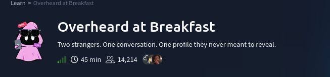
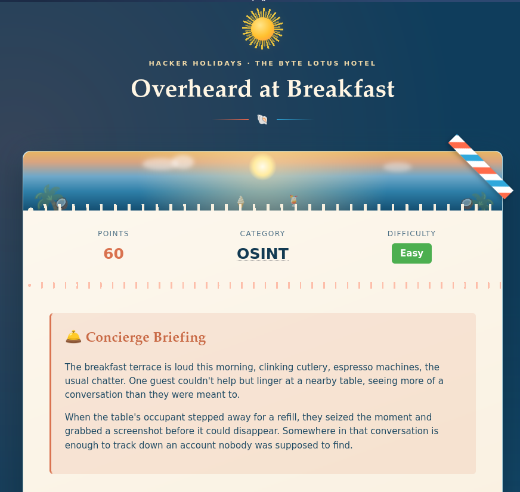
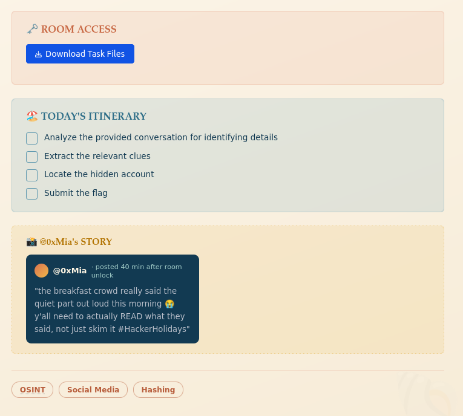
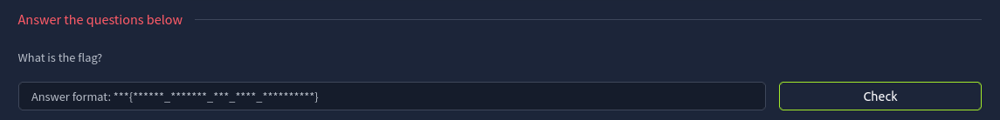
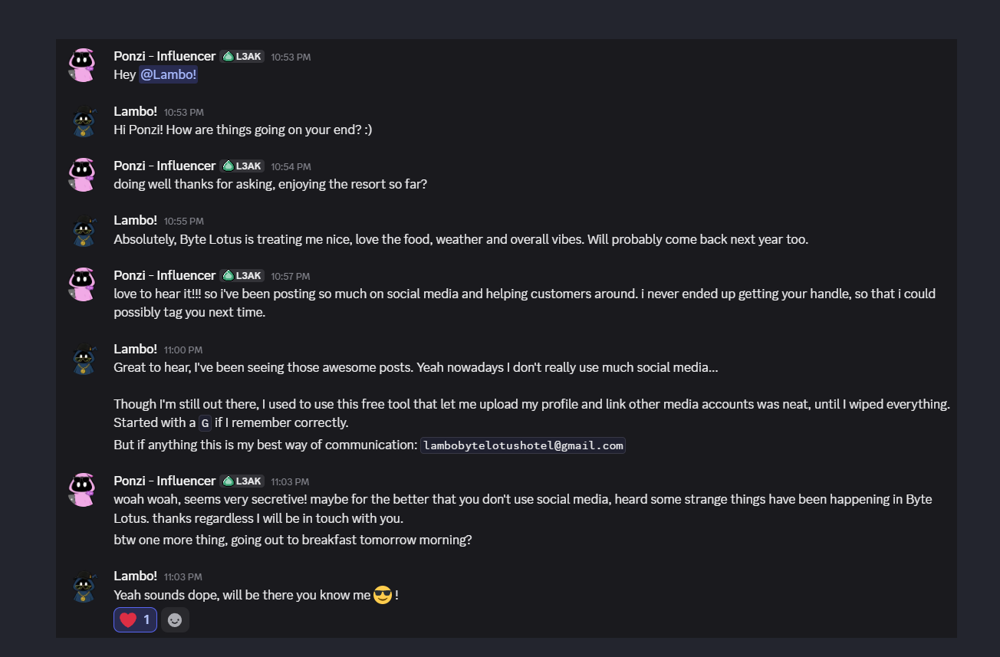
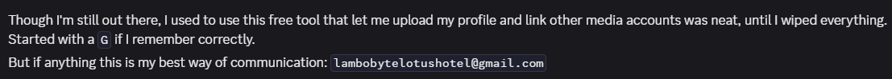
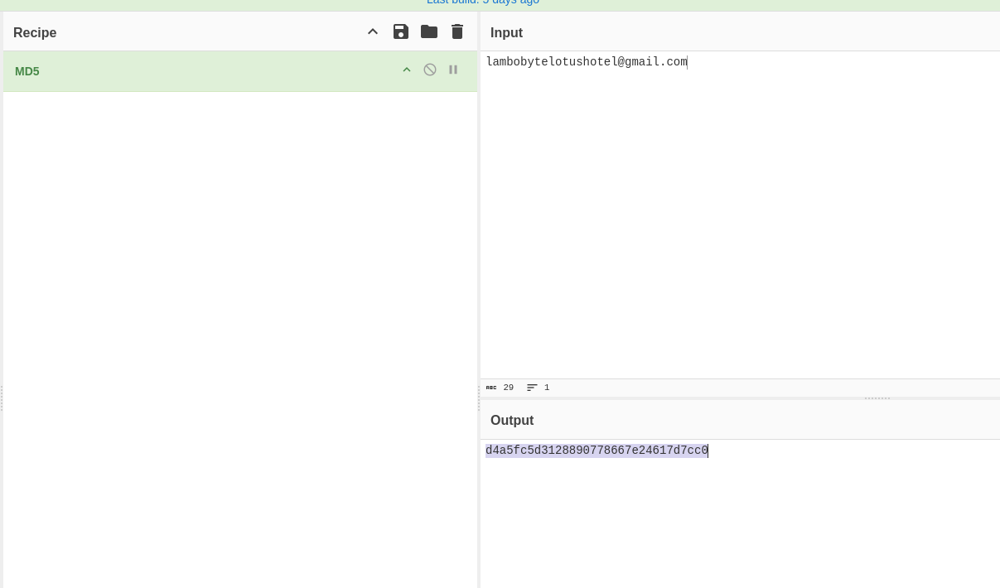
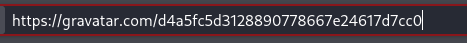
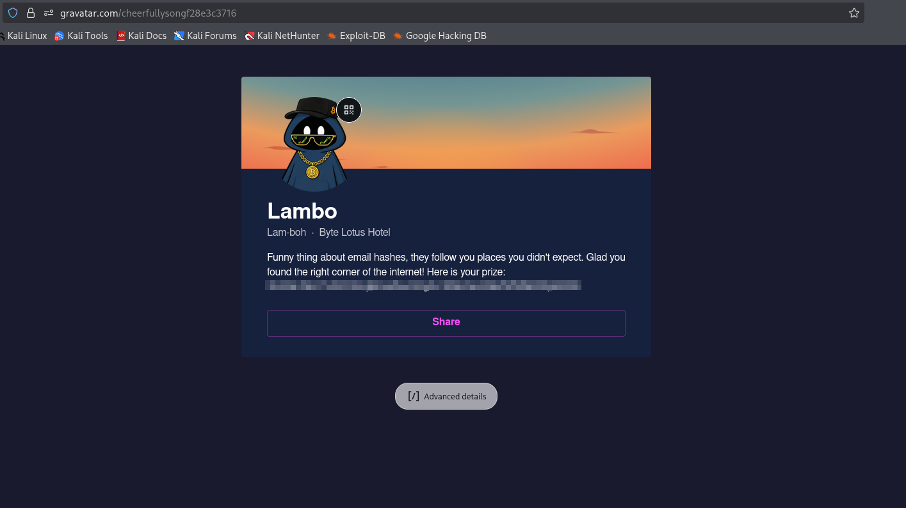
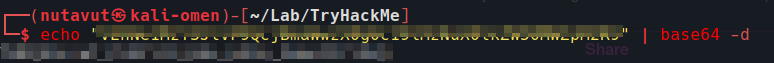

# Scenario

# Question

---

## Inspect file 

After downloading the file and unzipping it, we get an image of a conversation between  **Ponzi** and **Lambo**

This conversation hints at something for us. He mentioned a free tool that starts with `G`, and it allows you to upload a profile and link other media accounts.

and I think this relates to `Gravatar`, which allows platforms to display profile pictures by creating a unique MD5 hash of a user's lowercase email address.

So, all we need to do is create an MD5 hash of Lambo's email `lambobytelotushotel@gmail.com` and use it in the gravatar url.

and we found Lambo's profile

we got this from Lambo's profile as a prize, so let's decode it with base64

and we got the flag!

*DONE!!!*

---
