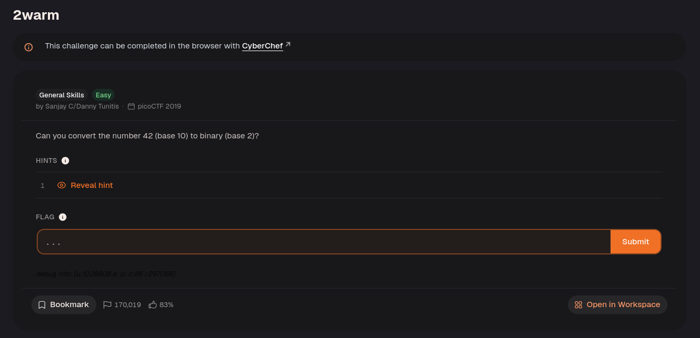

Convert 42 from decimal to binary:

42 -> 0010 1010

The set bits represent $$32 + 8 + 2 = 42$$. Leading zeros do not change the value, so `00101010` can be written as `101010` for the answer.

The answer was `picoCTF{101010}`.

---