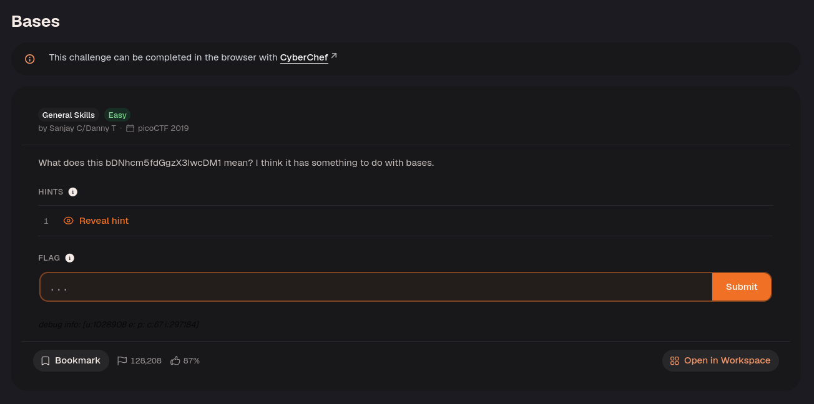
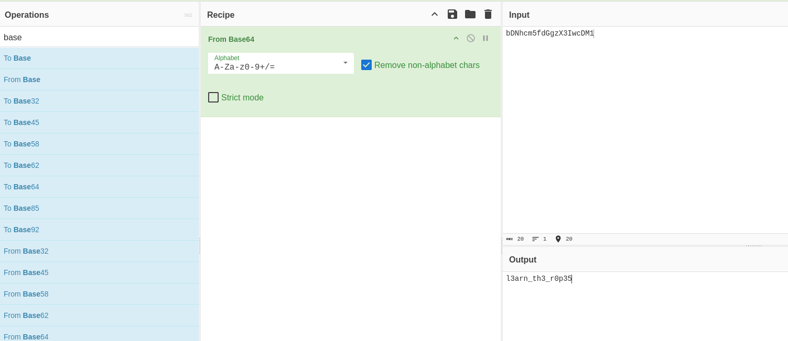

Decode the text from Base64.

Base64 represents bytes using printable characters. It is an encoding rather than encryption, so decoding it restores the text without a secret key.

The answer was `picoCTF{l3arn_th3_r0p35}`.

---
