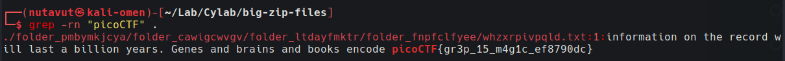

Download and extract the ZIP file. The extracted folder is large and contains many text files.

Search for the flag with `grep -rn "picoCTF" .`.

`-r` searches subdirectories recursively, `-n` includes matching line numbers, and `.` starts the search in the current directory. This avoids opening each extracted file individually.

DONE!

---
