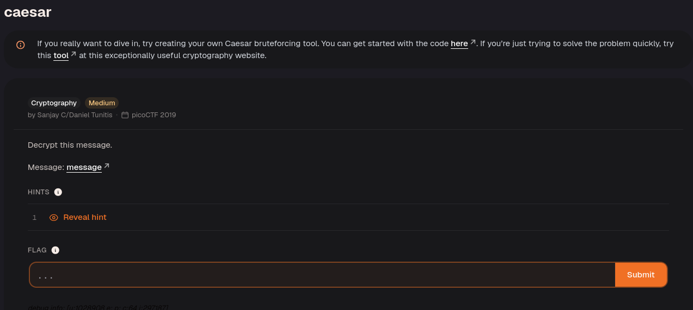
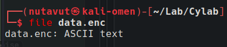
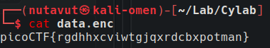
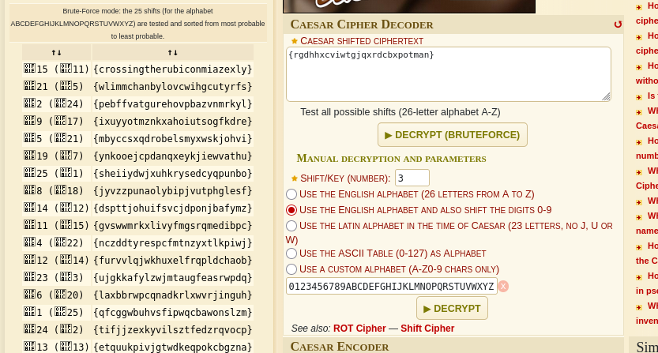

Download the file.

The text appears to be encrypted. Decrypt it to recover the flag.

`https://www.dcode.fr/caesar-cipher`

Use this website to decrypt the text.

A Caesar cipher shifts every letter by the same amount. Try the possible shifts and look for readable text; then place the recovered text inside the required flag format.

A readable result is: `crossingtherubiconmiazexly`.

**Flag :** `picoCTF{crossingtherubiconmiazexly}`

---
