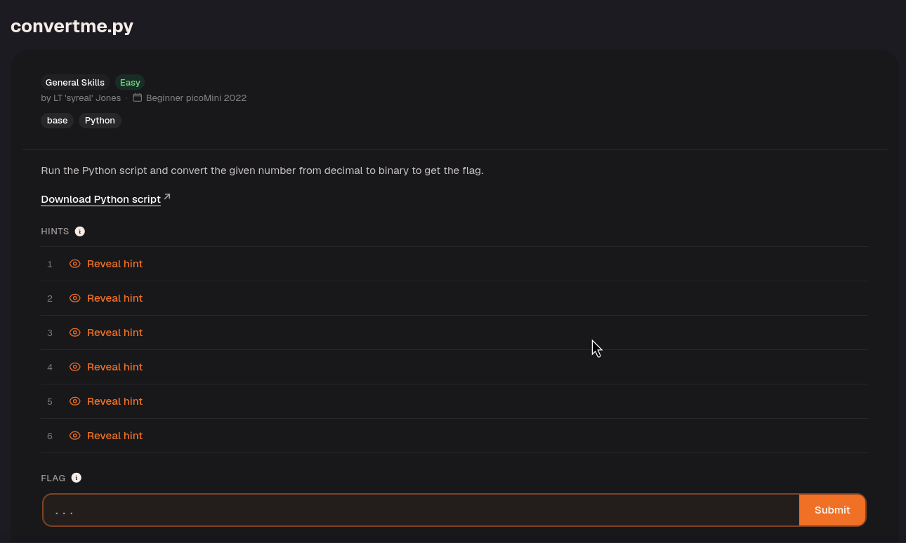
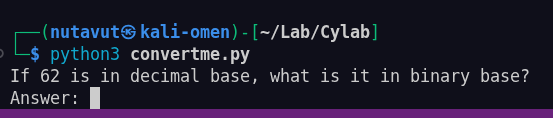
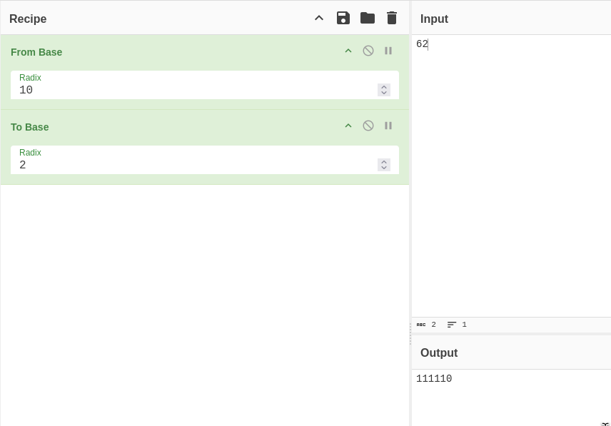
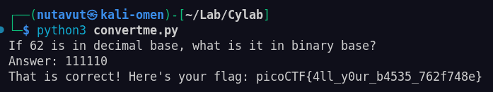

Download the Python script.

`chmod +x convertme.py`

Then run it with `python3 convertme.py`.

The script asks you to convert 62 from base 10 to base 2.

Since $$62 = 32 + 16 + 8 + 4 + 2$$, its binary representation is `111110`. Enter those digits without a `0b` prefix.

Done!

---
