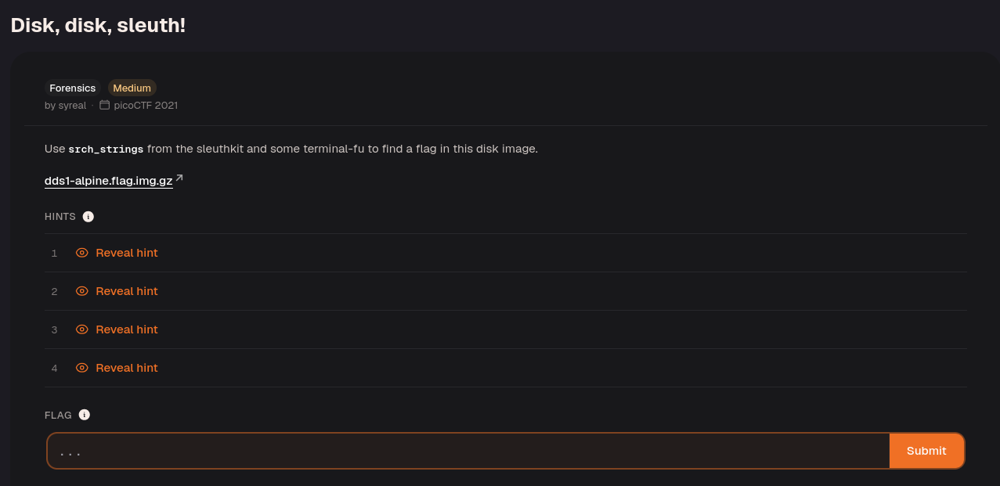
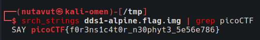

Download the file and decompress it with `gunzip`.
Then use `srch_strings` with `grep picoCTF` to find the flag.

`srch_strings` extracts readable text from the disk image, and `grep` keeps lines containing the flag prefix. This can reveal plaintext stored in the image without mounting its filesystem.

---
