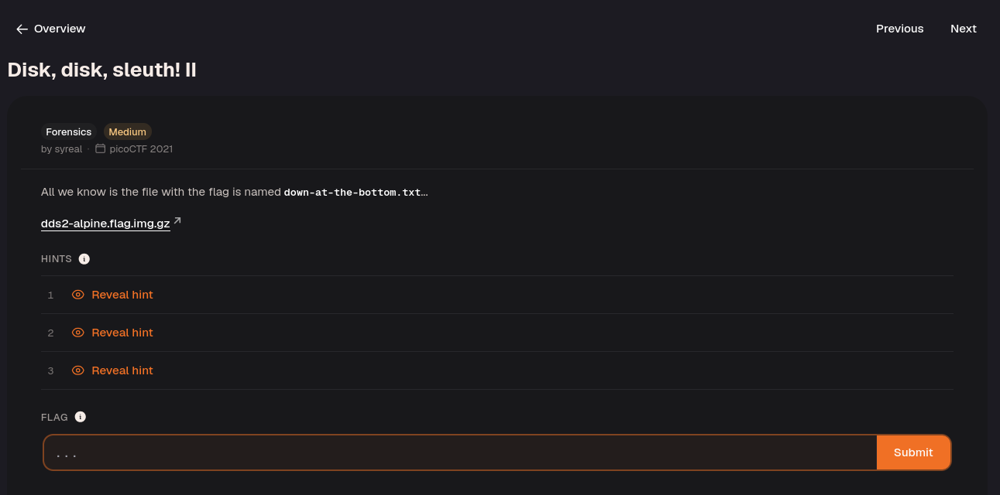
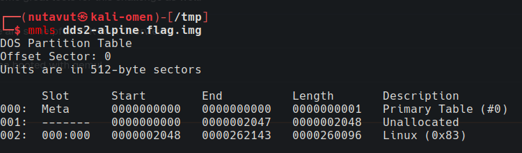
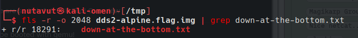
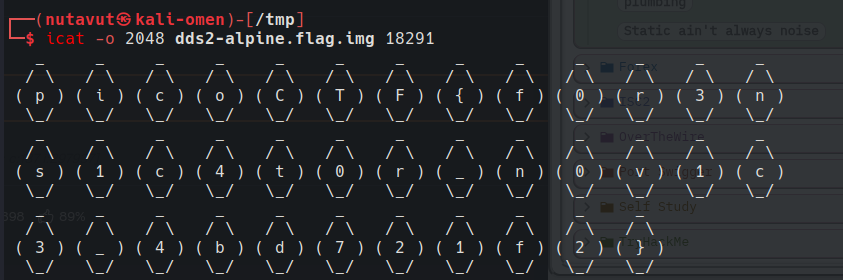

Download and extract the file.

Use `mmls` to check the partition start offsets.

Then use `fls` to find `down-at-the-bottom.txt`.

After finding the file, use `icat` to extract its contents.

`fls` lists filenames and their metadata addresses; `icat` uses the selected address to read the file. Supply the partition start sector with `-o` so the tools inspect the correct filesystem. See the [icat manual](https://www.sleuthkit.org/sleuthkit/man/icat.html).

Here is the flag!

`picoCTF{f0r3ns1c4t0r_n0v1c3_4bd721f2}`

---