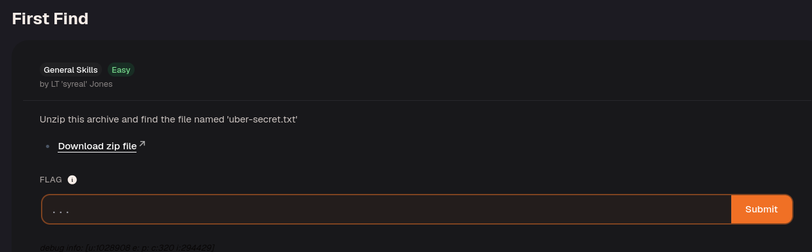
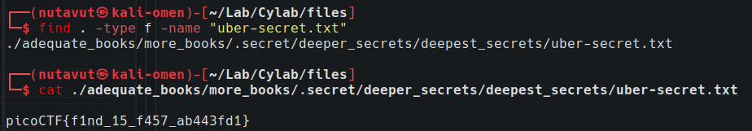

Download the file.

Extract the archive, then run `find . -type f -name "uber-secret.txt"` from the extracted directory. Here, `.` starts a recursive search, `-type f` restricts matches to files, and `-name` selects the target filename. Use `cat` on the returned path to read the flag.

---
