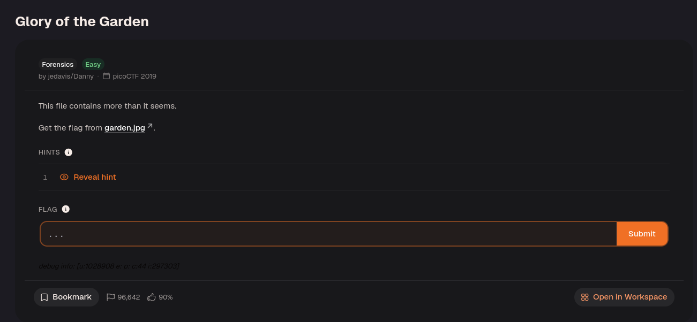
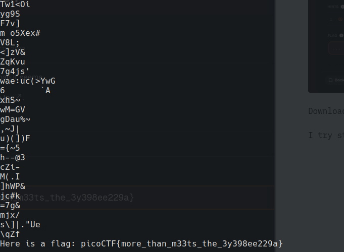

Download `garden.jpg`.

Use the `strings` command to reveal the flag!

An image file can contain readable text alongside its image data. `strings` extracts printable character sequences, exposing the flag without needing to interpret the pixels.

---