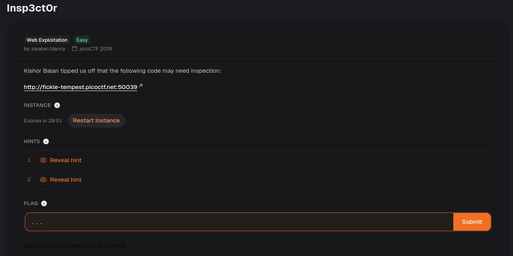
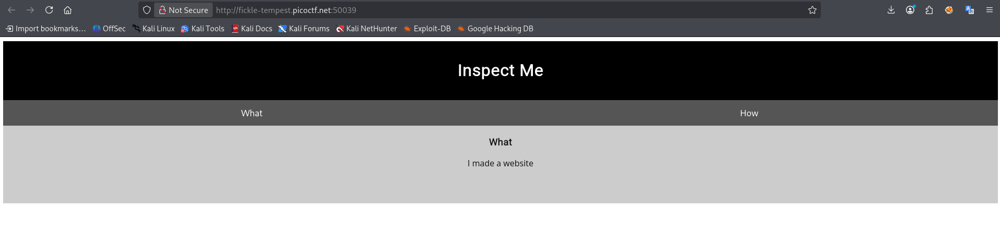
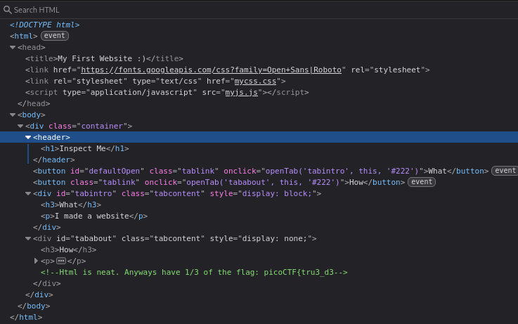
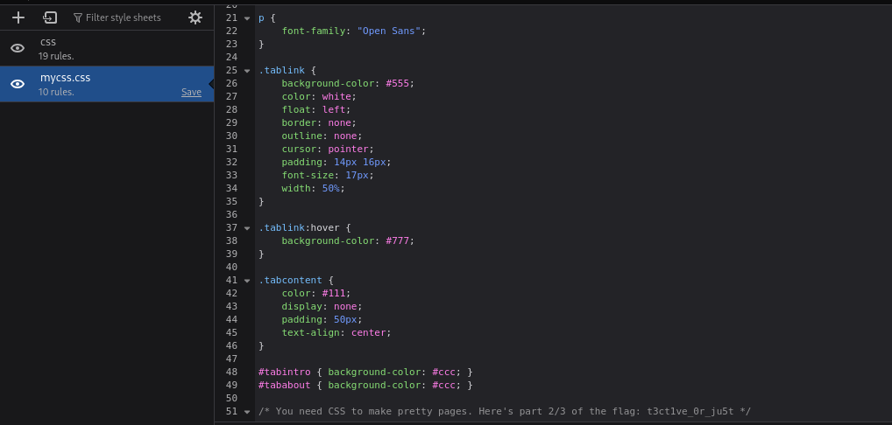
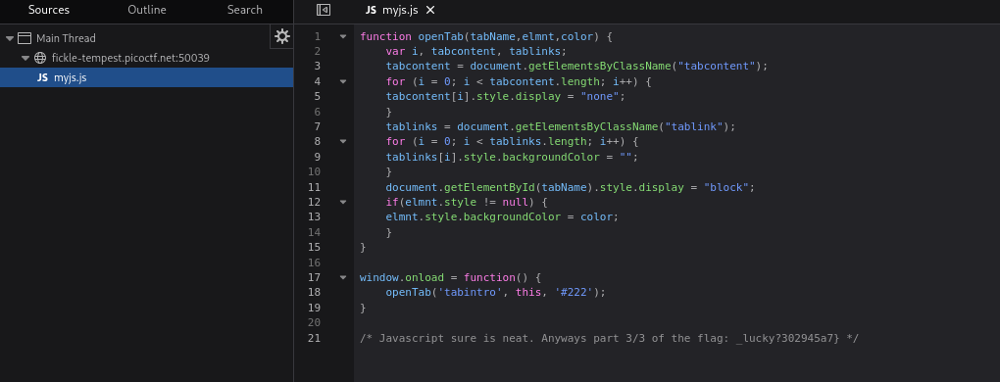

Open the website.

Inspect the HTML, then the linked CSS and JavaScript files. Each contains a comment with one part of the flag; join the parts in order. Comments are hidden from the rendered page but remain readable in the source.

The first third of the flag is `picoCTF{tru3_d3`.

Adding the second part gives `picoCTF{tru3_d3t3ct1ve_0r_ju5t`.

3/3 `picoCTF{tru3_d3t3ct1ve_0r_ju5t_lucky?302945a7}`

Done!

---
