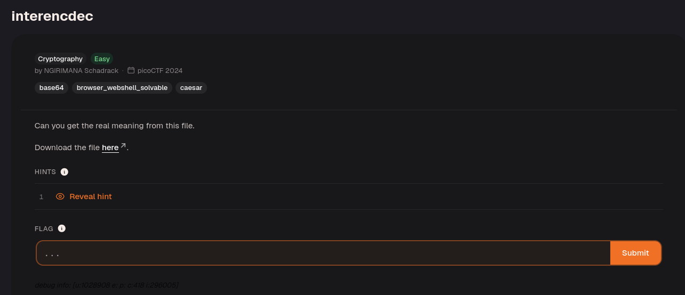
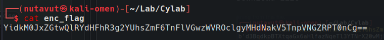
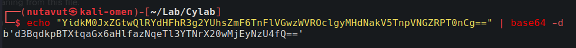
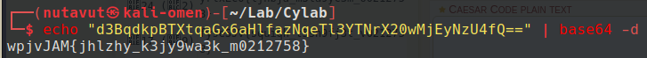
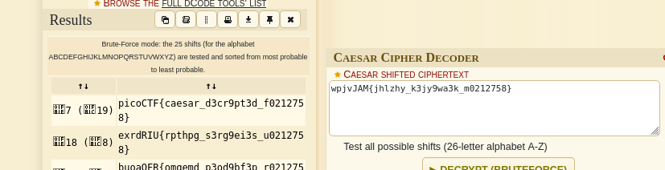

Download the file.

The text in the file ends with `=`, which suggests Base64 padding. Use `base64 -d` to decode it.

The result looks like Base64 again, so run `base64 -d` a second time.

The result now resembled a flag, but it appeared to need Caesar cipher decryption.

Enter it into `https://www.dcode.fr/caesar-cipher`.

to get the flag!

`picoCTF{caesar_d3cr9pt3d_f0212758}`

---
