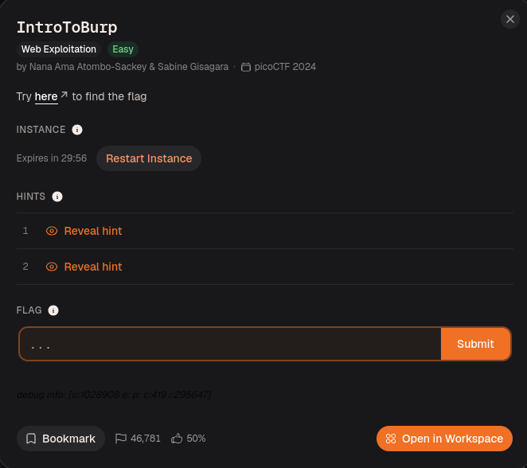
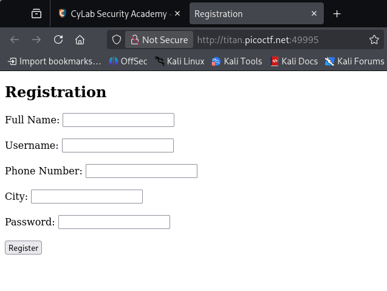
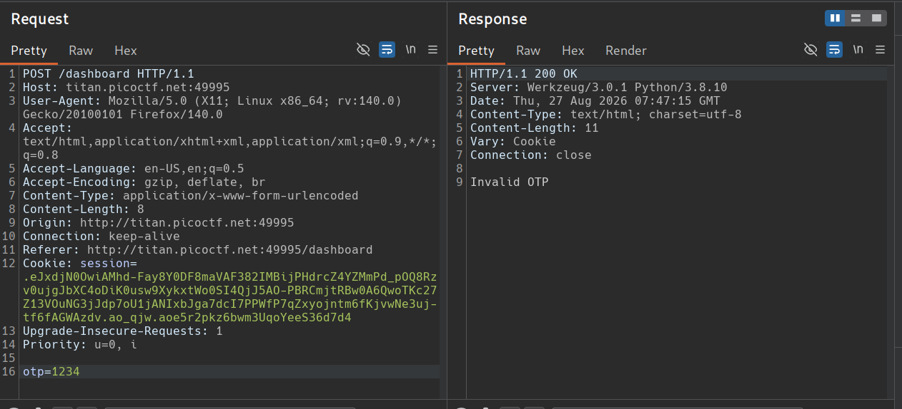
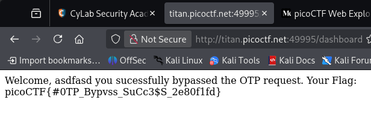

Use Burp Suite to intercept the request. The POST request includes an OTP in its body. Removing the OTP from the request body bypassed the check in this challenge.

This gives you access to `/dashboard`.

*DONE!!*

---
