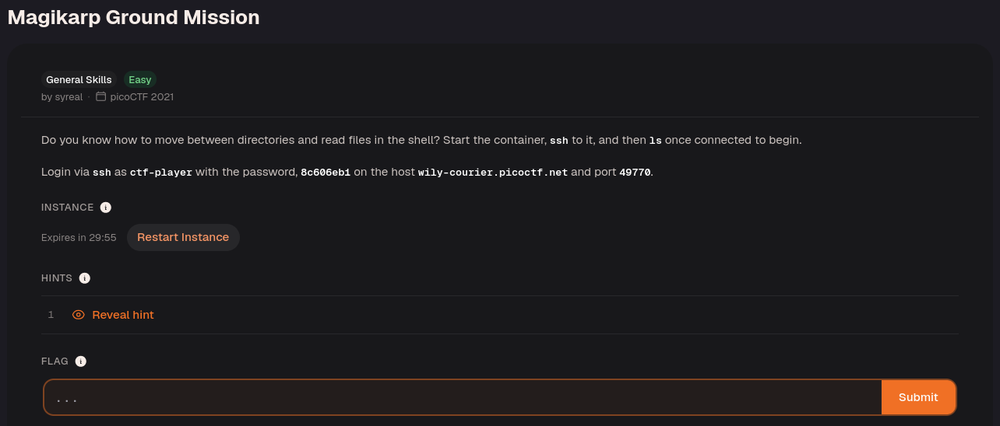
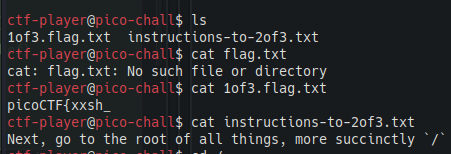
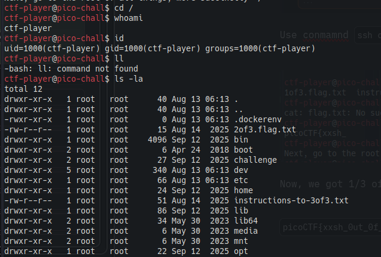
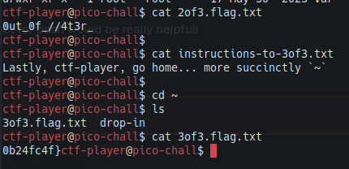

Connect with `ssh ctf-player@wily-courier.picoctf.net -p 49770`.

This reveals the first third of the flag.

Read the instruction files to locate the remaining pieces. `cd /` moves to the filesystem root, while `cd ~` returns to your home directory; read the numbered flag files in those locations and combine their contents in order.

These are the second and third parts. Combine all three to complete the flag!

`picoCTF{xxsh_0ut_0f_//4t3r_0b24fc4f}`

---

