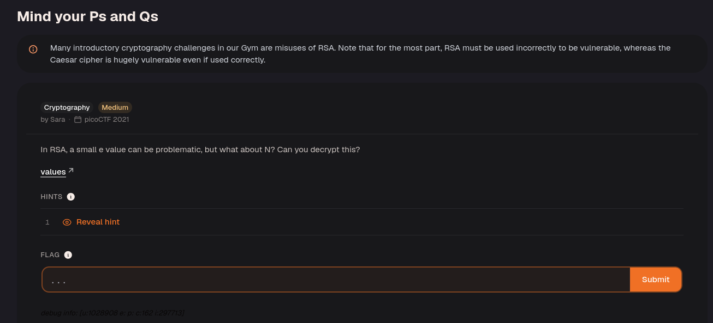
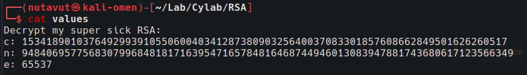
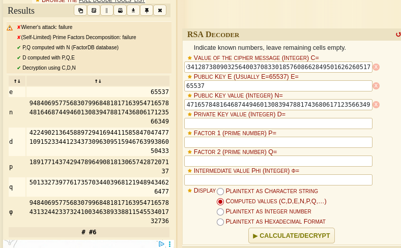
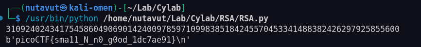

Download the file.





Use https://www.dcode.fr/rsa-cipher to obtain the values of p and q.

```python
def long_to_bytes(n):

return n.to_bytes((n.bit_length() + 7) // 8, 'big')

  

n = 948406957756830799684818171639547165784816468744946013083947881743680617123566349

e = 65537

c = 15341890103764929939105506004034128738090325640037083301857608662849501626260517

p = 1891771437429478964908181306574287207137

q = 501332739776173570344039681219489434626477

  

phi = (p - 1) * (q - 1)

# modular inverse

d = pow(e, -1, phi)

  

m = pow(c, d, n)

  

print(m)

print(long_to_bytes(m)[::-1])
```

Use this code to decrypt the ciphertext.

Factoring $$n$$ into $$p$$ and $$q$$ lets you calculate $$\varphi(n) = (p-1)(q-1)$$ and the private exponent $$d = e^{-1} \bmod \varphi(n)$$. The script then recovers the message integer with `pow(c, d, n)` and converts it to bytes. Its final `[::-1]` reverses the byte order. See the [RSA decryption primitive](https://www.rfc-editor.org/rfc/rfc8017.html#section-5.1.2) for the modular decryption operation.



This reveals the flag!

---
