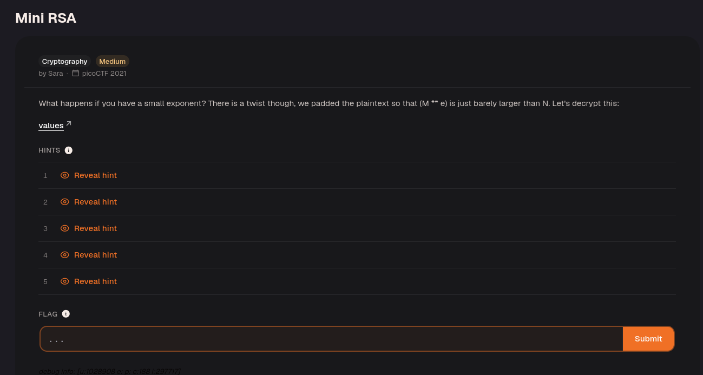
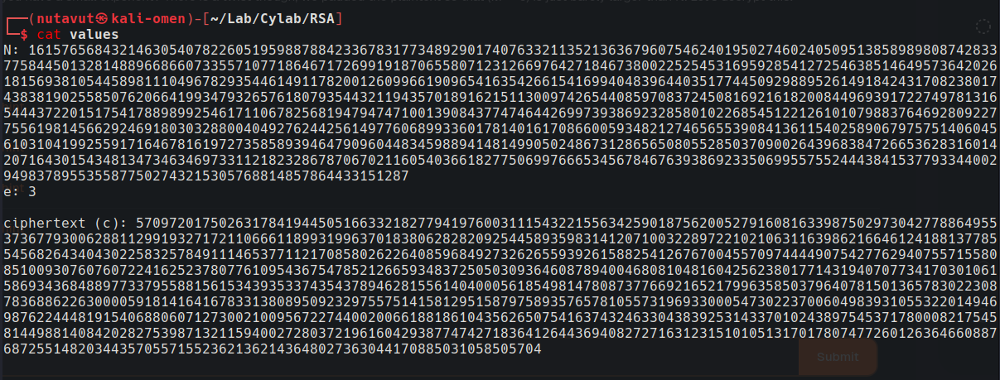
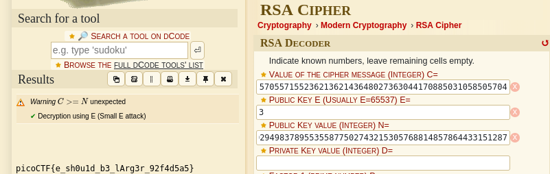

### 1. Inspect the provided values

Download the `values` file and inspect its contents.

The file provides three RSA values:

- **`N`**: the public modulus, usually the product of two large primes.
- **`e`**: the public exponent, which is `3` in this challenge.
- **`c`**: the ciphertext, represented as an integer.

RSA's encryption operation is:

$$
c = m^e \bmod N
$$

Here, $m$ is the integer representation of the encoded message. With $e = 3$, this becomes $c = m^3 \bmod N$. See [RFC 8017, Section 5.1.1](https://www.rfc-editor.org/rfc/rfc8017.html#section-5.1.1) for the RSA encryption primitive.

### 2. Understand the small-exponent weakness

If $m^3 < N$, the modulo operation does not change the value. In that case, $c = m^3$, and taking the exact integer cube root of $c$ recovers $m$ directly.

However, the challenge description adds a twist: the plaintext is padded so that $m^3$ is just barely larger than $N$. Taking the cube root of $c$ alone therefore does not recover the message.

The modulo operation means that some whole multiple of $N$ was subtracted from $m^3$:

$$
m^3 = c + kN
$$

Here, $k$ is a nonnegative integer. Because the challenge says $m^3$ is only slightly larger than $N$, a small value of $k$ is a promising starting point.

To recover the message, test $c + N$, $c + 2N$, and so on until one is a perfect cube. Use exact integer arithmetic: a candidate root $r$ is valid only if $r^3 = c + kN$. Floating-point cube roots can lose precision with integers this large.

Once an exact root is found, convert the recovered integer into bytes and inspect the decoded message for the flag. This approach does not require factoring $N$ or calculating the private key.

### 3. Recover the flag with dCode

Open the [dCode RSA decoder](https://www.dcode.fr/rsa-cipher) and enter the values from the file:

1. Paste `c` into the cipher message field.
2. Set the public exponent `E` to `3`.
3. Paste `N` into the public key value field.
4. Leave the unknown private-key values empty and run the decoder.

The result is labeled **“Decryption using E (Small E attack)”**, and the decoded flag appears beneath it. The screenshot confirms the successful result; it does not show which value of $k$ the tool used internally.

---
