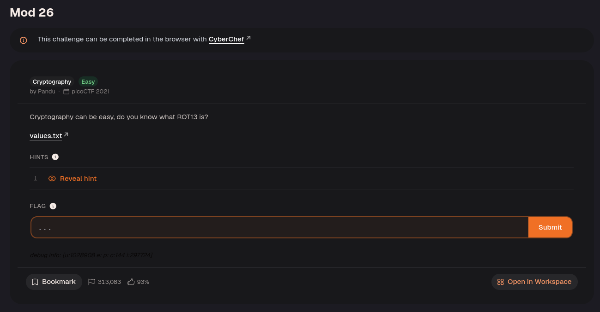
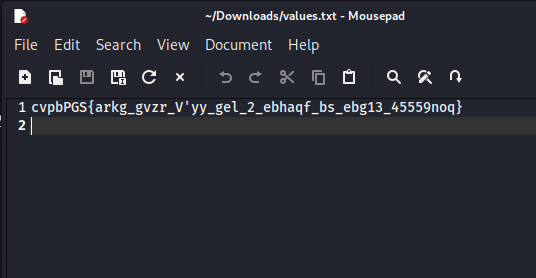
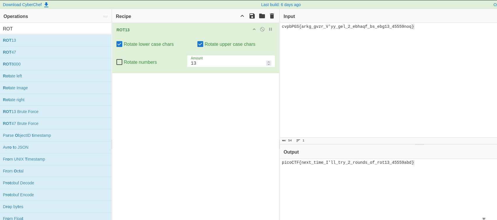

Enter the ciphertext into CyberChef and apply ROT13 to get the flag!

ROT13 shifts each letter 13 places through the alphabet while leaving digits and punctuation unchanged. Applying the same shift again restores the original text, so no separate decryption key is needed.

---