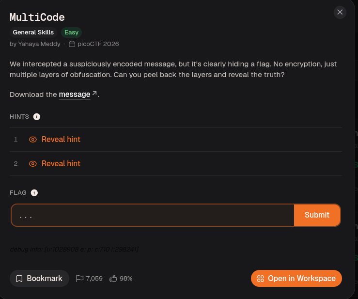
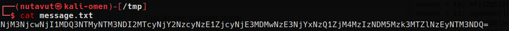
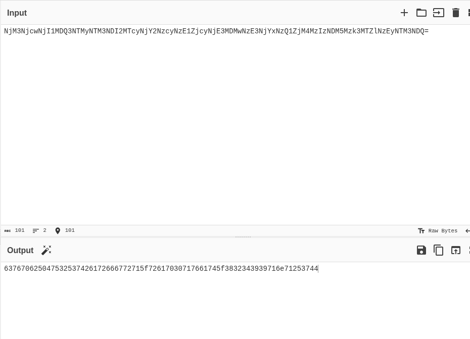
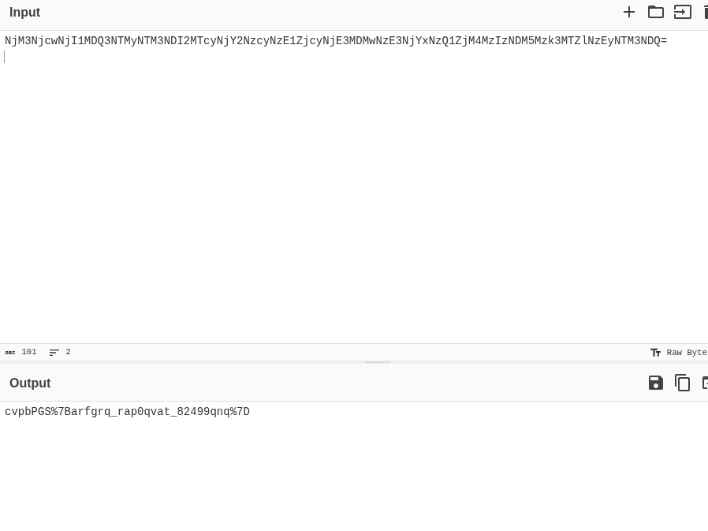
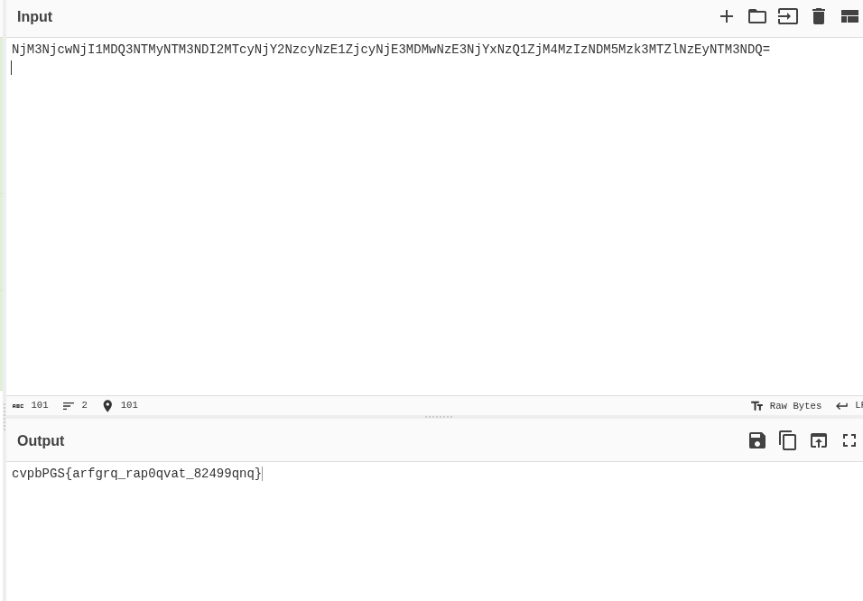
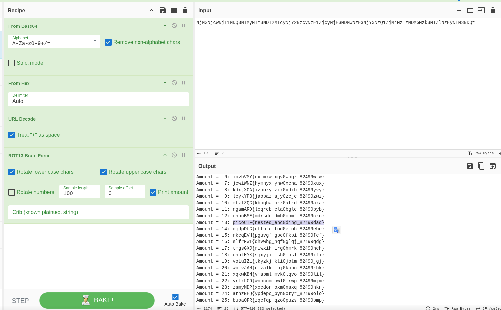

Download `message.txt`.

The text looks like Base64, so decode it with CyberChef.

The result looks like hexadecimal values, so decode it from hexadecimal.

The decoded text contains percent-encoded sequences, so apply URL decoding next.

The result resembles a flag, but the letters are shifted. Try different rotation values to recover the flag.

A rotation of 13 (ROT13) reveals the flag.

---
