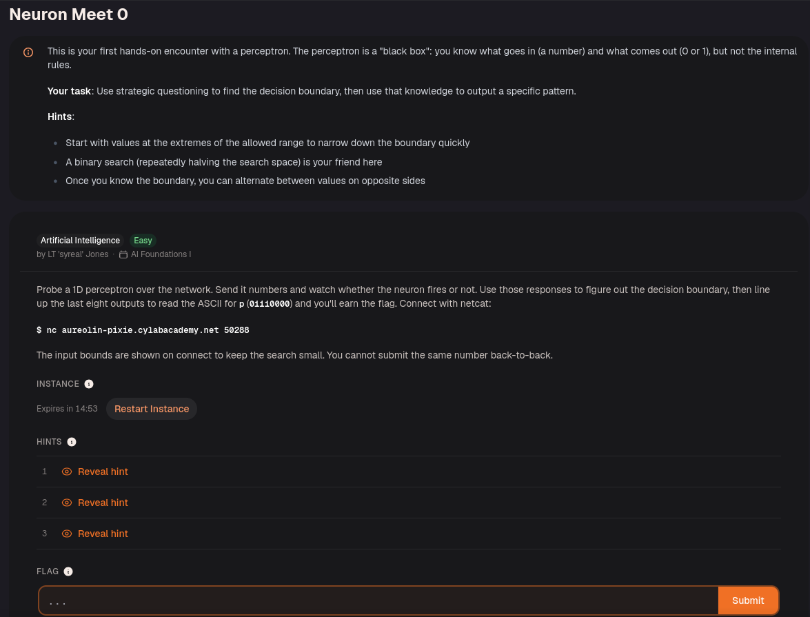
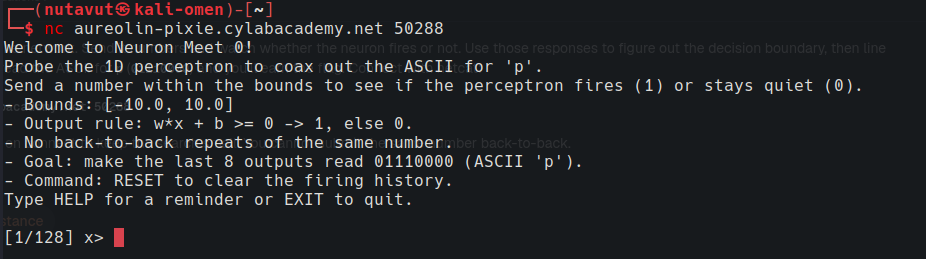
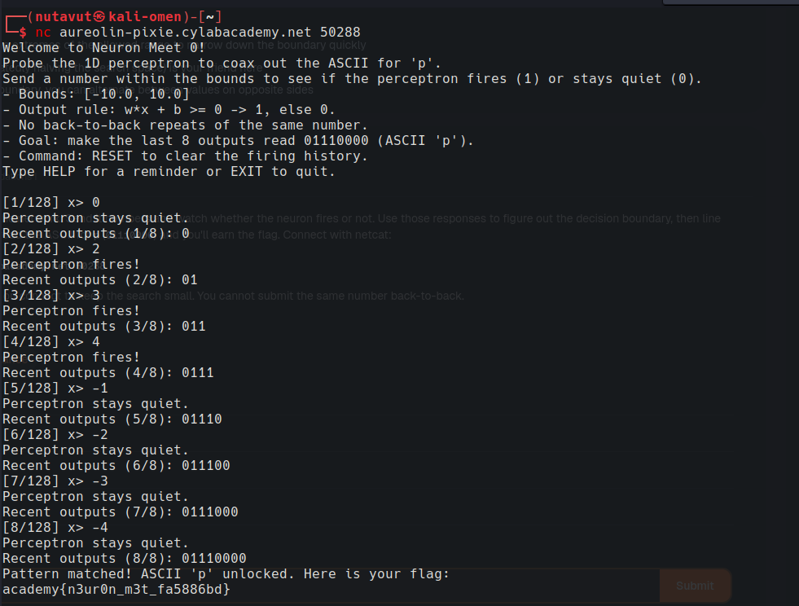

Test numbers with the probe until the output matches the target pattern to get the flag!

The perceptron fires when $$w*x + b>=0$$. Testing 0, 1, and 2 shows that it fires when $$x>=2$$. To make it fire, send a number greater than or equal to 2; otherwise, send a number less than 2.

---
