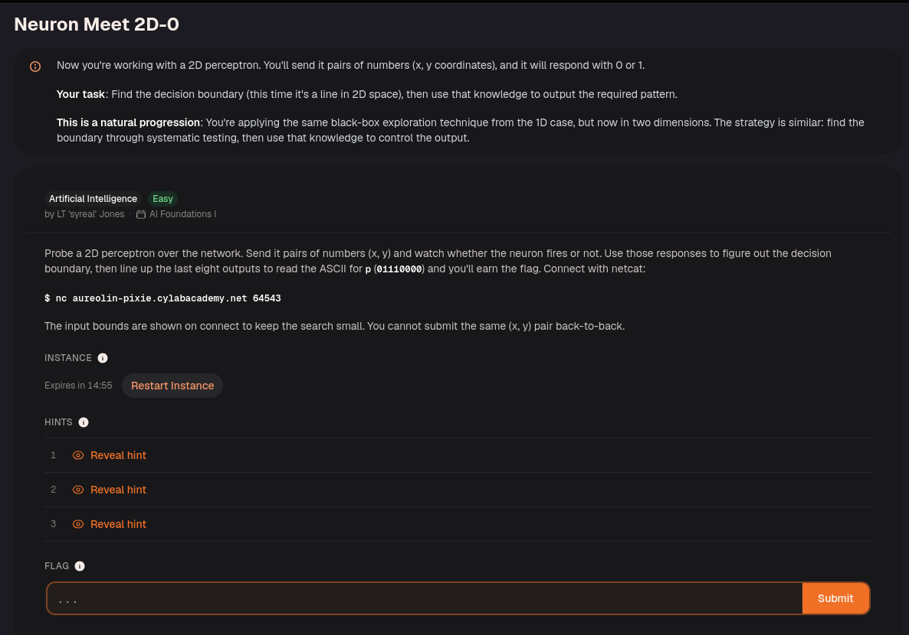
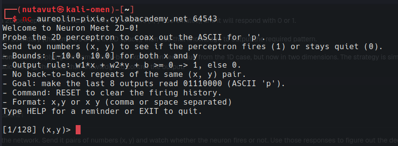
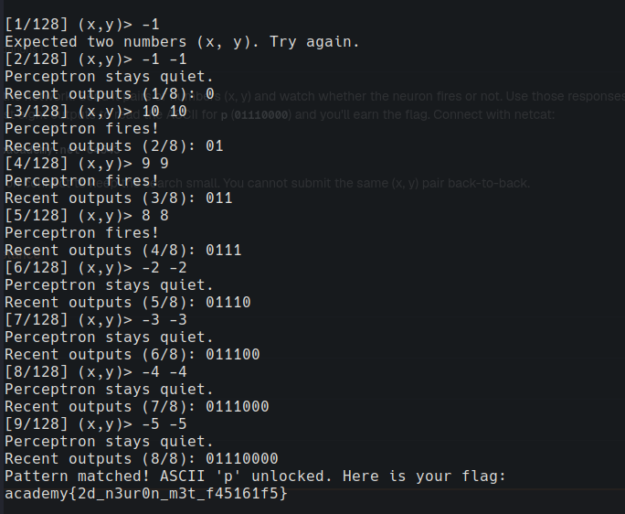

This is similar to the 1D challenge, but it takes two inputs, (x, y). Apply the same strategy
to get the flag!

Each input pair produces one bit: the perceptron outputs 1 when $$w_1x + w_2y + b \geq 0$$, and 0 otherwise. Choose pairs that produce the target sequence `01110000` (ASCII `p`), avoiding identical consecutive pairs as required by the challenge.

---
