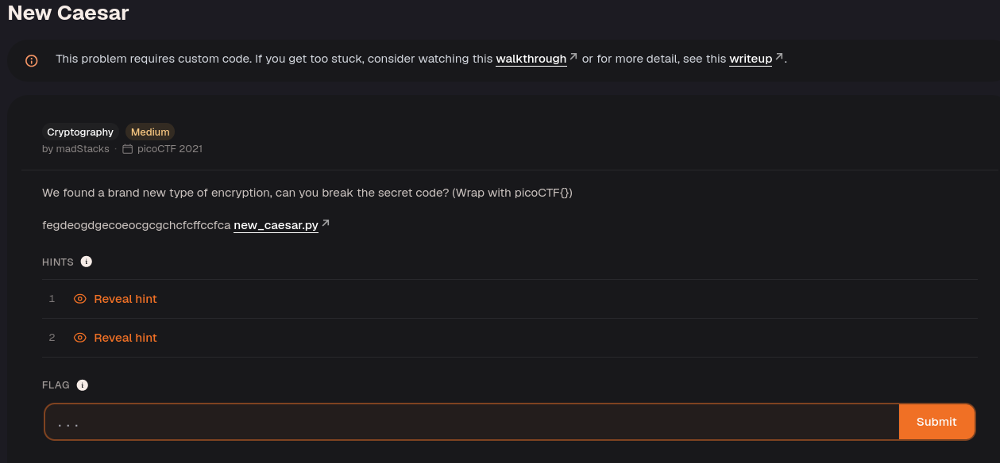

Download the Python code.

Let's walk through the encryption step by step.

### 1. The custom "base16" encoding

```python
ALPHABET = "abcdefghijklmnop"
```

Instead of using hexadecimal digits `0-9a-f`, the code uses:

```text
0 -> a
1 -> b
2 -> c
...
15 -> p
```

The function:

```python
def b16_encode(plain):
    enc = ""
    for c in plain:
        binary = "{0:08b}".format(ord(c))
        enc += ALPHABET[int(binary[:4], 2)]
        enc += ALPHABET[int(binary[4:], 2)]
    return enc
```

takes each character and:

1. Converts it to an 8-bit binary value.
    
2. Splits it into two 4-bit halves (nibbles).
    
3. Converts each nibble to a letter `a-p`.
    

#### Example: `'A'`

ASCII:

```text
A = 65
```

Binary:

```text
01000001
```

Split:

```text
0100 0001
```

Convert each nibble:

```text
0100 = 4 = e
0001 = 1 = b
```

So:

```text
'A' -> "eb"
```

---

### 2. The shift function

```python
def shift(c, k):
    t1 = ord(c) - ord('a')
    t2 = ord(k) - ord('a')
    return ALPHABET[(t1 + t2) % 16]
```

This is a Vigenère/Caesar shift on the alphabet `a-p`.

Example with key `'d'`:

```text
c = e  (4)
k = d  (3)

(4 + 3) mod 16 = 7

result = h
```

So:

```text
shift('e','d') = 'h'
```

---

### 3. Encryption process

```python
b16 = b16_encode(flag)

for i, c in enumerate(b16):
    enc += shift(c, key[i % len(key)])
```

Because:

```python
assert len(key) == 1
```

the same key character is used for every position.

So encryption is:

```text
flag
 ↓
custom base16 (a-p)
 ↓
Caesar shift by key value
 ↓
ciphertext
```

---

### Example

Suppose:

```python
flag = "A"
key = "c"
```

#### Step 1: b16 encode

```text
A -> 01000001
   -> 0100 0001
   -> e b
```

Result:

```text
"eb"
```

#### Step 2: shift by key `c`

```text
c = 2
```

Shift each character:

```text
e(4) + 2 = g
b(1) + 2 = d
```

Ciphertext:

```text
"gd"
```

---

### Why decryption is easy

Since:

```python
len(key) == 1
```

there are only 16 possible keys:

```text
a b c d e f g h i j k l m n o p
```

Trying all 16 keys is trivial. For each key:

1. Reverse the shift:
    

```python
(original - key) mod 16
```

2. Convert pairs of letters back to bytes.
    

That's why this scheme is very weak cryptographically—it is effectively a Caesar cipher over a 16-character alphabet after a reversible encoding step.

The decryptor simply reverses the two operations performed during encryption, in reverse order.

## Encryption recap

The original code does:

```text
Plaintext
   ↓
b16_encode()
   ↓
letters a-p
   ↓
shift by key
   ↓
Ciphertext
```

So decryption must do:

```text
Ciphertext
   ↓
reverse shift
   ↓
letters a-p
   ↓
b16_decode()
   ↓
Plaintext
```

---

## Step 1: Reverse the shift

Encryption used:

```python
def shift(c, k):
    return ALPHABET[(t1 + t2) % 16]
```

where:

```text
t1 = value of plaintext character
t2 = value of key character
```

For example:

```text
e (4)
key = c (2)

(4 + 2) mod 16 = 6
→ g
```

To recover the original character, subtract instead of add:

```python
def unshift(c, k):
    t1 = ord(c) - ord('a')
    t2 = ord(k) - ord('a')
    return ALPHABET[(t1 - t2) % 16]
```

Example:

```text
cipher = g (6)
key    = c (2)

(6 - 2) mod 16 = 4
→ e
```

So:

```text
g → e
```

---

## Step 2: Reverse the custom base16 encoding

Recall that:

```text
a = 0
b = 1
c = 2
...
p = 15
```

During encryption, each byte became two letters.

Example:

```text
'A'
```

ASCII:

```text
65
```

Binary:

```text
01000001
```

Split:

```text
0100 0001
```

Convert:

```text
0100 → 4 → e
0001 → 1 → b
```

Result:

```text
"A" → "eb"
```

To decode:

```python
high = ALPHABET.index('e')   # 4
low  = ALPHABET.index('b')   # 1

byte = (high << 4) | low
```

Calculation:

```text
(4 << 4) | 1
=
64 + 1
=
65
```

ASCII 65:

```text
'A'
```

Recovered successfully.

---

## The b16 decoder

```python
def b16_decode(enc):
    out = ""

    for i in range(0, len(enc), 2):
        high = ALPHABET.index(enc[i])
        low = ALPHABET.index(enc[i + 1])

        byte = (high << 4) | low
        out += chr(byte)

    return out
```

### What happens?

Suppose:

```text
enc = "eb"
```

Loop:

```python
high = 4
low = 1
```

Rebuild byte:

```python
byte = (4 << 4) | 1
```

Result:

```text
65
```

Convert back:

```python
chr(65)
```

Result:

```text
'A'
```

---

## Complete decryptor

```python
import string

  

LOWERCASE_OFFSET = ord("a")

ALPHABET = string.ascii_lowercase[:16] # abcdefghijklmnop

  

def unshift(c, k):

t1 = ord(c) - LOWERCASE_OFFSET

t2 = ord(k) - LOWERCASE_OFFSET

return ALPHABET[(t1 - t2) % len(ALPHABET)]

  

def b16_decode(enc):

out = ""

for i in range(0, len(enc), 2):

high = ALPHABET.index(enc[i])

low = ALPHABET.index(enc[i + 1])

  

byte = (high << 4) | low

out += chr(byte)

  

return out

  

def decrypt(ciphertext, key):

# Reverse Vigenère shift

b16 = ""

for i, c in enumerate(ciphertext):

b16 += unshift(c, key[i % len(key)])

  

# Decode base16-like encoding

return b16_decode(b16)

  
  

# Example usage

ciphertext = "fegdeogdgecoeocgcgchcfcffccfca"

for key in ALPHABET:

try:

print(f"{key}: {decrypt(ciphertext, key)}")

except:

pass

  

print(decrypt(ciphertext, key))
```

---

## Why brute force works

The original program contains:

```python
assert len(key) == 1
```

So the key is only one character from:

```text
abcdefghijklmnop
```

That's only:

```text
16 possible keys
```

Therefore you can simply try them all:

```python
for key in ALPHABET:
    print(key, decrypt(ciphertext, key))
```

Look for readable English or a recognizable flag among the outputs to identify the recovered plaintext.


Flag: `picoCTF{et_tu?_77866c61}`


---
