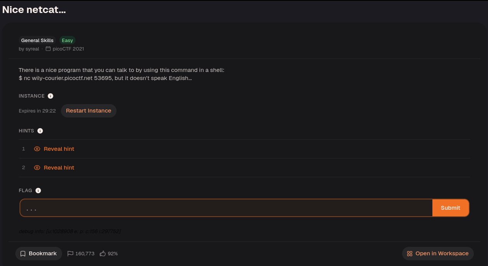
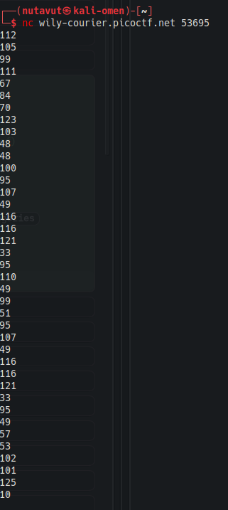
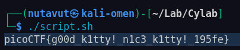

Connect with `nc wily-courier.picoctf.net 53695`.



The service returned decimal numbers.

These numbers appear to represent ASCII characters. Convert them to text.

Save the decimal values in `to_ascii.txt`, one per line, for the script below. The inner `printf` converts each number to octal, and the outer `printf` interprets that octal escape as a character.

```bash
#!/bin/bash

  

while read -r n; do

printf "\\$(printf '%03o' "$n")"

done < to_ascii.txt

echo
```

Run this script to get the flag!



---
