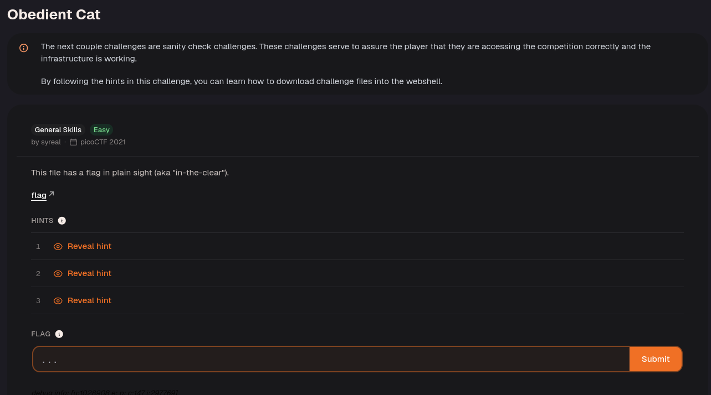
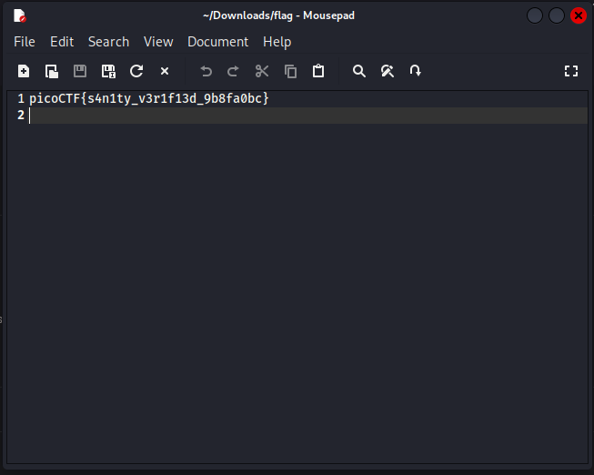

Download the file to find the flag inside.

Use `cat` followed by the downloaded filename to print its contents in the terminal. The flag is stored as readable text, so no decoding is needed.

---
