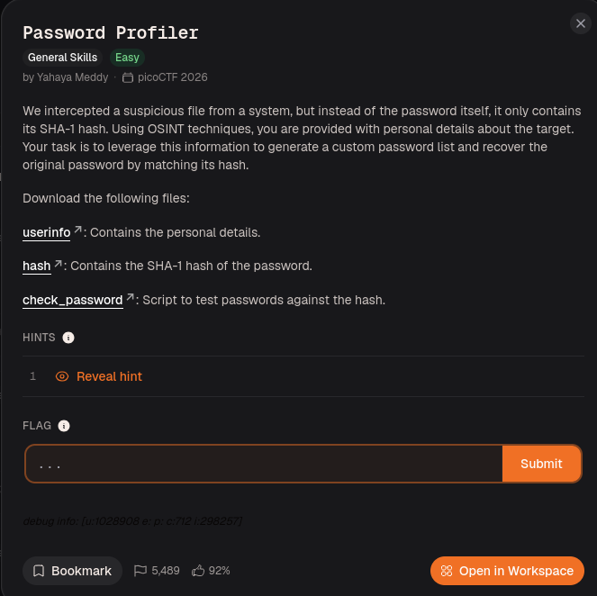
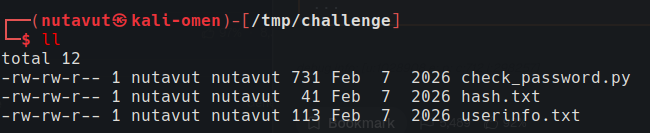
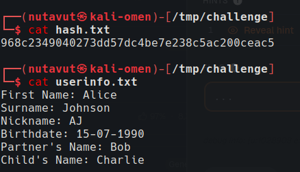
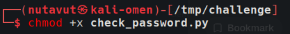
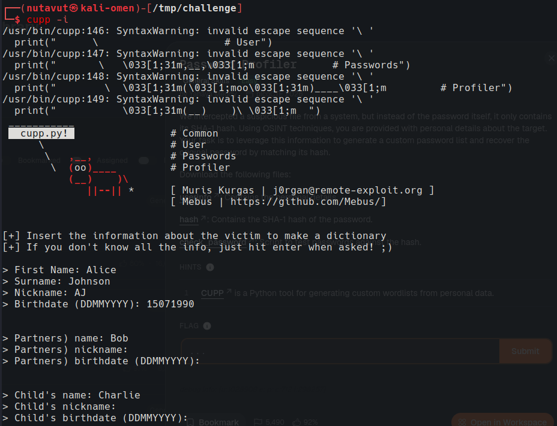
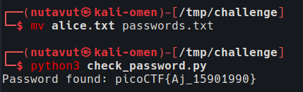

Download all the files.







```python
#!/usr/bin/env python3

import hashlib

  

HASH_FILE = "hash.txt"

WORDLIST_FILE = "passwords.txt" # wordlist that was generated using CUPP

  

def load_hash():

with open(HASH_FILE, "r") as f:

return f.read().strip()

  

def crack_password(target_hash):

with open(WORDLIST_FILE, "r", encoding="utf-8", errors="ignore") as f:

for password in f:

password = password.strip()

if hashlib.sha1(password.encode()).hexdigest() == target_hash:

return password

return None

  

if __name__ == "__main__":

target_hash = load_hash()

result = crack_password(target_hash)

if result:

print(f"Password found: picoCTF{{{result}}}")

else:

print("No match found.")
```

The challenge required a custom password wordlist based on the user's information.

Use `cupp` to create a custom wordlist from the available information.

CUPP combines the supplied personal details into likely password candidates. The Python script hashes each candidate with SHA-1 and compares it with `hash.txt`; a matching hash identifies the password.

`cupp -i`


Enter the available information.



After generating the wordlist, rename it to `passwords.txt` and run `check_password.py` to get the flag!

---
