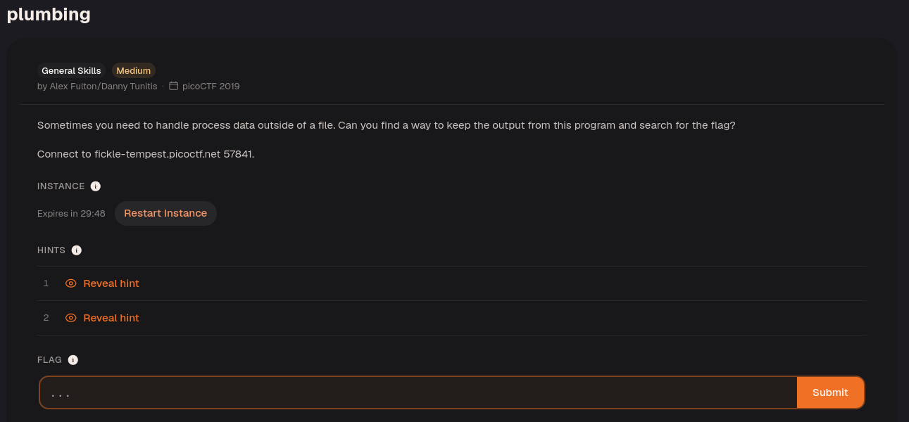
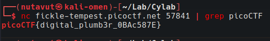

The command `nc fickle-tempest.picoctf.net 57841 ` produces a lot of output. Filter it with `grep`:

The pipe (`|`) sends the output from `nc` to `grep`. Only lines containing `picoCTF` are printed, making the flag easier to spot in the large response.

```bash
nc fickle-tempest.picoctf.net 57841 | grep picoCTF
```



This reveals the flag!

---
