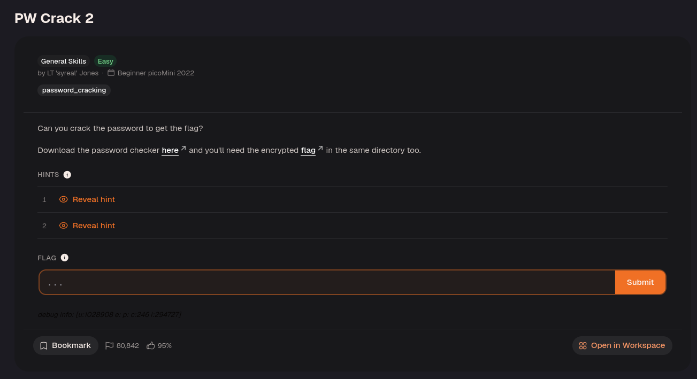
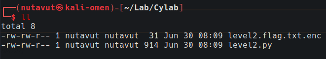
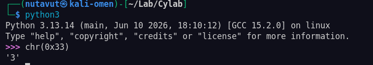
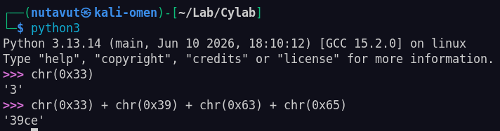
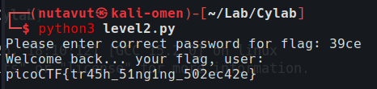

First, download all the files.



Then grant execute permission with `chmod +x level2.py`.

```python
### THIS FUNCTION WILL NOT HELP YOU FIND THE FLAG --LT ########################

def str_xor(secret, key):

#extend key to secret length

new_key = key

i = 0

while len(new_key) < len(secret):

new_key = new_key + key[i]

i = (i + 1) % len(key)

return "".join([chr(ord(secret_c) ^ ord(new_key_c)) for (secret_c,new_key_c) in zip(secret,new_key)])

###############################################################################

  

flag_enc = open('level2.flag.txt.enc', 'rb').read()

  
  
  

def level_2_pw_check():

user_pw = input("Please enter correct password for flag: ")

if( user_pw == chr(0x33) + chr(0x39) + chr(0x63) + chr(0x65) ):

print("Welcome back... your flag, user:")

decryption = str_xor(flag_enc.decode(), user_pw)

print(decryption)

return

print("That password is incorrect")

  
  
  

level_2_pw_check()
```

The `chr()` function converts a character code to its corresponding character. For example:
**chr(0x33) = '3'**



Evaluate all the `chr()` calls to reconstruct the password.


This gives you the password.

Then run `level2.py` and enter this password to get the flag!



---
