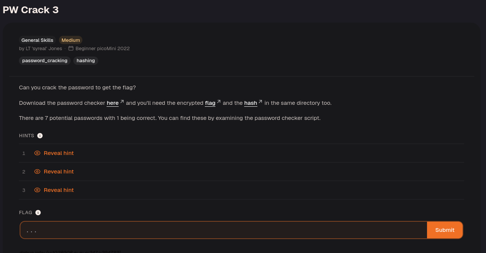
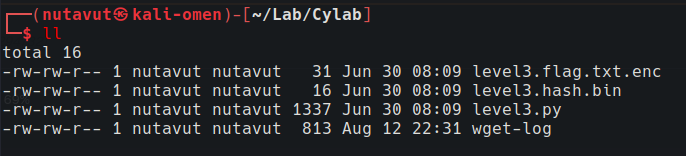
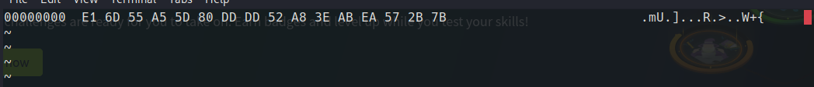
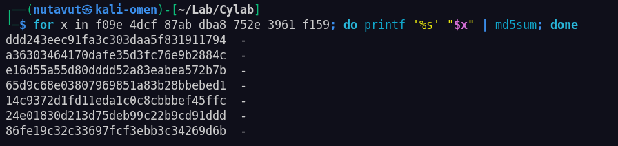
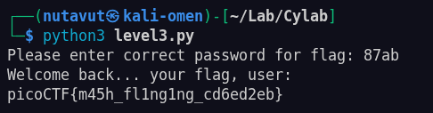

Download all the files.



`chmod +x level3.py`

```python
import hashlib

  

### THIS FUNCTION WILL NOT HELP YOU FIND THE FLAG --LT ########################

def str_xor(secret, key):

#extend key to secret length

new_key = key

i = 0

while len(new_key) < len(secret):

new_key = new_key + key[i]

i = (i + 1) % len(key)

return "".join([chr(ord(secret_c) ^ ord(new_key_c)) for (secret_c,new_key_c) in zip(secret,new_key)])

###############################################################################

  

flag_enc = open('level3.flag.txt.enc', 'rb').read()

correct_pw_hash = open('level3.hash.bin', 'rb').read()

  
  

def hash_pw(pw_str):

pw_bytes = bytearray()

pw_bytes.extend(pw_str.encode())

m = hashlib.md5()

m.update(pw_bytes)

return m.digest()

  
  

def level_3_pw_check():

user_pw = input("Please enter correct password for flag: ")

user_pw_hash = hash_pw(user_pw)

if( user_pw_hash == correct_pw_hash ):

print("Welcome back... your flag, user:")

decryption = str_xor(flag_enc.decode(), user_pw)

print(decryption)

return

print("That password is incorrect")

  
  
  

level_3_pw_check()

  
  

# The strings below are 7 possibilities for the correct password.

# (Only 1 is correct)

pos_pw_list = ["f09e", "4dcf", "87ab", "dba8", "752e", "3961", "f159"]
```


The code lists seven possible passwords. The `hash_pw` function hashes each password with MD5.

```python
if( user_pw_hash == correct_pw_hash ):

print("Welcome back... your flag, user:")

decryption = str_xor(flag_enc.decode(), user_pw)

print(decryption)

return

print("That password is incorrect")
```

These lines show that you can identify the correct password by comparing its hash with `correct_pw_hash`. Start by inspecting `level3.hash.bin`.

Use `bvi level3.hash.bin`.



`e16d55a55d80dddd52a83eabea572b7b`

Find the password whose MD5 hash matches this value.

Use this one-line Bash command:

`for x in f09e 4dcf 87ab dba8 752e 3961 f159; do printf '%s' "$x" | md5sum; done`



The MD5 hash of `87ab` was `e16d55a55d80dddd52a83eabea572b7b`, so `87ab` was the correct password.

Then run `level3.py`.



---

