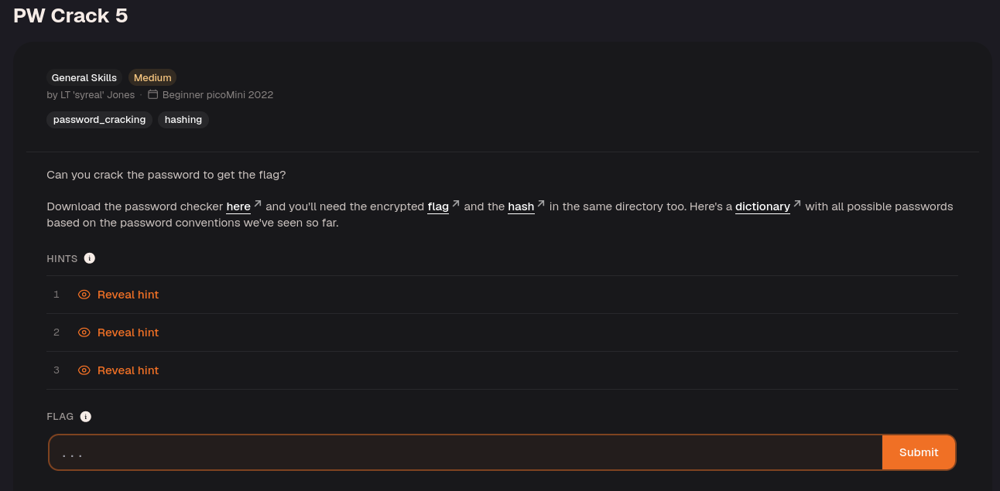
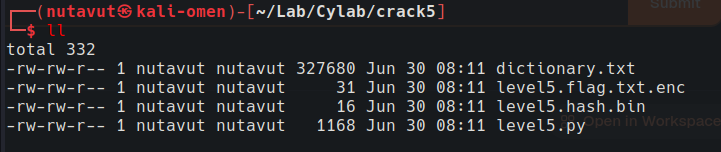
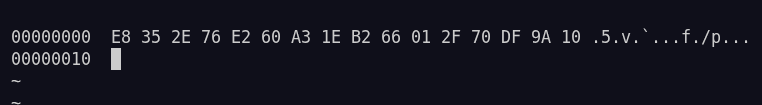
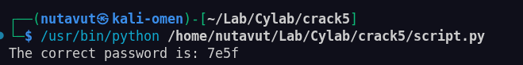
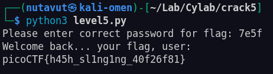

Download all the files.



`chmod +x level5.py`

```python
import hashlib

  

### THIS FUNCTION WILL NOT HELP YOU FIND THE FLAG --LT ########################

def str_xor(secret, key):

#extend key to secret length

new_key = key

i = 0

while len(new_key) < len(secret):

new_key = new_key + key[i]

i = (i + 1) % len(key)

return "".join([chr(ord(secret_c) ^ ord(new_key_c)) for (secret_c,new_key_c) in zip(secret,new_key)])

###############################################################################

  

flag_enc = open('level5.flag.txt.enc', 'rb').read()

correct_pw_hash = open('level5.hash.bin', 'rb').read()

  
  

def hash_pw(pw_str):

pw_bytes = bytearray()

pw_bytes.extend(pw_str.encode())

m = hashlib.md5()

m.update(pw_bytes)

return m.digest()

  
  

def level_5_pw_check():

user_pw = input("Please enter correct password for flag: ")

user_pw_hash = hash_pw(user_pw)

if( user_pw_hash == correct_pw_hash ):

print("Welcome back... your flag, user:")

decryption = str_xor(flag_enc.decode(), user_pw)

print(decryption)

return

print("That password is incorrect")

  
  
  

level_5_pw_check()
```


This level is similar to the previous one, but all candidate passwords are stored in `dictionary.txt`. Start with the same approach.



MD5 hash: `e8352e76e260a31eb266012f70df9a10`

Reuse the previous script with the following modifications.

```python
import hashlib

correct_pw = "e8352e76e260a31eb266012f70df9a10"

  

with open("dictionary.txt", "r") as f:

pos_pw_list = [line.strip() for line in f]

  
  

def check_correct_pw(pos_pw_list):

for item in pos_pw_list:

m = hashlib.md5()

m.update(item.encode())

if m.hexdigest() == correct_pw:

print("The correct password is: " + item)

  
  

check_correct_pw(pos_pw_list)
```



This identifies the correct password.



DONE!

---
