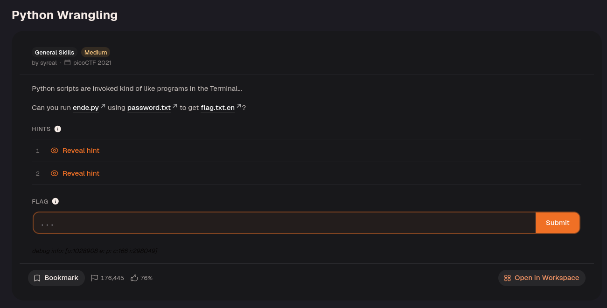
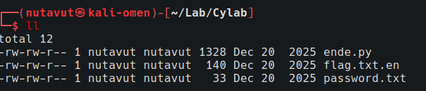
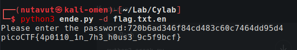

First, download all the files.



`chmod +x ende.py`

```python
import sys
import base64
from cryptography.fernet import Fernet


usage_msg = "Usage: "+ sys.argv[0] +" (-e/-d) [file]"
help_msg = usage_msg + "\n" +\
        "Examples:\n" +\
        "  To decrypt a file named 'pole.txt', do: " +\
        "'$ python "+ sys.argv[0] +" -d pole.txt'\n"


if len(sys.argv) < 2 or len(sys.argv) > 4:
    print(usage_msg)
    sys.exit(1)


if sys.argv[1] == "-e":
    if len(sys.argv) < 4:
        sim_sala_bim = input("Please enter the password:")
    else:
        sim_sala_bim = sys.argv[3]

    ssb_b64 = base64.b64encode(sim_sala_bim.encode())
    c = Fernet(ssb_b64)

    with open(sys.argv[2], "rb") as f:
        data = f.read()
        data_c = c.encrypt(data)
        sys.stdout.write(data_c.decode())


elif sys.argv[1] == "-d":

```

The Python code shows that `-e` encrypts file contents and `-d` decrypts them.

First, retrieve the password with `cat password.txt`, then run:

```bash
python3 ende.py -d flag.txt.en
```

Enter the password from `password.txt`.



Done!

---
