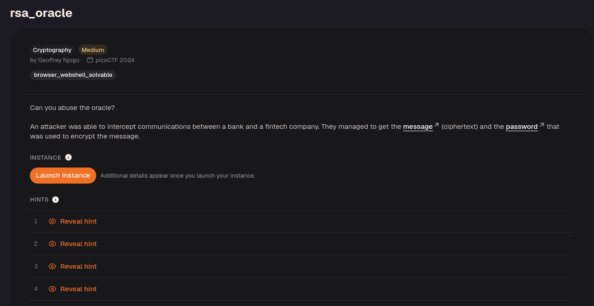
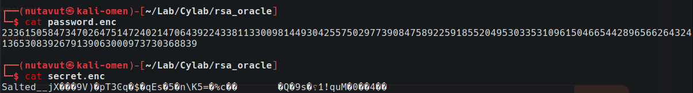
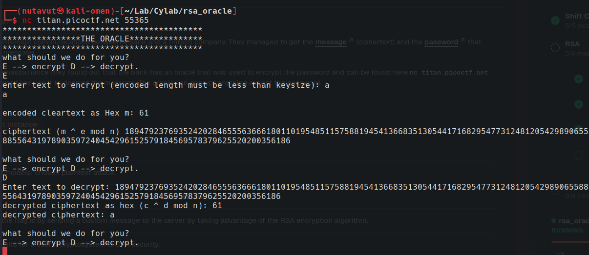
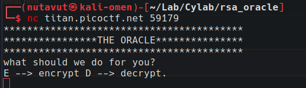
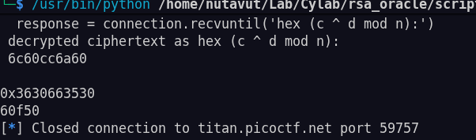
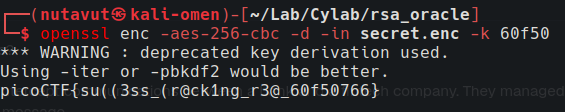

The files serve different purposes: `password.enc` contains an RSA-encrypted password, while `secret.enc` contains the encrypted message. The oracle offers encryption and decryption operations, as the sample round trip with `a` shows.

`nc titan.picoctf.net 59179`

The script output shows the recovered password as `60f50`. Use it with the OpenSSL AES-256-CBC decryption command shown below to read `secret.enc`. The recovery script itself is not included in this note, so the intermediate RSA manipulation is not documented here.

Got the flag!

---