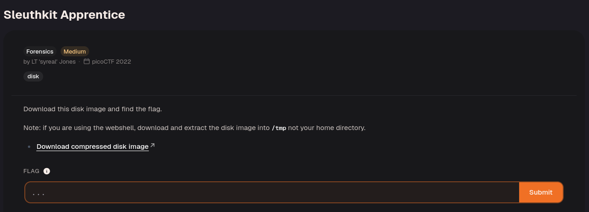
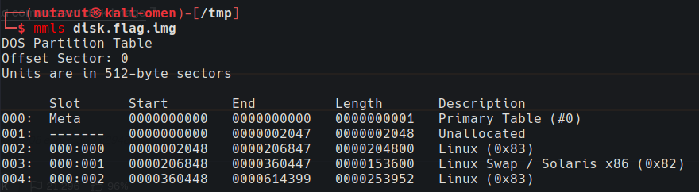
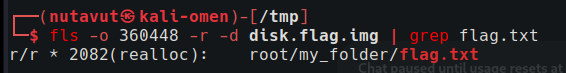
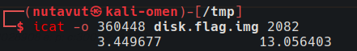
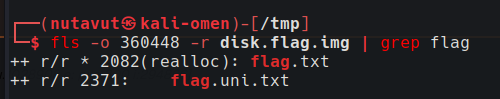
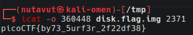

Download and extract the file.



Use `mmls` to inspect the partitions.

There are two partitions to investigate further, starting at offsets 2048 and 360448.

Use the following `fls` command to look for the flag in both partitions. The second partition contains `flag.txt`:

```bash
fls -o 360448 -r -d disk.flag.img 
```

This command recursively lists deleted files.



Trying `icat` on this entry returned no content.



The `realloc` marker suggests that the file's metadata entry has been reallocated. Continue searching for other flag files.



Search for the pattern `flag`. The results include a promising file named `flag.uni.txt`.



Use `icat` to extract this file's contents to get the flag!

---
