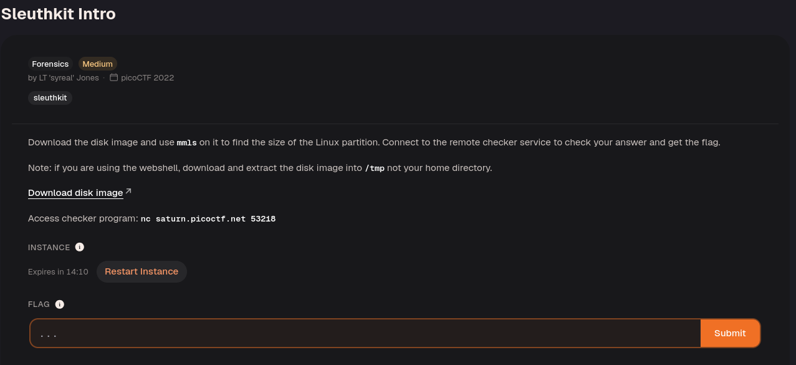
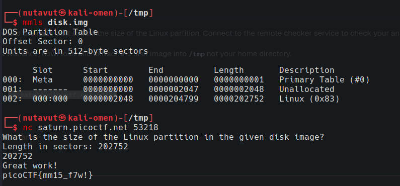

Run `mmls disk.img` to inspect the partition table. The Linux partition has a **Length** of `202752` sectors in the screenshot; submit that value to the checker. Use the Length column rather than the Start or End column, since the question asks for the partition size in sectors. See the [mmls manual](https://www.sleuthkit.org/sleuthkit/man/mmls.html)

---