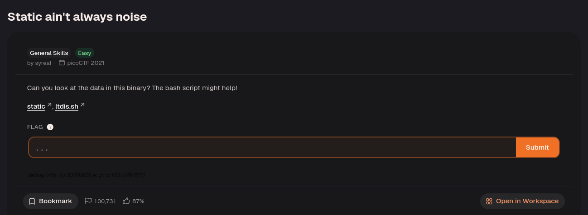
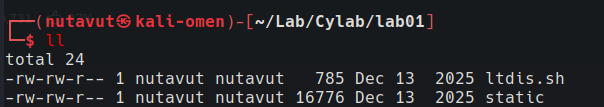
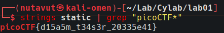
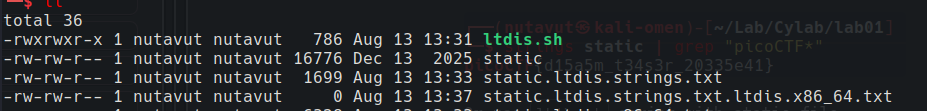
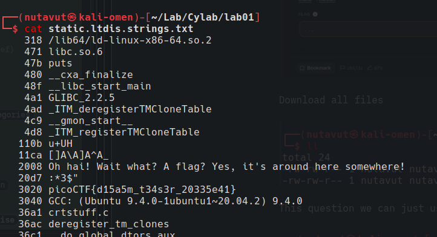

Download all the files.

Find the flag with `strings static | grep "picoCTF"`.

`strings` extracts printable text from the executable, while `grep` selects lines containing the flag prefix. This examines data stored in the binary without running it.

Alternatively, use the `ltdis.sh` script with the `static` file.

This produced the following output:

The output reveals the flag!

---

