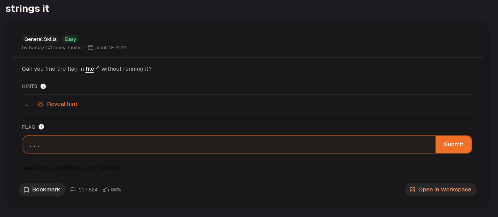
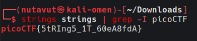

Try the `strings` command.

`strings` extracts printable character sequences from a binary file. Pipe the result to `grep -i picoCTF` to find the flag prefix; `-i` makes the search case-insensitive.

---
