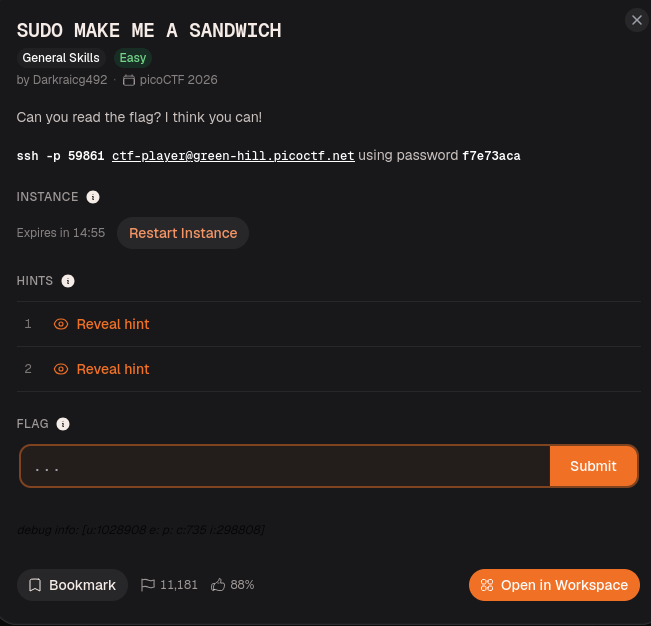
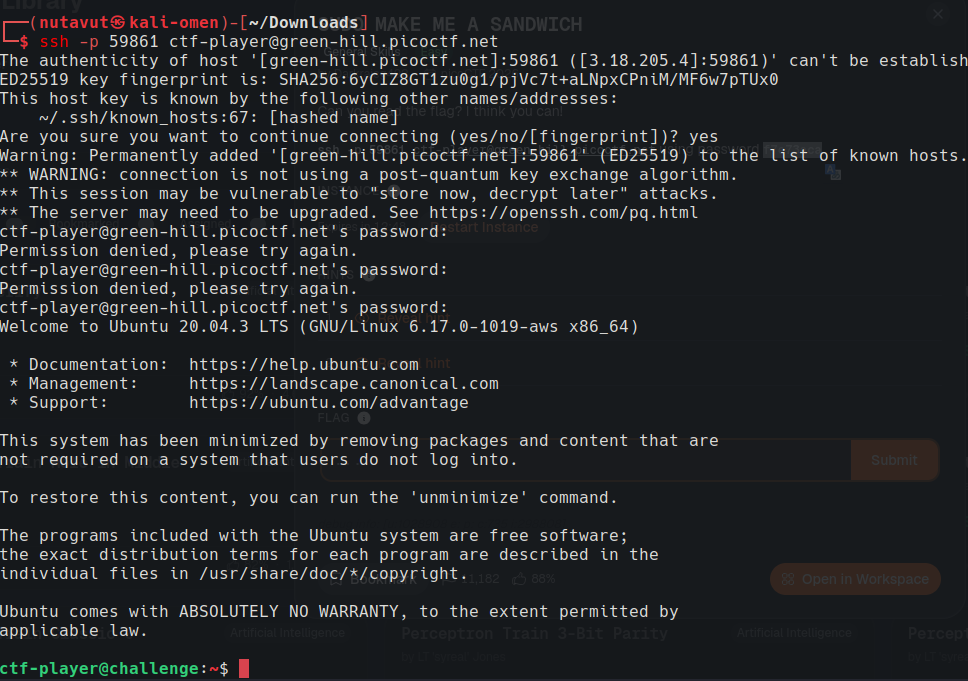
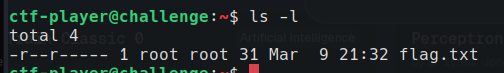
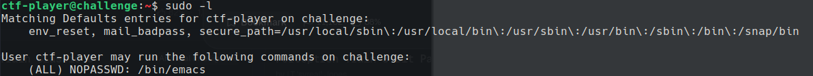
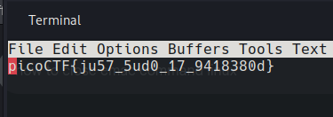

Connect with `ssh -p 59861 ctf-player@green-hill.picoctf.net` and use the password `f7e73aca`.

Only root can read `flag.txt`. Use `sudo -l` to check which commands your user can run with elevated privileges.

The sudo rules allow you to run the text editor `emacs` without a password (`NOPASSWD`). Run `sudo emacs flag.txt` to read the flag!

---
